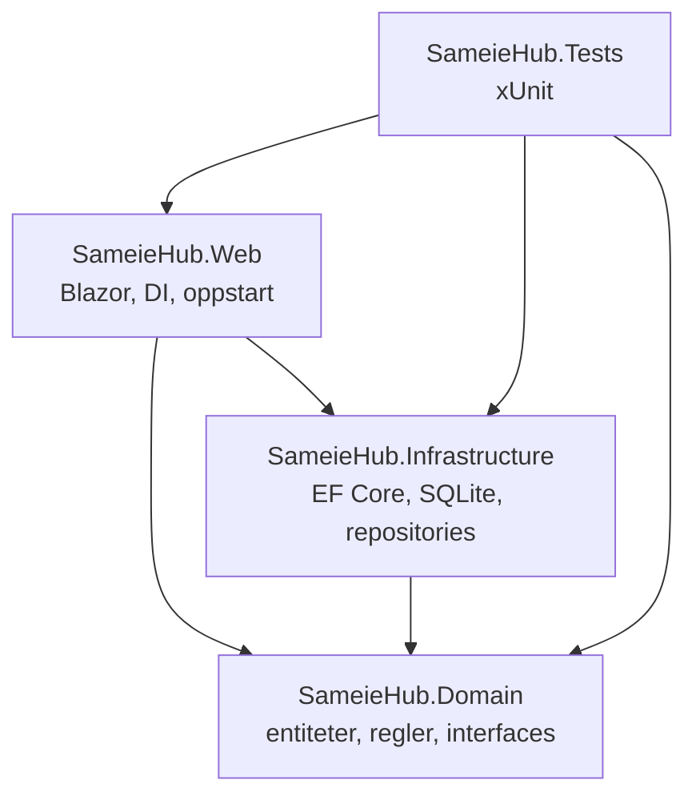
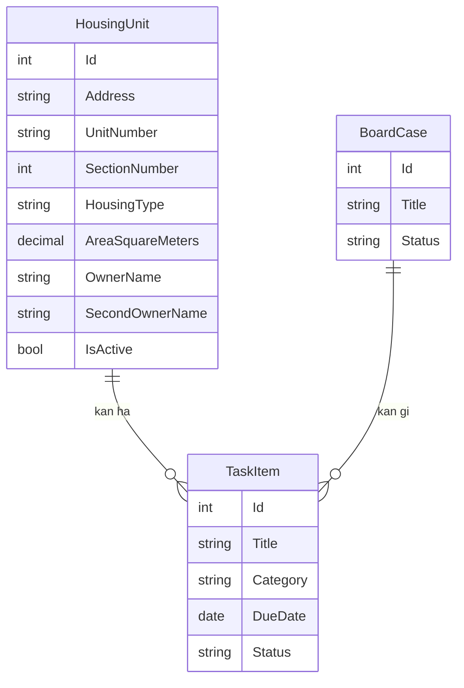

# Arkitektur

## Prosjekter og avhengigheter

| Prosjekt | Ansvar | Refererer |
|---|---|---|
| Domain | Entiteter, enums, repository-interfaces, forretningsregler. Ingen EF/SQLite/Blazor. | – |
| Infrastructure | `DbContext`, repository-implementasjoner, konfigurasjon, migreringer. | Domain |
| Web | Blazor-komponenter, navigasjon, DI og oppstart. | Domain, Infrastructure |
| Tests | Enhetstester (fake repositories), integrasjonstester mot SQLite. | alle |

Hvorfor Web refererer Infrastructure: composition root (`Program.cs`) registrerer konkrete implementasjoner i DI. Komponenter bør likevel bruke Domain-interfaces. Reglene «Domain avhenger ikke av noe» og «Infrastructure avhenger ikke av Web» sikres av `DependencyDirectionTests`.

## Beslutninger
| Beslutning | Alternativ | Begrunnelse |
|---|---|---|
| Blazor Interactive Server | WebAssembly, MAUI/WPF | Én lokal prosess, ingen API, enklest å pakke. |
| SQLite + EF Core | JSON-filer, SQL Server | Én fil å sikkerhetskopiere, ingen server, relasjoner og migreringer. |
| EF Core 10.0.x | EF Core 11 | Pakkene må matche `net10.0` (11 krever net11). |
| 4 prosjekter | Ett prosjekt / flere lag | Nok separasjon til å teste regler uten UI/DB, uten overarkitektur. |
| Repository kun ved konkret nytte | Repository for alt | `DbContext` er allerede en unit of work; interfaces lages når fakes gir testverdi. |

## Datamodell (foreløpig utkast – avklares per milepæl)

Relasjonene er hypoteser; endelige felter og regler besluttes i M1–M3 før koden skrives.

## Domenemodell: HousingUnit (M1A–M1E)

`HousingUnit` har `Id`, `Address`, `UnitNumber`, `SectionNumber`, `HousingType`, `AreaSquareMeters`, eier 1 (`OwnerName`, `OwnerPhoneNumber`, `OwnerEmail`), eier 2 (`SecondOwnerName`, `SecondOwnerPhoneNumber`, `SecondOwnerEmail`), `Notes` og `IsActive`. Alle properties har `private set`.

- **Opprettelse:** `new HousingUnit(address)` (bare adresse) eller `new HousingUnit(details)`.
- **Endring:** `UpdateDetails(HousingUnitDetails)` erstatter alle opplysningene. Alt valideres og normaliseres først, og først deretter tilordnes verdiene, så ugyldig input etterlater aldri objektet halvt oppdatert. `ChangeAddress()` finnes fortsatt.
- **Normalisering:** tekst trimmes; tomme valgfrie tekster blir `null`.
- **Feil:** `ArgumentException` (eller `ArgumentOutOfRangeException`) der `ParamName` er navnet på feltet. Meldingene inneholder aldri selve verdien (personvern).
- **Status:** `Deactivate()` og `Activate()` er idempotente. Inaktive enheter kan fortsatt redigeres. Data beholdes.
- **`Id`:** satt av databasen (se «Lagring» og `AssignId`).
- Reglenes grenser er offentlige konstanter (`HousingUnit.MaxAddressLength` osv.) slik at UI kan bruke de samme tallene.
- **Søk/filter:** `HousingUnitFilter.Apply(units, text, statusFilter)` er ren domenelogikk uten database. Teksten søkes (uten hensyn til store/små bokstaver) i adresse, bolignummer, seksjonsnummer og begge eiernavn. Søk gjøres i minnet fordi antallet boenheter er lite.

### Beslutninger (M1E)
| Beslutning | Alternativer | Begrunnelse |
|---|---|---|
| Seksjonsnummer er `int?` (1–9999) | tekst | Seksjonsnummer er et heltall; heltall gir enkel validering og sortering. Bolignummer med bokstaver (H0101) er eget tekstfelt. |
| `HousingType` er en enum lagret som tekst (`HasConversion<string>`) | enum som tall, fritekst | Lesbar database, tåler omrekkefølge av enum-verdier. Norske navn finnes bare i UI (`HousingTypeText`). |
| Areal er `decimal?` | `double` | Nøyaktig for m². SQLite lagrer det som TEXT; vi sorterer eller summerer ikke på det i databasen. |
| To flate sett med eierfelter | eget `Owner`-objekt/tabell (EF `OwnsOne`, relasjon) | Enklest for maks to eiere. Ingen eierskapsmodell. Feltene heter `Owner…` og `SecondOwner…` (ikke `PhoneNumber`/`Email`) for å gjøre de to settene symmetriske. |
| `HousingUnitDetails` (record) + `UpdateDetails` | stor konstruktør, mange `SetX`-metoder | Én endringsoperasjon med alt-eller-ingenting-validering uten konstruktør med 12 parametere. |
| Feil fra domenet vises ved riktig felt via `ParamName` | duplisere reglene i UI med DataAnnotations | Domenet er eneste kilde til reglene. UI har bare norske meldinger per felt (`HousingUnitFieldMessages`) og `[Required]` på adresse. |
| Ingen lengdegrenser i databasen | `HasMaxLength` | Som i M1C: SQLite håndhever ikke lengde, og grensene håndheves i domenet. |
| `IsActive` med migreringsstandard `true` | `false`/modellstandard | Eksisterende boenheter skal forbli aktive. Standarden er satt i migreringen, ikke i modellen (`HasDefaultValue(true)` ville gjort at EF overstyrte `false`). |

## Lagring med EF Core og SQLite (M1C)

- **`SameieHubDbContext`** (Infrastructure/Persistence) konfigurerer `HousingUnit` med Fluent API: `Id` er primærnøkkel (autoinkrement i SQLite), `Address` er påkrevd og `HousingType` lagres som tekst. Domain har ingen EF-attributter. EF fyller `private set`-properties og bruker konstruktøren `HousingUnit(string address)` ved lesing.
- **`EfHousingUnitRepository`** implementerer `IHousingUnitRepository`. Hver metode lager en kortlevd `DbContext` fra `IDbContextFactory`. Lesing bruker `AsNoTracking`. `UpdateAsync` bruker `Update()` fordi enheten kommer fra en annen kontekst.
- **Plassering:** `%LocalAppData%\SameieHub\sameiehub.db` (`DatabaseLocation`). Mappen opprettes ved oppstart. Plasseringen er fast, slik at backup og gjenoppretting (M5) vet hvor filen ligger. Filen ligger utenfor repoet, og `.gitignore` utelukker `*.db`.
- **Oppstart:** `Program.cs` kaller `MigrateSameieHubDatabaseAsync()`, som kjører `Database.MigrateAsync()`. Migreringene er eneste måte skjemaet opprettes på; `EnsureCreated()` brukes ikke.
- **Skjemaendring:** `dotnet ef migrations add <Navn> --project src/SameieHub.Infrastructure --output-dir Persistence/Migrations` (verktøyet er pinnet i `dotnet-tools.json`).

### Beslutning: DbContext og levetid
| Alternativ | Vurdering |
|---|---|
| `AddDbContext` (scoped) | I Blazor Server varer en scope hele brukerøkten (kretsen). Én langlevd kontekst gir utdaterte data og samtidighetsproblemer. Forkastet. |
| **`AddDbContextFactory` + kortlevd kontekst per repository-kall** | Valgt. Trygt og enkelt. Repository og `HousingUnitService` er scoped, men holder bare fabrikken. |

### Beslutning: Id og EF Core
EF Core tildeler `Id` ved `SaveChangesAsync` og setter den på objektet (verifisert i `EfHousingUnitRepositoryTests`). `EfHousingUnitRepository` kaller derfor ikke `AssignId()`; den brukes bare av fake-repoet. Svakheter: `AssignId` er offentlig, og EF og fake setter Id på ulike måter, men begge oppfyller kontrakten «Id er satt etter `AddAsync`», som begge er testet.

### Beslutning: lengder
Ingen maksimal lengde i databasen: SQLite håndhever ikke lengde, og grensene håndheves i `HousingUnit`.

## Brukergrensesnitt (M1D)

- Blazor-komponentene bruker `HousingUnitService` via `@inject`. De kjenner verken `DbContext` eller repository.
- Rendermodus: Interactive Server uten prerendering (`App.razor`). Alternativet, prerendering, ville kjørt `OnInitializedAsync` og dermed databasespørringen to ganger per sidevisning. For en lokal app uten søkemotorer gir prerendering ingen nytte.
- Feilhåndtering ved UI-grensen: `HousingUnitForm` og sidene fanger feil, logger dem (`ILogger`) og viser en norsk melding. `ArgumentException` (domeneregel) og `KeyNotFoundException` (enhet fjernet) får egne meldinger; andre feil logges med full detalj.
- Skjemavalidering: bare adressen har `[Required]` i `HousingUnitFormModel`. Alle andre regler kommer fra domenet: skjemaet fanger `ArgumentException`, leser `ParamName` og viser en norsk melding (`HousingUnitFieldMessages`) ved riktig felt. Se M1E.
- Databasesti kan overstyres med konfigurasjonsnøkkelen `Database:Path` (miljøvariabel `Database__Path`). Brukes til isolert testing; standard er AppData.

### Migreringer
- `InitialCreate` (M1C): tabellen `HousingUnits` med `Id` og `Address`.
- `AddHousingUnitDetails` (M1E): legger til de nye kolonnene (alle valgfrie, unntatt `IsActive` som er `NOT NULL` med standard `true`). Eksisterende rader beholdes, og får `IsActive = true`. Migreringen er testet fra `InitialCreate`-skjemaet med rader satt inn før oppgraderingen (`HousingUnitMigrationTests`). Eksisterende migreringer endres aldri.
