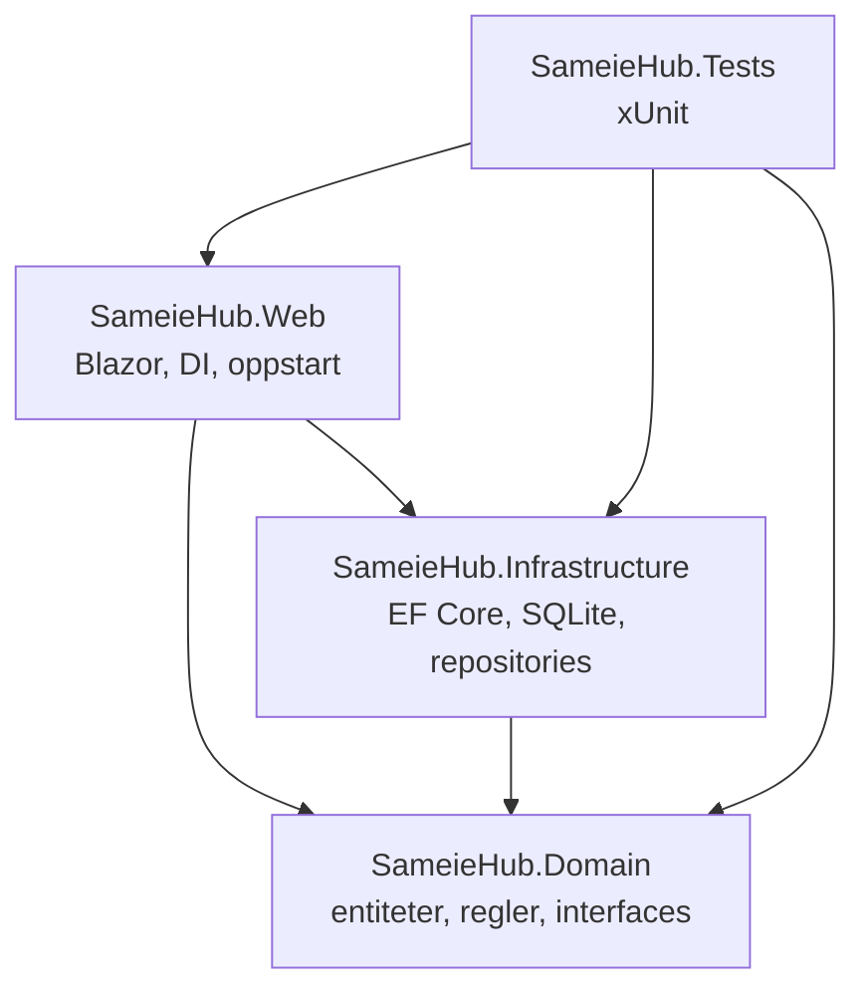
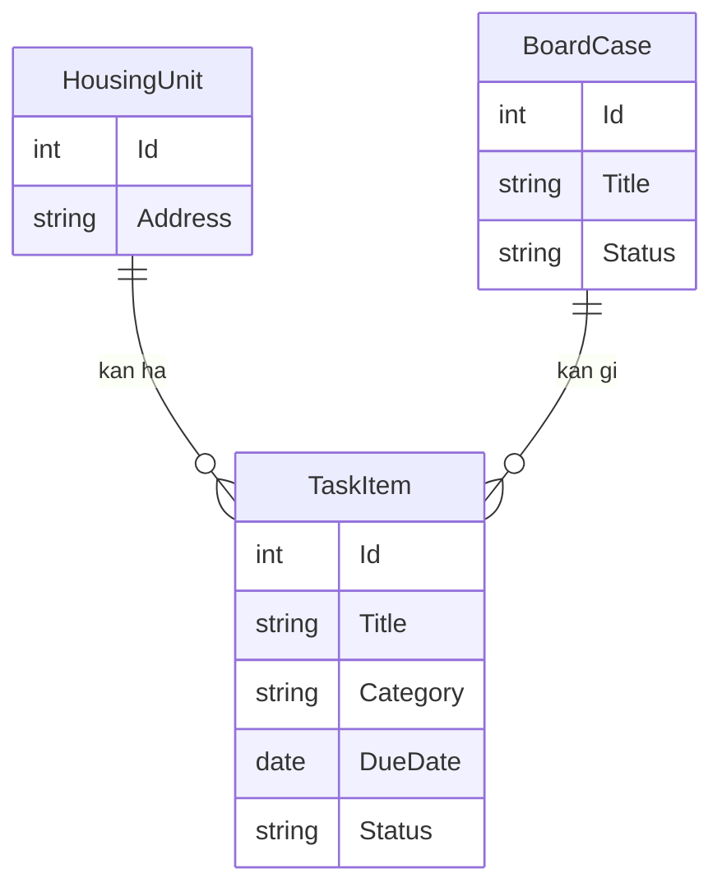

# Arkitektur

## Prosjekter og avhengigheter

| Prosjekt | Ansvar | Refererer |
|---|---|---|
| Domain | Entiteter, enums, repository-interfaces, forretningsregler. Ingen EF/SQLite/Blazor. | – |
| Infrastructure | `DbContext`, repository-implementasjoner, konfigurasjon, migreringer. | Domain |
| Web | Blazor-komponenter, navigasjon, DI og oppstart. | Domain, Infrastructure |
| Tests | Enhetstester (fake repositories), integrasjonstester mot SQLite. | alle |

Hvorfor Web refererer Infrastructure: composition root (`Program.cs`) registrerer konkrete implementasjoner i DI. Komponenter bør likevel bruke Domain-interfaces. Reglene «Domain avhenger ikke av noe» og «Infrastructure avhenger ikke av Web» sikres av `DependencyDirectionTests`.

## Beslutninger
| Beslutning | Alternativ | Begrunnelse |
|---|---|---|
| Blazor Interactive Server | WebAssembly, MAUI/WPF | Én lokal prosess, ingen API, enklest å pakke. |
| SQLite + EF Core | JSON-filer, SQL Server | Én fil å sikkerhetskopiere, ingen server, relasjoner og migreringer. |
| EF Core 10.0.x | EF Core 11 | Pakkene må matche `net10.0` (11 krever net11). |
| 4 prosjekter | Ett prosjekt / flere lag | Nok separasjon til å teste regler uten UI/DB, uten overarkitektur. |
| Repository kun ved konkret nytte | Repository for alt | `DbContext` er allerede en unit of work; interfaces lages når fakes gir testverdi. |

## Datamodell (foreløpig utkast – avklares per milepæl)

Relasjonene er hypoteser; endelige felter og regler besluttes i M1–M3 før koden skrives.

## Domenemodell: HousingUnit (M1A)

`HousingUnit` har foreløpig `Id` og `Address`. Flere felter kommer i senere deloppgaver.

- **Invarianter i klassen:** `Address` har `private set` og kan bare endres via konstruktøren eller `ChangeAddress()`. Begge bruker `NormalizeAddress`, slik at valideringen finnes på ett sted.
- **Regel:** adressen kan ikke være `null`, tom eller bare mellomrom. Gyldige adresser trimmes.
- **Feilhåndtering:** ugyldig adresse gir `ArgumentException` (`ArgumentNullException` for `null`). Ved feil beholdes den gamle adressen, fordi tilordningen skjer etter vellykket validering.
- **`Id`:** satt av databasen senere (0 til da); `private set` er nok for EF Core.
