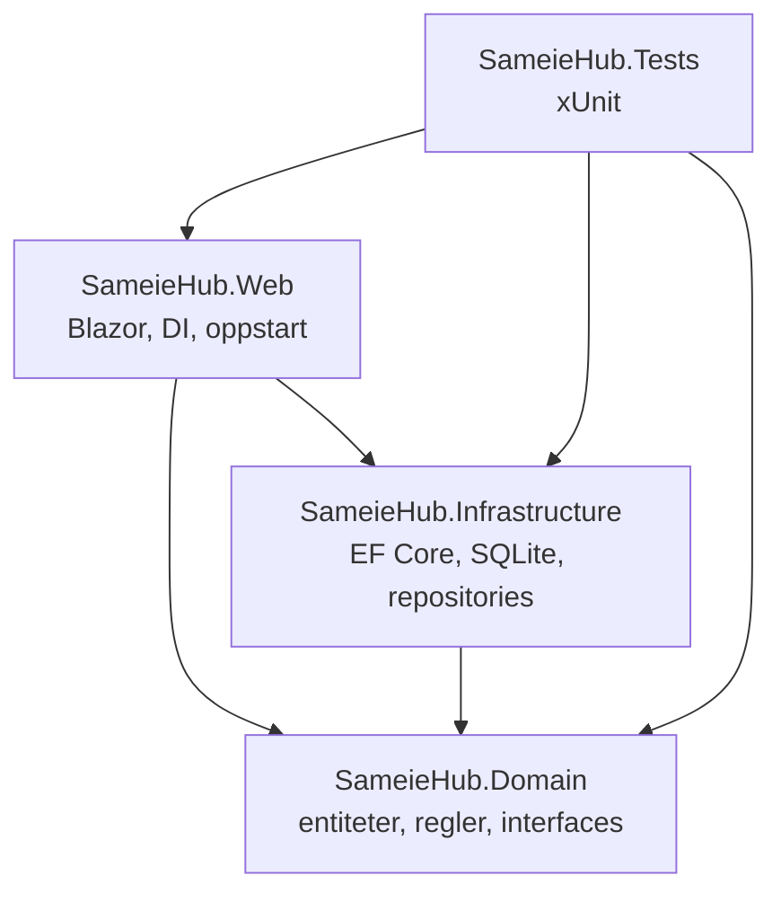
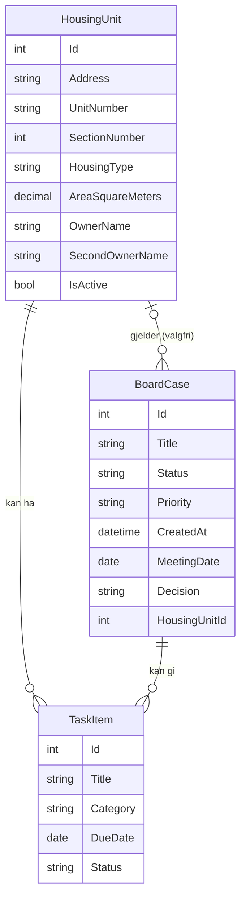
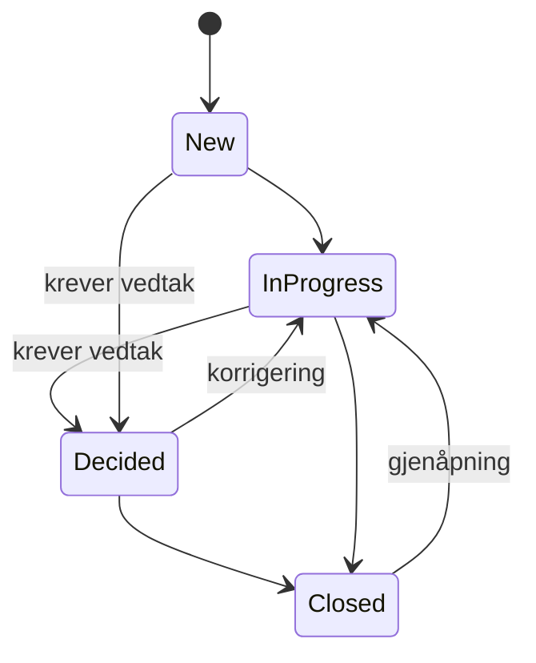
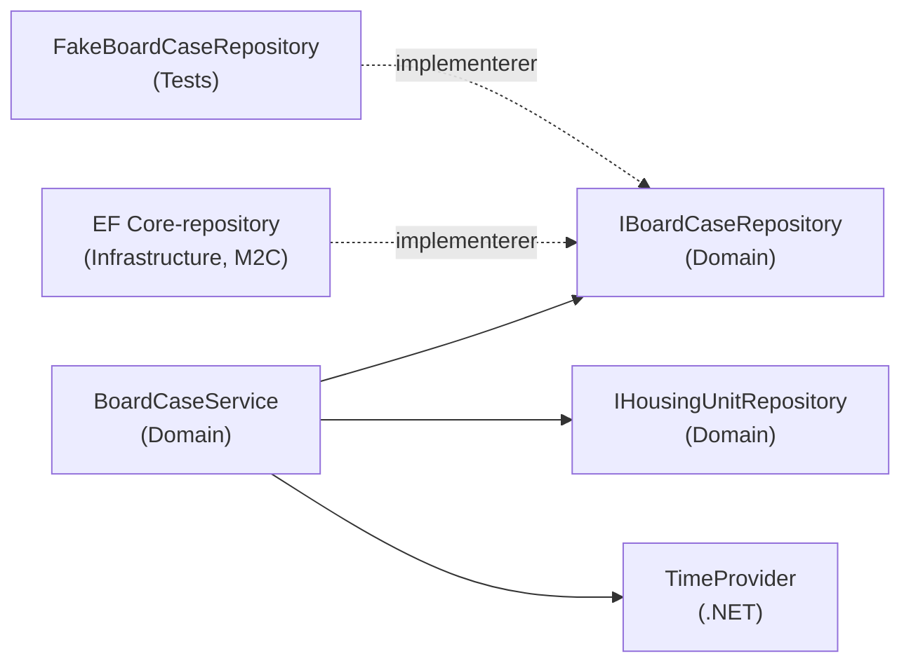

# Arkitektur

## Prosjekter og avhengigheter

| Prosjekt | Ansvar | Refererer |
|---|---|---|
| Domain | Entiteter, enums, repository-interfaces, forretningsregler. Ingen EF/SQLite/Blazor. | – |
| Infrastructure | `DbContext`, repository-implementasjoner, konfigurasjon, migreringer. | Domain |
| Web | Blazor-komponenter, navigasjon, DI og oppstart. | Domain, Infrastructure |
| Tests | Enhetstester (fake repositories), integrasjonstester mot SQLite. | alle |

Hvorfor Web refererer Infrastructure: composition root (`Program.cs`) registrerer konkrete implementasjoner i DI. Komponenter bør likevel bruke Domain-interfaces. Reglene «Domain avhenger ikke av noe» og «Infrastructure avhenger ikke av Web» sikres av `DependencyDirectionTests`.

## Beslutninger
| Beslutning | Alternativ | Begrunnelse |
|---|---|---|
| Blazor Interactive Server | WebAssembly, MAUI/WPF | Én lokal prosess, ingen API, enklest å pakke. |
| SQLite + EF Core | JSON-filer, SQL Server | Én fil å sikkerhetskopiere, ingen server, relasjoner og migreringer. |
| EF Core 10.0.x | EF Core 11 | Pakkene må matche `net10.0` (11 krever net11). |
| 4 prosjekter | Ett prosjekt / flere lag | Nok separasjon til å teste regler uten UI/DB, uten overarkitektur. |
| Repository kun ved konkret nytte | Repository for alt | `DbContext` er allerede en unit of work; interfaces lages når fakes gir testverdi. |

## Datamodell (foreløpig utkast – avklares per milepæl)

Relasjonene er hypoteser; endelige felter og regler besluttes i M1–M3 før koden skrives.

## Domenemodell: HousingUnit (M1A–M1E)

`HousingUnit` har `Id`, `Address`, `UnitNumber`, `SectionNumber`, `HousingType`, `AreaSquareMeters`, eier 1 (`OwnerName`, `OwnerPhoneNumber`, `OwnerEmail`), eier 2 (`SecondOwnerName`, `SecondOwnerPhoneNumber`, `SecondOwnerEmail`), `Notes` og `IsActive`. Alle properties har `private set`.

- **Opprettelse:** `new HousingUnit(address)` (bare adresse) eller `new HousingUnit(details)`.
- **Endring:** `UpdateDetails(HousingUnitDetails)` erstatter alle opplysningene. Alt valideres og normaliseres først, og først deretter tilordnes verdiene, så ugyldig input etterlater aldri objektet halvt oppdatert. `ChangeAddress()` finnes fortsatt.
- **Normalisering:** tekst trimmes; tomme valgfrie tekster blir `null`.
- **Feil:** `ArgumentException` (eller `ArgumentOutOfRangeException`) der `ParamName` er navnet på feltet. Meldingene inneholder aldri selve verdien (personvern).
- **Status:** `Deactivate()` og `Activate()` er idempotente. Inaktive enheter kan fortsatt redigeres. Data beholdes.
- **`Id`:** satt av databasen (se «Lagring» og `AssignId`).
- Reglenes grenser er offentlige konstanter (`HousingUnit.MaxAddressLength` osv.) slik at UI kan bruke de samme tallene.
- **Søk/filter:** `HousingUnitFilter.Apply(units, text, statusFilter)` er ren domenelogikk uten database. Teksten søkes (uten hensyn til store/små bokstaver) i adresse, bolignummer, seksjonsnummer og begge eiernavn. Søk gjøres i minnet fordi antallet boenheter er lite.

### Beslutninger (M1E)
| Beslutning | Alternativer | Begrunnelse |
|---|---|---|
| Seksjonsnummer er `int?` (1–9999) | tekst | Seksjonsnummer er et heltall; heltall gir enkel validering og sortering. Bolignummer med bokstaver (H0101) er eget tekstfelt. |
| `HousingType` er en enum lagret som tekst (`HasConversion<string>`) | enum som tall, fritekst | Lesbar database, tåler omrekkefølge av enum-verdier. Norske navn finnes bare i UI (`HousingTypeText`). |
| Areal er `decimal?` | `double` | Nøyaktig for m². SQLite lagrer det som TEXT; vi sorterer eller summerer ikke på det i databasen. |
| To flate sett med eierfelter | eget `Owner`-objekt/tabell (EF `OwnsOne`, relasjon) | Enklest for maks to eiere. Ingen eierskapsmodell. Feltene heter `Owner…` og `SecondOwner…` (ikke `PhoneNumber`/`Email`) for å gjøre de to settene symmetriske. |
| `HousingUnitDetails` (record) + `UpdateDetails` | stor konstruktør, mange `SetX`-metoder | Én endringsoperasjon med alt-eller-ingenting-validering uten konstruktør med 12 parametere. |
| Feil fra domenet vises ved riktig felt via `ParamName` | duplisere reglene i UI med DataAnnotations | Domenet er eneste kilde til reglene. UI har bare norske meldinger per felt (`HousingUnitFieldMessages`) og `[Required]` på adresse. |
| Ingen lengdegrenser i databasen | `HasMaxLength` | Som i M1C: SQLite håndhever ikke lengde, og grensene håndheves i domenet. |
| `IsActive` med migreringsstandard `true` | `false`/modellstandard | Eksisterende boenheter skal forbli aktive. Standarden er satt i migreringen, ikke i modellen (`HasDefaultValue(true)` ville gjort at EF overstyrte `false`). |

## Domenemodell: BoardCase (M2A)

`BoardCase` er en styresak. Domeneklassen (M2A), repository-kontrakt og tjeneste (M2B) og lagring i SQLite (M2C) finnes; UI kommer i M2D.

| Felt | Type | Regel |
|---|---|---|
| `Id` | `int` | Satt av lagringen via `AssignId` (som `HousingUnit`) |
| `Title` | `string` | Obligatorisk, trimmes, maks 200 tegn |
| `Description` | `string?` | Valgfri, maks 4000 tegn |
| `Status` | `BoardCaseStatus` | `New` ved opprettelse |
| `Priority` | `BoardCasePriority` | `Normal` som standard |
| `CreatedAt` | `DateTime` | UTC, satt ved opprettelse, endres aldri |
| `UpdatedAt` | `DateTime` | UTC. Lik `CreatedAt` til saken endres. Settes bare ved en reell endring (M2B) |
| `MeetingDate` | `DateOnly?` | Valgfri kalenderdato mellom 2000-01-01 og 2100-12-31 |
| `Decision` | `string?` | Valgfri, maks 4000 tegn |
| `HousingUnitId` | `int?` | Valgfri; `null` betyr hele sameiet; ellers positiv Id |
| `Notes` | `string?` | Valgfri, maks 2000 tegn |

Alle felt har `private set`. Valgfri tekst trimmes, og tom tekst blir `null`. Feil gir `ArgumentException` der `ParamName` er feltnavnet (samme mønster som `HousingUnit`, slik at UI senere kan vise melding ved riktig felt).

**Metoder:** `new BoardCase(details, createdAt)`, `UpdateDetails(details, now)`, `ChangeStatus(status, now)`, `RegisterDecision(text, now)`, `ClearDecision(now)`, `ToDetails()` og `AssignId(id)`. Parameteren `now` er tidspunktet for endringen (må være UTC); den brukes bare til `UpdatedAt` (se M2B).
`UpdateDetails` tar en `BoardCaseDetails`-record (tittel, beskrivelse, prioritet, møtedato, boenhet og merknader) og er alt-eller-ingenting: alt valideres først. Den dekker dermed «endre tittel og beskrivelse», «endre prioritet», «endre møtedato» og «knytte til eller fjerne kobling til boenhet» (`HousingUnitId = null` fjerner koblingen). Status og vedtak har egne metoder fordi de har regler.

### Statusendringer

Diagrammet viser den vanlige veien. Reglene er bevisst enkle:
- Alle statuser kan endres til alle andre, slik at registreringsfeil kan rettes (inkludert å gjenåpne en avsluttet sak).
- **Eneste regel:** en sak kan bare settes til `Decided` når den har et vedtak.
- En sak kan være vedtatt uten å være avsluttet. `RegisterDecision` endrer ikke status; det gjør `ChangeStatus`.
- `ClearDecision` (for et vedtak registrert ved en feil) er ikke tillatt mens saken er `Decided`; endre status først. Da får en vedtatt sak aldri mangle vedtak.
- Statusendringer logges ikke foreløpig (se «Ikke implementert» under M2C).

### Beslutninger (M2A)
| Beslutning | Alternativer | Begrunnelse |
|---|---|---|
| Enum-verdier starter på 1 | starter på 0 | `default` (0) blir en ugyldig verdi som fanges, i stedet for å bli «Low»/«New» ved en feil. |
| `DateTime` i UTC for `CreatedAt`, `DateOnly` for møtedato | `DateTimeOffset`; `DateTime` for begge | Tidsstempler er UTC, kalenderdatoer har ikke klokkeslett og kan ikke få tidssoneproblemer. |
| Tidspunktet sendes inn i konstruktøren | `DateTime.UtcNow` inni klassen | Gjør klassen testbar. Tjenesten (M2B) leverer tiden via `TimeProvider`. |
| Én `UpdateDetails` + egne metoder for status og vedtak | én metode per felt | Én validering og ingen delvis oppdatering når skjemaet endrer flere felt. Færre metoder å vedlikeholde. |
| Kobling med `int? HousingUnitId` | navigasjonsegenskap `HousingUnit`; mange-til-mange | Enklest. BoardCase kjenner ikke HousingUnit-klassen. Eksistens kontrolleres i tjenesten (M2B). |

## Lagring med EF Core og SQLite (M1C)

- **`SameieHubDbContext`** (Infrastructure/Persistence) konfigurerer `HousingUnit` med Fluent API: `Id` er primærnøkkel (autoinkrement i SQLite), `Address` er påkrevd og `HousingType` lagres som tekst. Domain har ingen EF-attributter. EF fyller `private set`-properties og bruker konstruktøren `HousingUnit(string address)` ved lesing.
- **`EfHousingUnitRepository`** implementerer `IHousingUnitRepository`. Hver metode lager en kortlevd `DbContext` fra `IDbContextFactory`. Lesing bruker `AsNoTracking`. `UpdateAsync` bruker `Update()` fordi enheten kommer fra en annen kontekst.
- **Plassering:** `%LocalAppData%\SameieHub\sameiehub.db` (`DatabaseLocation`). Mappen opprettes ved oppstart. Plasseringen er fast, slik at backup og gjenoppretting (M5) vet hvor filen ligger. Filen ligger utenfor repoet, og `.gitignore` utelukker `*.db`.
- **Oppstart:** `Program.cs` kaller `MigrateSameieHubDatabaseAsync()`, som kjører `Database.MigrateAsync()`. Migreringene er eneste måte skjemaet opprettes på; `EnsureCreated()` brukes ikke.
- **Skjemaendring:** `dotnet ef migrations add <Navn> --project src/SameieHub.Infrastructure --output-dir Persistence/Migrations` (verktøyet er pinnet i `dotnet-tools.json`).

### Beslutning: DbContext og levetid
| Alternativ | Vurdering |
|---|---|
| `AddDbContext` (scoped) | I Blazor Server varer en scope hele brukerøkten (kretsen). Én langlevd kontekst gir utdaterte data og samtidighetsproblemer. Forkastet. |
| **`AddDbContextFactory` + kortlevd kontekst per repository-kall** | Valgt. Trygt og enkelt. Repository og `HousingUnitService` er scoped, men holder bare fabrikken. |

### Beslutning: Id og EF Core
EF Core tildeler `Id` ved `SaveChangesAsync` og setter den på objektet (verifisert i `EfHousingUnitRepositoryTests`). `EfHousingUnitRepository` kaller derfor ikke `AssignId()`; den brukes bare av fake-repoet. Svakheter: `AssignId` er offentlig, og EF og fake setter Id på ulike måter, men begge oppfyller kontrakten «Id er satt etter `AddAsync`», som begge er testet.

### Beslutning: lengder
Ingen maksimal lengde i databasen: SQLite håndhever ikke lengde, og grensene håndheves i `HousingUnit`.

## Brukergrensesnitt (M1D)

- Blazor-komponentene bruker `HousingUnitService` via `@inject`. De kjenner verken `DbContext` eller repository.
- Rendermodus: Interactive Server uten prerendering (`App.razor`). Alternativet, prerendering, ville kjørt `OnInitializedAsync` og dermed databasespørringen to ganger per sidevisning. For en lokal app uten søkemotorer gir prerendering ingen nytte.
- Feilhåndtering ved UI-grensen: `HousingUnitForm` og sidene fanger feil, logger dem (`ILogger`) og viser en norsk melding. `ArgumentException` (domeneregel) og `KeyNotFoundException` (enhet fjernet) får egne meldinger; andre feil logges med full detalj.
- Skjemavalidering: bare adressen har `[Required]` i `HousingUnitFormModel`. Alle andre regler kommer fra domenet: skjemaet fanger `ArgumentException`, leser `ParamName` og viser en norsk melding (`HousingUnitFieldMessages`) ved riktig felt. Se M1E.
- Databasesti kan overstyres med konfigurasjonsnøkkelen `Database:Path` (miljøvariabel `Database__Path`). Brukes til isolert testing; standard er AppData.

### Migreringer
- `InitialCreate` (M1C): tabellen `HousingUnits` med `Id` og `Address`.
- `AddHousingUnitDetails` (M1E): legger til de nye kolonnene (alle valgfrie, unntatt `IsActive` som er `NOT NULL` med standard `true`). Eksisterende rader beholdes, og får `IsActive = true`. Migreringen er testet fra `InitialCreate`-skjemaet med rader satt inn før oppgraderingen (`HousingUnitMigrationTests`). Eksisterende migreringer endres aldri.

## Permanent sletting av boenheter (M1F)

- **Kontrakt:** `IHousingUnitRepository.DeleteAsync(int id)` returnerer `true` hvis en boenhet ble slettet og `false` hvis Id-en ikke finnes. `HousingUnitService.DeleteAsync(id)` kaster `KeyNotFoundException` for ukjent Id (som de andre tjenestemetodene) og `HousingUnitInUseException` (Domain) hvis andre poster refererer til boenheten. Deaktivering og reaktivering er uendret.
- **Hva som slettes:** raden i `HousingUnits`. Eier- og kontaktopplysningene er kolonner i samme rad og forsvinner dermed med den (testet).
- **Referanseintegritet:** tilkoblingen bruker `Foreign Keys=True`, slik at SQLite alltid håndhever fremmednøkler. Fremmednøkler konfigureres med `OnDelete(DeleteBehavior.Restrict)`: **aldri cascade**. Sletting av en refert boenhet gir SQLite-feil 19, og `EfHousingUnitRepository` oversetter den til `HousingUnitInUseException`. Hvordan feilen kjennes igjen er beskrevet under «Fremmednøkkelfeil» i M2C-avsnittet. `try/catch` er her berettiget fordi feilen kan håndteres (UI viser en forståelig melding).
- **Id-er gjenbrukes ikke:** `Id` er `INTEGER PRIMARY KEY AUTOINCREMENT`, så SQLite husker høyeste brukte Id selv om den siste raden slettes (testet). Koden setter aldri Id-er manuelt.
- **Blokkering testet mot ekte relasjon (M2C):** `BoardCases.HousingUnitId` er en ekte fremmednøkkel, og `BoardCaseRelationTests` viser at sletting av en boenhet med styresaker blokkeres. De simulerte testene fra M1F er erstattet. Relasjonen fra `TaskItem` (M3) er ikke testet ennå, fordi `TaskItem` ikke finnes.
- **Personvern:** logger inneholder bare Id-en til boenheten, aldri adresse eller eierinformasjon.

| Beslutning | Alternativer | Begrunnelse |
|---|---|---|
| `DeleteAsync` returnerer `bool` | kaste unntak for ukjent Id i repository; ta imot entitet | Repository melder bare fakta; tjenesten bestemmer at ukjent Id er en feil. Ingen ekstra spørring først i tjenesten. |
| Blokkering via databasens fremmednøkkel | sjekke i tjenesten før sletting | Databasen er den eneste som garantert vet om alle referanser, også ved samtidige endringer. Ingen duplisert regel som må vedlikeholdes for hver ny tabell. |
| Ingen cascade delete | cascade | Styresaker og oppgaver er historikk og skal aldri forsvinne som bivirkning. |
| Aktive og inaktive kan slettes | bare inaktive | Feilregistrerte enheter er ofte aktive; bekreftelsen i UI beskytter mot uhell. |

## Styresaktjeneste og repository (M2B)

- **`IBoardCaseRepository`** er lite: `AddAsync`, `GetByIdAsync`, `GetAllAsync`, `UpdateAsync` og `DeleteAsync(id)` (returnerer `false` for ukjent Id). Ingen generisk repository.
- **`BoardCaseService`** (konstruktør: begge repositoryene og `TimeProvider`):
  `RegisterAsync`, `GetByIdAsync`, `GetAllAsync`, `UpdateDetailsAsync`, `ChangeHousingUnitAsync`, `ChangeStatusAsync`, `RegisterDecisionAsync`, `ClearDecisionAsync` og `DeleteAsync`. Domeneklassen eier reglene; tjenesten henter saken, kaller domenemetoden med tidspunktet og lagrer. Ukjent sak gir `KeyNotFoundException`.
- **DI (M2C):** `IBoardCaseRepository` registreres i `AddSameieHubInfrastructure`, og `BoardCaseService` og `TimeProvider.System` i `Program.cs`, som `HousingUnitService`.

### Kobling til boenhet
Domain kjenner bare `int? HousingUnitId`. Tjenesten kontrollerer referansen via `IHousingUnitRepository`:

| Situasjon | Resultat |
|---|---|
| `HousingUnitId = null` | OK. Saken gjelder hele sameiet. |
| Ny kobling (ved registrering, eller en annen enn dagens) til en **eksisterende og aktiv** boenhet | OK |
| Ny kobling til ukjent boenhet | `ArgumentException`, `ParamName = "HousingUnitId"`, ingenting endres |
| Ny kobling til inaktiv boenhet | Samme feil |
| Uendret kobling til en boenhet som senere er deaktivert | **Beholdes**, ingen kontroll. Andre felt kan redigeres som vanlig. |
| Kobling fjernes (`null`) | Alltid tillatt |

Kontrollen skjer før domenemetoden endrer noe, og domenemetoden er alt-eller-ingenting, så ugyldig input gir aldri delvis oppdatering. Feilen skiller ikke «finnes ikke» fra «inaktiv» i parameternavnet; meldingen (engelsk) gjør det. UI viser én norsk melding ved feltet (M2D).

### Tidsstempler
- Tjenesten henter tiden fra `TimeProvider` (`GetUtcNow().UtcDateTime`, alltid UTC) og sender den til domenet. `DateTime.UtcNow` brukes ikke i koden; tester styrer klokken med `ManualTimeProvider`.
- `CreatedAt` settes ved opprettelse og endres aldri. `UpdatedAt` er lik `CreatedAt` til første endring.
- `UpdatedAt` settes **bare når noe faktisk endres**. Ingenting skjer ved: ugyldig input (kaster før noe tilordnes), uendrede verdier (sammenlignes etter normalisering, så «  Tittel » mot «Tittel» er uendret), samme status, samme vedtak, og `ClearDecision` uten vedtak.
- En `now` som ikke er UTC avvises (`ArgumentException`, `ParamName = "now"`).
- Det finnes ingen hendelseslogg (se «Ikke implementert» under M2C).

### Sletting (foreløpig)
- `DeleteAsync(id)` i tjenesten: `KeyNotFoundException` for ukjent Id, ellers sletter den og lar `BoardCaseInUseException` boble opp hvis repoet melder at andre poster refererer til saken.
- Kontrakten er implementert i `EfBoardCaseRepository` (M2C). Det er ingen cascade. I M3 skal fremmednøkkelen fra `TaskItem` til `BoardCase` konfigureres med `DeleteBehavior.Restrict`. `EfBoardCaseRepository.DeleteAsync` oversetter allerede fremmednøkkelbrudd til `BoardCaseInUseException`, men det er ikke testet mot en ekte referanse før `TaskItem` finnes (kun klassifiseringen er enhetstestet).
- Fake-repoet har `IsDeletionBlocked` for å teste at feilen når frem. `TaskItem` finnes ikke ennå, og er ikke laget for å teste dette.
- Sletting av en **boenhet** som styresaker refererer til blokkeres av fremmednøkkelen fra `BoardCase.HousingUnitId` (`Restrict`) og er testet i M2C.

### Beslutninger (M2B)
| Beslutning | Alternativer | Begrunnelse |
|---|---|---|
| `UpdatedAt` er ikke-null og lik `CreatedAt` ved opprettelse | `null` til første endring | Ingen nullhåndtering; kan sorteres på «sist endret» uten spesialtilfelle. |
| Domenemetodene tar `now` som parameter | tjenesten setter `UpdatedAt` etter at metoden har returnert `bool`; `TimeProvider` i entiteten | Domenet avgjør selv hva som er en reell endring, og kan ikke glemme å oppdatere tidsstempelet. Ingen tidskilde i entiteten. |
| `ChangeHousingUnitAsync` finnes ved siden av `UpdateDetailsAsync` | bare `UpdateDetailsAsync` | Enkelt kall for «knytt til/fjern boenhet», uten at kalleren må bygge hele `BoardCaseDetails`. Bruker `BoardCase.ToDetails()` og samme kontroll. |
| Ny kobling krever aktiv boenhet; eksisterende kobling beholdes | alltid tillate inaktive; alltid kreve aktive | Historikk skal ikke gå tapt når en boenhet deaktiveres, men nye saker skal ikke knyttes til boenheter som ikke lenger er i bruk. |
| Referansekontroll i tjenesten | fremmednøkkel alene | Gir en forståelig feil før lagring. Fremmednøkkelen er likevel siste sikring (testet i M2C). |
| `BoardCaseInUseException` finnes allerede | innføre den i M3 | Kontrakten er da ferdig, og UI (M2D) kan håndtere den. |

## Lagring av styresaker (M2C)

### Tabellen `BoardCases`
| Kolonne | SQLite-type | Mapping |
|---|---|---|
| `Id` | `INTEGER` | Primærnøkkel, `AUTOINCREMENT` (Id gjenbrukes ikke). Satt på objektet etter `SaveChangesAsync`. |
| `Title` | `TEXT NOT NULL` | |
| `Description`, `Decision`, `Notes` | `TEXT` | Valgfrie |
| `Status`, `Priority` | `TEXT NOT NULL` | Enum som tekst (`HasConversion<string>`), f.eks. `InProgress`, `High` |
| `CreatedAt`, `UpdatedAt` | `TEXT NOT NULL` | UTC, se under |
| `MeetingDate` | `TEXT` | `DateOnly?` lagres av EF som `yyyy-MM-dd` |
| `HousingUnitId` | `INTEGER` | Valgfri fremmednøkkel til `HousingUnits(Id)` |

Mappingen ligger i `SameieHubDbContext` (Fluent API). `BoardCase` har ingen EF-attributter, beholder `private set`, og har en privat parameterløs konstruktør som bare EF bruker. Det er ingen navigasjonsegenskaper: relasjonen er konfigurert med `HasOne<HousingUnit>().WithMany().HasForeignKey(...)`, så `BoardCase` kjenner fortsatt bare `int? HousingUnitId`.

### Fremmednøkkel til boenhet
- `FK_BoardCases_HousingUnits_HousingUnitId` med `ON DELETE RESTRICT` og en indeks på kolonnen. Ingen cascade og ingen automatisk nullstilling.
- `NULL` betyr at saken gjelder hele sameiet. Databasen krever ikke at en referert boenhet er aktiv; den regelen ligger i `BoardCaseService` (ny kobling).
- Ugyldig referanse (ukjent boenhet) avvises av databasen med `DbUpdateException` (SQLite 787) også hvis tjenesten omgås. Dette oversettes ikke til noen annen feil.
- En boenhet som har styresaker kan ikke slettes (`HousingUnitInUseException`). Den kan slettes når koblingen er fjernet eller styresaken slettet.

### Fremmednøkkelfeil
Feilen kjennes igjen på SQLites **utvidede feilkode**, ikke på meldingsteksten (`SqliteConstraintErrors.IsForeignKeyViolation`). Målt mot SQLite:

| Situasjon | Utvidet kode |
|---|---|
| Sette inn/oppdatere rad med referanse til manglende rad | 787 (`SQLITE_CONSTRAINT_FOREIGNKEY`) |
| Slette en rad som andre refererer til, med `ON DELETE RESTRICT` | **1811** (`SQLITE_CONSTRAINT_TRIGGER`) |
| Unique / primærnøkkel / not null | 2067 / 1555 / 1299 (ikke fremmednøkkel) |

Nøkkelpunkt: RESTRICT rapporteres som 1811, ikke 787. Forventningen om bare 787 var grunnen til at M1F først måtte bruke meldingsteksten. Sjekken godtar nå 787 og 1811 (med feilkode 19) og er felles for `EfHousingUnitRepository` og `EfBoardCaseRepository`. Databasen har ingen andre triggere, så 1811 betyr her alltid en begrenset fremmednøkkel. Andre databasefeil oversettes ikke til fremmednøkkelfeil (enhetstestet). Dermed erstatter den M1F-sjekken som brukte meldingsteksten.

### UTC for tidsstempler
- Domenet garanterer UTC (`DateTimeKind.Utc`, kontrollert i konstruktøren og i endringsmetodene).
- SQLite lagrer `DateTime` som tekst uten tidssone (`2026-11-18 10:30:00`), og EF leser den tilbake som `Unspecified`. En enkel `ValueConverter` (`DateTime.SpecifyKind(value, Utc)` ved lesing) gjør at verdiene alltid får `Kind = Utc`. Ingen tidssonekonvertering skjer, så klokkeslettet endres aldri.
- Presisjon: 7 desimaler (100 ns), og verdiene er identiske før og etter lagring (testet).
- `CreatedAt` beholdes ved endring, og `UpdatedAt` endres ikke ved lesing (testet).

### Repository
`EfBoardCaseRepository` følger `EfHousingUnitRepository`: en kortlevd `DbContext` per operasjon fra `IDbContextFactory`, `AsNoTracking` ved lesing, `Update()` for frakoblede entiteter, og `DeleteAsync` som returnerer `false` for ukjent Id.

### Migreringer
`AddBoardCases` oppretter bare tabellen og indeksen; eksisterende tabeller og rader røres ikke. Testet fra en tom database og fra en database på `AddHousingUnitDetails`-skjemaet (M1F) med boenheter og personopplysninger, som er uendrede etter migreringen (`BoardCaseMigrationTests`). Eksisterende migreringer er ikke endret, og `EnsureCreated()` brukes ikke.

### Ikke implementert
- **Endringshistorikk:** det finnes bare `CreatedAt` og `UpdatedAt`. Ingen logg over statusendringer, vedtak eller hvem som endret hva.
- Blazor-sider for styresaker (M2D).
- Fremmednøkkel fra `TaskItem` (M3).

## Brukergrensesnitt for styresaker (M2D)

- **Sider** (`Components/Pages/BoardCases/`): `BoardCaseList`, `BoardCaseDetail`, `BoardCaseCreate`, `BoardCaseEdit` og det delte `BoardCaseForm`. Alle bruker `BoardCaseService` og (for boenhetsvalg og visning) `HousingUnitService`; ingen bruker `DbContext` eller repository direkte.
- **Filter og sortering ligger i Domain** (`BoardCaseFilter`, `BoardCaseFilterCriteria`, `BoardCaseSorting`, `BoardCaseSortOrder`), som `HousingUnitFilter`. Alle saker leses og filtreres i minnet, fordi antallet saker i et lite sameie er lite. Dette gir testbar logikk uten UI og uten spørrelag.
- **Saksnummer** er `Id`. Søk på tall matcher saksnummeret eksakt (så «2» ikke finner sak 12); ellers søkes tittel og beskrivelse.
- **Status og vedtak** håndheves av domenet; UI omgår aldri reglene. Hver handling på detaljsiden (`RunActionAsync`) fanger `ArgumentException` og `InvalidOperationException` (regelbrudd) og viser en norsk melding som er skrevet for akkurat den handlingen. `KeyNotFoundException` gir «finnes ikke lenger», og alle andre feil logges (kun unntaket, aldri vedtaksteksten) og gir en generell databasemelding. `InvalidOperationException` brukes av domenet for regelbrudd; ekte databasefeil er `SqliteException`/`DbUpdateException` og blir derfor ikke feiltolket som regelbrudd.
- **Boenhetsvalg i skjemaet:** siden bestemmer hvilke boenheter som tilbys (`BoardCaseCreate`: aktive; `BoardCaseEdit`: aktive pluss den koblede, selv om den er deaktivert). Skjemaet (`BoardCaseForm`) mottar bare listen. Tjenesten kontrollerer fortsatt at en ny kobling er aktiv.
- **Feil ved feltet:** `ParamName` fra domenet/tjenesten (`Title`, `Description`, `Priority`, `MeetingDate`, `HousingUnitId`, `Notes`) slås opp i `BoardCaseFieldMessages` for en norsk melding ved riktig felt, som for boenheter. Bare tittel har `[Required]` i skjemamodellen.
- **Norsk dato og tid:** `NorwegianDateFormat` viser UTC-tider i norsk tid (`Europe/Oslo`, reservevei `W. Europe Standard Time`) som `dd.MM.yyyy HH:mm`, og datoer som `dd.MM.yyyy`. Lagring er uendret (UTC).
- **Boenhetens detaljside** henter alle saker og viser de som har `HousingUnitId` lik boenhetens Id (nyeste først). Beskyttelsen mot sletting av boenheter med styresaker er uendret (fremmednøkkel, M2C).
- Ikke i M2D: endringshistorikk, oppgavekobling (M3).

### Gjenstår før M2 er komplett
1. **Beslutning:** er `CreatedAt`/`UpdatedAt` nok, eller skal statusendringer og vedtak logges (egen tabell og visning)? Foreslått: vent til behovet er tydelig.
2. **Oppgavekobling (M3):** fremmednøkkel fra `TaskItem` til `BoardCase` med `Restrict`, og tester av `BoardCaseInUseException` mot ekte referanse.
3. **Dashboard (M4):** antall åpne saker og kommende møter (data finnes allerede).
4. **Mulig forbedring:** en snarvei «Registrer styresak» på boenhetens side som forhåndsvelger boenheten.
5. **Gjennomgang av M2:** kodegjennomgang og eventuell opprydding før M3.
