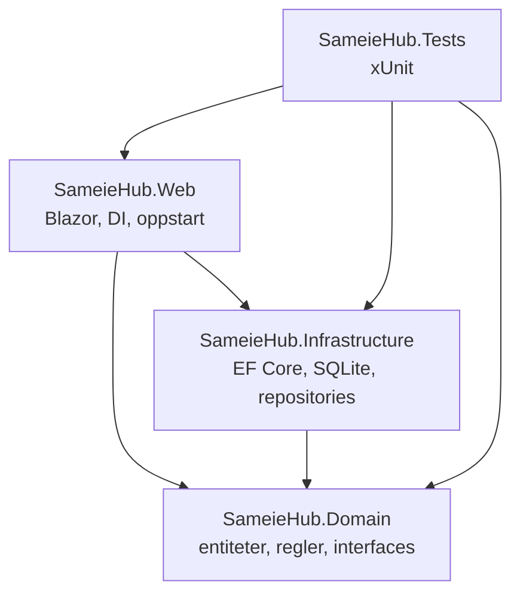
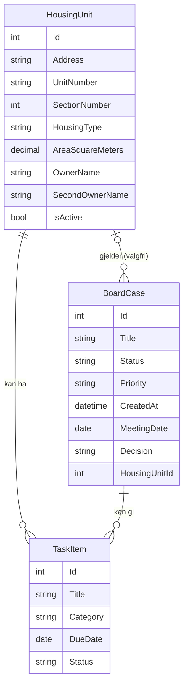
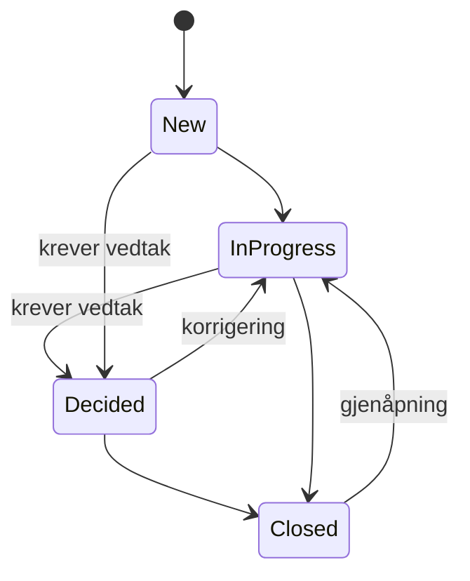

# Arkitektur

## Prosjekter og avhengigheter

| Prosjekt | Ansvar | Refererer |
|---|---|---|
| Domain | Entiteter, enums, repository-interfaces, forretningsregler. Ingen EF/SQLite/Blazor. | – |
| Infrastructure | `DbContext`, repository-implementasjoner, konfigurasjon, migreringer. | Domain |
| Web | Blazor-komponenter, navigasjon, DI og oppstart. | Domain, Infrastructure |
| Tests | Enhetstester (fake repositories), integrasjonstester mot SQLite. | alle |

Hvorfor Web refererer Infrastructure: composition root (`Program.cs`) registrerer konkrete implementasjoner i DI. Komponenter bør likevel bruke Domain-interfaces. Reglene «Domain avhenger ikke av noe» og «Infrastructure avhenger ikke av Web» sikres av `DependencyDirectionTests`.

## Beslutninger
| Beslutning | Alternativ | Begrunnelse |
|---|---|---|
| Blazor Interactive Server | WebAssembly, MAUI/WPF | Én lokal prosess, ingen API, enklest å pakke. |
| SQLite + EF Core | JSON-filer, SQL Server | Én fil å sikkerhetskopiere, ingen server, relasjoner og migreringer. |
| EF Core 10.0.x | EF Core 11 | Pakkene må matche `net10.0` (11 krever net11). |
| 4 prosjekter | Ett prosjekt / flere lag | Nok separasjon til å teste regler uten UI/DB, uten overarkitektur. |
| Repository kun ved konkret nytte | Repository for alt | `DbContext` er allerede en unit of work; interfaces lages når fakes gir testverdi. |

## Datamodell (foreløpig utkast – avklares per milepæl)

Relasjonene er hypoteser; endelige felter og regler besluttes i M1–M3 før koden skrives.

## Domenemodell: HousingUnit (M1A–M1E)

`HousingUnit` har `Id`, `Address`, `UnitNumber`, `SectionNumber`, `HousingType`, `AreaSquareMeters`, eier 1 (`OwnerName`, `OwnerPhoneNumber`, `OwnerEmail`), eier 2 (`SecondOwnerName`, `SecondOwnerPhoneNumber`, `SecondOwnerEmail`), `Notes` og `IsActive`. Alle properties har `private set`.

- **Opprettelse:** `new HousingUnit(address)` (bare adresse) eller `new HousingUnit(details)`.
- **Endring:** `UpdateDetails(HousingUnitDetails)` erstatter alle opplysningene. Alt valideres og normaliseres først, og først deretter tilordnes verdiene, så ugyldig input etterlater aldri objektet halvt oppdatert. `ChangeAddress()` finnes fortsatt.
- **Normalisering:** tekst trimmes; tomme valgfrie tekster blir `null`.
- **Feil:** `ArgumentException` (eller `ArgumentOutOfRangeException`) der `ParamName` er navnet på feltet. Meldingene inneholder aldri selve verdien (personvern).
- **Status:** `Deactivate()` og `Activate()` er idempotente. Inaktive enheter kan fortsatt redigeres. Data beholdes.
- **`Id`:** satt av databasen (se «Lagring» og `AssignId`).
- Reglenes grenser er offentlige konstanter (`HousingUnit.MaxAddressLength` osv.) slik at UI kan bruke de samme tallene.
- **Søk/filter:** `HousingUnitFilter.Apply(units, text, statusFilter)` er ren domenelogikk uten database. Teksten søkes (uten hensyn til store/små bokstaver) i adresse, bolignummer, seksjonsnummer og begge eiernavn. Søk gjøres i minnet fordi antallet boenheter er lite.

### Beslutninger (M1E)
| Beslutning | Alternativer | Begrunnelse |
|---|---|---|
| Seksjonsnummer er `int?` (1–9999) | tekst | Seksjonsnummer er et heltall; heltall gir enkel validering og sortering. Bolignummer med bokstaver (H0101) er eget tekstfelt. |
| `HousingType` er en enum lagret som tekst (`HasConversion<string>`) | enum som tall, fritekst | Lesbar database, tåler omrekkefølge av enum-verdier. Norske navn finnes bare i UI (`HousingTypeText`). |
| Areal er `decimal?` | `double` | Nøyaktig for m². SQLite lagrer det som TEXT; vi sorterer eller summerer ikke på det i databasen. |
| To flate sett med eierfelter | eget `Owner`-objekt/tabell (EF `OwnsOne`, relasjon) | Enklest for maks to eiere. Ingen eierskapsmodell. Feltene heter `Owner…` og `SecondOwner…` (ikke `PhoneNumber`/`Email`) for å gjøre de to settene symmetriske. |
| `HousingUnitDetails` (record) + `UpdateDetails` | stor konstruktør, mange `SetX`-metoder | Én endringsoperasjon med alt-eller-ingenting-validering uten konstruktør med 12 parametere. |
| Feil fra domenet vises ved riktig felt via `ParamName` | duplisere reglene i UI med DataAnnotations | Domenet er eneste kilde til reglene. UI har bare norske meldinger per felt (`HousingUnitFieldMessages`) og `[Required]` på adresse. |
| Ingen lengdegrenser i databasen | `HasMaxLength` | Som i M1C: SQLite håndhever ikke lengde, og grensene håndheves i domenet. |
| `IsActive` med migreringsstandard `true` | `false`/modellstandard | Eksisterende boenheter skal forbli aktive. Standarden er satt i migreringen, ikke i modellen (`HasDefaultValue(true)` ville gjort at EF overstyrte `false`). |

## Domenemodell: BoardCase (M2A)

`BoardCase` er en styresak. Foreløpig finnes bare domeneklassen og testene (ingen repository, database eller UI; det kommer i M2B–M2D).

| Felt | Type | Regel |
|---|---|---|
| `Id` | `int` | Satt av lagringen via `AssignId` (som `HousingUnit`) |
| `Title` | `string` | Obligatorisk, trimmes, maks 200 tegn |
| `Description` | `string?` | Valgfri, maks 4000 tegn |
| `Status` | `BoardCaseStatus` | `New` ved opprettelse |
| `Priority` | `BoardCasePriority` | `Normal` som standard |
| `CreatedAt` | `DateTime` | UTC, satt ved opprettelse, endres aldri |
| `MeetingDate` | `DateOnly?` | Valgfri kalenderdato mellom 2000-01-01 og 2100-12-31 |
| `Decision` | `string?` | Valgfri, maks 4000 tegn |
| `HousingUnitId` | `int?` | Valgfri; `null` betyr hele sameiet; ellers positiv Id |
| `Notes` | `string?` | Valgfri, maks 2000 tegn |

Alle felt har `private set`. Valgfri tekst trimmes, og tom tekst blir `null`. Feil gir `ArgumentException` der `ParamName` er feltnavnet (samme mønster som `HousingUnit`, slik at UI senere kan vise melding ved riktig felt).

**Metoder:** `new BoardCase(details, createdAt)`, `UpdateDetails(details)`, `ChangeStatus(status)`, `RegisterDecision(text)`, `ClearDecision()` og `AssignId(id)`.
`UpdateDetails` tar en `BoardCaseDetails`-record (tittel, beskrivelse, prioritet, møtedato, boenhet og merknader) og er alt-eller-ingenting: alt valideres først. Den dekker dermed «endre tittel og beskrivelse», «endre prioritet», «endre møtedato» og «knytte til eller fjerne kobling til boenhet» (`HousingUnitId = null` fjerner koblingen). Status og vedtak har egne metoder fordi de har regler.

### Statusendringer

Diagrammet viser den vanlige veien. Reglene er bevisst enkle:
- Alle statuser kan endres til alle andre, slik at registreringsfeil kan rettes (inkludert å gjenåpne en avsluttet sak).
- **Eneste regel:** en sak kan bare settes til `Decided` når den har et vedtak.
- En sak kan være vedtatt uten å være avsluttet. `RegisterDecision` endrer ikke status; det gjør `ChangeStatus`.
- `ClearDecision` (for et vedtak registrert ved en feil) er ikke tillatt mens saken er `Decided`; endre status først. Da får en vedtatt sak aldri mangle vedtak.
- Statusendringer logges ikke foreløpig (se «Avklaringer før M2B»).

### Beslutninger (M2A)
| Beslutning | Alternativer | Begrunnelse |
|---|---|---|
| Enum-verdier starter på 1 | starter på 0 | `default` (0) blir en ugyldig verdi som fanges, i stedet for å bli «Low»/«New» ved en feil. |
| `DateTime` i UTC for `CreatedAt`, `DateOnly` for møtedato | `DateTimeOffset`; `DateTime` for begge | Tidsstempler er UTC, kalenderdatoer har ikke klokkeslett og kan ikke få tidssoneproblemer. |
| Tidspunktet sendes inn i konstruktøren | `DateTime.UtcNow` inni klassen | Gjør klassen testbar. Tjenesten (M2B) leverer tiden, helst via `TimeProvider`. |
| Én `UpdateDetails` + egne metoder for status og vedtak | én metode per felt | Én validering og ingen delvis oppdatering når skjemaet endrer flere felt. Færre metoder å vedlikeholde. |
| Kobling med `int? HousingUnitId` | navigasjonsegenskap `HousingUnit`; mange-til-mange | Enklest. BoardCase kjenner ikke HousingUnit-klassen. Eksistens kontrolleres i tjenesten (M2B). |

## Lagring med EF Core og SQLite (M1C)

- **`SameieHubDbContext`** (Infrastructure/Persistence) konfigurerer `HousingUnit` med Fluent API: `Id` er primærnøkkel (autoinkrement i SQLite), `Address` er påkrevd og `HousingType` lagres som tekst. Domain har ingen EF-attributter. EF fyller `private set`-properties og bruker konstruktøren `HousingUnit(string address)` ved lesing.
- **`EfHousingUnitRepository`** implementerer `IHousingUnitRepository`. Hver metode lager en kortlevd `DbContext` fra `IDbContextFactory`. Lesing bruker `AsNoTracking`. `UpdateAsync` bruker `Update()` fordi enheten kommer fra en annen kontekst.
- **Plassering:** `%LocalAppData%\SameieHub\sameiehub.db` (`DatabaseLocation`). Mappen opprettes ved oppstart. Plasseringen er fast, slik at backup og gjenoppretting (M5) vet hvor filen ligger. Filen ligger utenfor repoet, og `.gitignore` utelukker `*.db`.
- **Oppstart:** `Program.cs` kaller `MigrateSameieHubDatabaseAsync()`, som kjører `Database.MigrateAsync()`. Migreringene er eneste måte skjemaet opprettes på; `EnsureCreated()` brukes ikke.
- **Skjemaendring:** `dotnet ef migrations add <Navn> --project src/SameieHub.Infrastructure --output-dir Persistence/Migrations` (verktøyet er pinnet i `dotnet-tools.json`).

### Beslutning: DbContext og levetid
| Alternativ | Vurdering |
|---|---|
| `AddDbContext` (scoped) | I Blazor Server varer en scope hele brukerøkten (kretsen). Én langlevd kontekst gir utdaterte data og samtidighetsproblemer. Forkastet. |
| **`AddDbContextFactory` + kortlevd kontekst per repository-kall** | Valgt. Trygt og enkelt. Repository og `HousingUnitService` er scoped, men holder bare fabrikken. |

### Beslutning: Id og EF Core
EF Core tildeler `Id` ved `SaveChangesAsync` og setter den på objektet (verifisert i `EfHousingUnitRepositoryTests`). `EfHousingUnitRepository` kaller derfor ikke `AssignId()`; den brukes bare av fake-repoet. Svakheter: `AssignId` er offentlig, og EF og fake setter Id på ulike måter, men begge oppfyller kontrakten «Id er satt etter `AddAsync`», som begge er testet.

### Beslutning: lengder
Ingen maksimal lengde i databasen: SQLite håndhever ikke lengde, og grensene håndheves i `HousingUnit`.

## Brukergrensesnitt (M1D)

- Blazor-komponentene bruker `HousingUnitService` via `@inject`. De kjenner verken `DbContext` eller repository.
- Rendermodus: Interactive Server uten prerendering (`App.razor`). Alternativet, prerendering, ville kjørt `OnInitializedAsync` og dermed databasespørringen to ganger per sidevisning. For en lokal app uten søkemotorer gir prerendering ingen nytte.
- Feilhåndtering ved UI-grensen: `HousingUnitForm` og sidene fanger feil, logger dem (`ILogger`) og viser en norsk melding. `ArgumentException` (domeneregel) og `KeyNotFoundException` (enhet fjernet) får egne meldinger; andre feil logges med full detalj.
- Skjemavalidering: bare adressen har `[Required]` i `HousingUnitFormModel`. Alle andre regler kommer fra domenet: skjemaet fanger `ArgumentException`, leser `ParamName` og viser en norsk melding (`HousingUnitFieldMessages`) ved riktig felt. Se M1E.
- Databasesti kan overstyres med konfigurasjonsnøkkelen `Database:Path` (miljøvariabel `Database__Path`). Brukes til isolert testing; standard er AppData.

### Migreringer
- `InitialCreate` (M1C): tabellen `HousingUnits` med `Id` og `Address`.
- `AddHousingUnitDetails` (M1E): legger til de nye kolonnene (alle valgfrie, unntatt `IsActive` som er `NOT NULL` med standard `true`). Eksisterende rader beholdes, og får `IsActive = true`. Migreringen er testet fra `InitialCreate`-skjemaet med rader satt inn før oppgraderingen (`HousingUnitMigrationTests`). Eksisterende migreringer endres aldri.

## Permanent sletting av boenheter (M1F)

- **Kontrakt:** `IHousingUnitRepository.DeleteAsync(int id)` returnerer `true` hvis en boenhet ble slettet og `false` hvis Id-en ikke finnes. `HousingUnitService.DeleteAsync(id)` kaster `KeyNotFoundException` for ukjent Id (som de andre tjenestemetodene) og `HousingUnitInUseException` (Domain) hvis andre poster refererer til boenheten. Deaktivering og reaktivering er uendret.
- **Hva som slettes:** raden i `HousingUnits`. Eier- og kontaktopplysningene er kolonner i samme rad og forsvinner dermed med den (testet).
- **Referanseintegritet:** tilkoblingen bruker `Foreign Keys=True`, slik at SQLite alltid håndhever fremmednøkler. Når `BoardCase` (M2C) og `TaskItem` (M3) lagres, skal fremmednøkkelen til `HousingUnits` konfigureres med `OnDelete(DeleteBehavior.Restrict)`: **aldri cascade**. Sletting av en refert boenhet gir da SQLite-feil 19 («FOREIGN KEY constraint failed»), og `EfHousingUnitRepository` oversetter den til `HousingUnitInUseException`. `try/catch` er her berettiget fordi feilen kan håndteres (UI viser en forståelig melding).
- **Id-er gjenbrukes ikke:** `Id` er `INTEGER PRIMARY KEY AUTOINCREMENT`, så SQLite husker høyeste brukte Id selv om den siste raden slettes (testet). Koden setter aldri Id-er manuelt.
- **Begrensning (viktig):** `BoardCase` og `TaskItem` lagres ennå ikke. Blokkeringen er derfor testet mot en tabell som kun opprettes i testen, med samme fremmednøkkel (`ON DELETE RESTRICT`) som de ekte tabellene skal ha. Det beviser at SQLite håndhever regelen og at oversettelsen til `HousingUnitInUseException` virker, men ikke at de ekte tabellene er konfigurert riktig. Disse testene skal erstattes av tester mot de ekte tabellene i M2C og M3.
- **Personvern:** logger inneholder bare Id-en til boenheten, aldri adresse eller eierinformasjon.

| Beslutning | Alternativer | Begrunnelse |
|---|---|---|
| `DeleteAsync` returnerer `bool` | kaste unntak for ukjent Id i repository; ta imot entitet | Repository melder bare fakta; tjenesten bestemmer at ukjent Id er en feil. Ingen ekstra spørring først i tjenesten. |
| Blokkering via databasens fremmednøkkel | sjekke i tjenesten før sletting | Databasen er den eneste som garantert vet om alle referanser, også ved samtidige endringer. Ingen duplisert regel som må vedlikeholdes for hver ny tabell. |
| Ingen cascade delete | cascade | Styresaker og oppgaver er historikk og skal aldri forsvinne som bivirkning. |
| Aktive og inaktive kan slettes | bare inaktive | Feilregistrerte enheter er ofte aktive; bekreftelsen i UI beskytter mot uhell. |

## Avklaringer før M2B
1. **Historikk:** nå finnes bare `CreatedAt`. Trengs `UpdatedAt` eller en logg over statusendringer og vedtak (og i så fall egen tabell)?
2. **Kontroll av boenhet:** `BoardCaseService` bør sjekke at `HousingUnitId` finnes via `IHousingUnitRepository`. Kan en sak knyttes til en inaktiv boenhet? (Forslag: ja, men UI tilbyr bare aktive i nedtrekkslisten.)
3. **Repository-kontrakt:** `AddAsync`, `GetByIdAsync`, `GetAllAsync`, `UpdateAsync` som for boenheter, pluss et filter på boenhet?
4. **Tid:** `TimeProvider` injiseres i tjenesten og leverer `CreatedAt` (fake i tester).
5. **Persistens (M2C):** `DateTime` leses fra SQLite som `Unspecified`, så EF trenger en verdikonvertering til UTC. Enum og `DateOnly` lagres som tekst. EF trenger også en privat parameterløs konstruktør i `BoardCase`.
