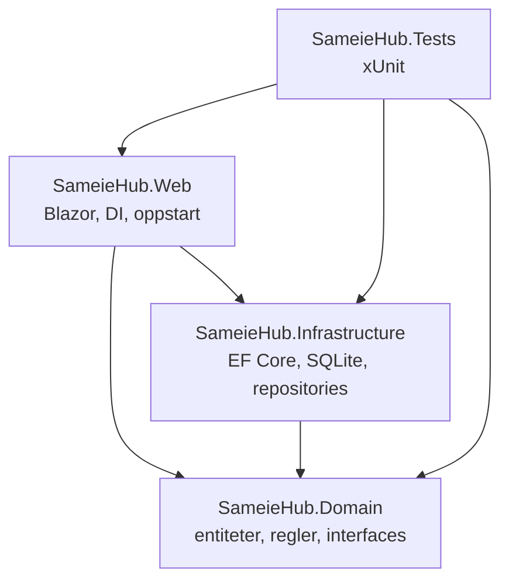
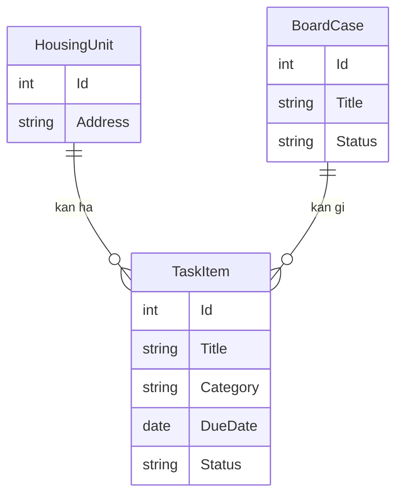
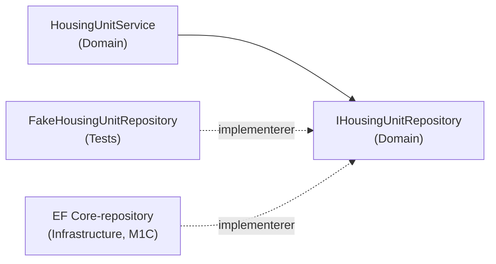

# Arkitektur

## Prosjekter og avhengigheter

| Prosjekt | Ansvar | Refererer |
|---|---|---|
| Domain | Entiteter, enums, repository-interfaces, forretningsregler. Ingen EF/SQLite/Blazor. | – |
| Infrastructure | `DbContext`, repository-implementasjoner, konfigurasjon, migreringer. | Domain |
| Web | Blazor-komponenter, navigasjon, DI og oppstart. | Domain, Infrastructure |
| Tests | Enhetstester (fake repositories), integrasjonstester mot SQLite. | alle |

Hvorfor Web refererer Infrastructure: composition root (`Program.cs`) registrerer konkrete implementasjoner i DI. Komponenter bør likevel bruke Domain-interfaces. Reglene «Domain avhenger ikke av noe» og «Infrastructure avhenger ikke av Web» sikres av `DependencyDirectionTests`.

## Beslutninger
| Beslutning | Alternativ | Begrunnelse |
|---|---|---|
| Blazor Interactive Server | WebAssembly, MAUI/WPF | Én lokal prosess, ingen API, enklest å pakke. |
| SQLite + EF Core | JSON-filer, SQL Server | Én fil å sikkerhetskopiere, ingen server, relasjoner og migreringer. |
| EF Core 10.0.x | EF Core 11 | Pakkene må matche `net10.0` (11 krever net11). |
| 4 prosjekter | Ett prosjekt / flere lag | Nok separasjon til å teste regler uten UI/DB, uten overarkitektur. |
| Repository kun ved konkret nytte | Repository for alt | `DbContext` er allerede en unit of work; interfaces lages når fakes gir testverdi. |

## Datamodell (foreløpig utkast – avklares per milepæl)

Relasjonene er hypoteser; endelige felter og regler besluttes i M1–M3 før koden skrives.

## Domenemodell: HousingUnit (M1A)

`HousingUnit` har foreløpig `Id` og `Address`. Flere felter kommer i senere deloppgaver.

- **Invarianter i klassen:** `Address` har `private set` og kan bare endres via konstruktøren eller `ChangeAddress()`. Begge bruker `NormalizeAddress`, slik at valideringen finnes på ett sted.
- **Regel:** adressen kan ikke være `null`, tom eller bare mellomrom. Gyldige adresser trimmes.
- **Feilhåndtering:** ugyldig adresse gir `ArgumentException` (`ArgumentNullException` for `null`). Ved feil beholdes den gamle adressen, fordi tilordningen skjer etter vellykket validering.
- **`Id`:** satt av databasen senere (0 til da); `private set` er nok for EF Core.

## Repository og tjeneste for boenheter (M1B)

- `HousingUnitService` håndterer brukstilfellene (registrere, hente, hente alle, endre adresse) og kjenner kun interfacet.
- `IHousingUnitRepository` ligger i Domain. Fake-repoet ligger i testprosjektet; EF Core-implementasjonen kommer i Infrastructure (M1C).
- Ukjent Id: `GetByIdAsync` returnerer `null`; `ChangeAddressAsync` kaster `KeyNotFoundException`.

### Beslutning: Id-tildeling
`HousingUnit.Id` skal være satt på objektet etter lagring, uansett om det lagres i fake-repo eller av EF Core/SQLite.

| Alternativ | Vurdering |
|---|---|
| Repository returnerer Id, objektet beholder `Id == 0` | Ingen domeneendring, men inkonsekvent: fake og EF Core oppfører seg ulikt, og objektet viser feil Id. Forkastet. |
| Reflection eller `InternalsVisibleTo` | Omvei som skjuler kontrakten. Forkastet. |
| Guid generert i konstruktøren | Konsekvent og enkelt, men mindre lesbare Id-er og tyngre for læring av SQL-relasjoner. Forkastet. |
| **`AssignId(int)` på `HousingUnit`, kalt av repository** | Valgt. Eksplisitt, ingen omveier. Beskyttet: Id må være positiv og kan bare settes én gang. |

`AddAsync` er derfor `Task` (ikke `Task<int>`), og `RegisterAsync` returnerer den lagrede `HousingUnit` med Id. EF Core fyller `Id` selv ved `SaveChanges`, slik at kontrakten er lik. Ulempen er at `AssignId` er offentlig; den er dokumentert som beregnet på repositories.

## Lagring med EF Core og SQLite (M1C)

- **`SameieHubDbContext`** (Infrastructure/Persistence) konfigurerer `HousingUnit` med Fluent API: `Id` er primærnøkkel (autoinkrement i SQLite) og `Address` er påkrevd. Domain har ingen EF-attributter. EF fyller `private set`-properties og bruker konstruktøren `HousingUnit(string address)` ved lesing.
- **`EfHousingUnitRepository`** implementerer `IHousingUnitRepository`. Hver metode lager en kortlevd `DbContext` fra `IDbContextFactory`. Lesing bruker `AsNoTracking`. `UpdateAsync` bruker `Update()` fordi enheten kommer fra en annen kontekst.
- **Plassering:** `%LocalAppData%\SameieHub\sameiehub.db` (`DatabaseLocation`). Mappen opprettes ved oppstart. Plasseringen er fast, slik at backup og gjenoppretting (M5) vet hvor filen ligger. Filen ligger utenfor repoet, og `.gitignore` utelukker `*.db`.
- **Oppstart:** `Program.cs` kaller `MigrateSameieHubDatabaseAsync()`, som kjører `Database.MigrateAsync()`. Migreringene er eneste måte skjemaet opprettes på; `EnsureCreated()` brukes ikke.
- **Skjemaendring:** `dotnet ef migrations add <Navn> --project src/SameieHub.Infrastructure --output-dir Persistence/Migrations` (verktøyet er pinnet i `dotnet-tools.json`).

### Beslutning: DbContext og levetid
| Alternativ | Vurdering |
|---|---|
| `AddDbContext` (scoped) | I Blazor Server varer en scope hele brukerøkten (kretsen). Én langlevd kontekst gir utdaterte data og samtidighetsproblemer. Forkastet. |
| **`AddDbContextFactory` + kortlevd kontekst per repository-kall** | Valgt. Trygt og enkelt. Repository og `HousingUnitService` er scoped, men holder bare fabrikken. |

### Beslutning: Id og EF Core
EF Core tildeler `Id` ved `SaveChangesAsync` og setter den på objektet (verifisert i `EfHousingUnitRepositoryTests`). `EfHousingUnitRepository` kaller derfor ikke `AssignId()`; den brukes bare av fake-repoet. Svakheter: `AssignId` er offentlig, og EF og fake setter Id på ulike måter, men begge oppfyller kontrakten «Id er satt etter `AddAsync`», som begge er testet.

### Beslutning: adresselengde
Ingen maksimal lengde i databasen: domenet har ingen slik regel, og SQLite håndhever ikke lengde. Hvis en grense innføres, skal den innføres i `HousingUnit` først og deretter i modellen.

## Brukergrensesnitt (M1D)

- Blazor-komponentene bruker `HousingUnitService` via `@inject`. De kjenner verken `DbContext` eller repository.
- Rendermodus: Interactive Server uten prerendering (`App.razor`). Alternativet, prerendering, ville kjørt `OnInitializedAsync` og dermed databasespørringen to ganger per sidevisning. For en lokal app uten søkemotorer gir prerendering ingen nytte.
- Feilhåndtering ved UI-grensen: `HousingUnitForm` og sidene fanger feil, logger dem (`ILogger`) og viser en norsk melding. `ArgumentException` (domeneregel) og `KeyNotFoundException` (enhet fjernet) får egne meldinger; andre feil logges med full detalj.
- Skjemavalidering: `[Required]` i `HousingUnitFormModel` gir en vennlig melding ved feltet. Domenet validerer fortsatt alt og er siste forsvar.
- Databasesti kan overstyres med konfigurasjonsnøkkelen `Database:Path` (miljøvariabel `Database__Path`). Brukes til isolert testing; standard er AppData.
