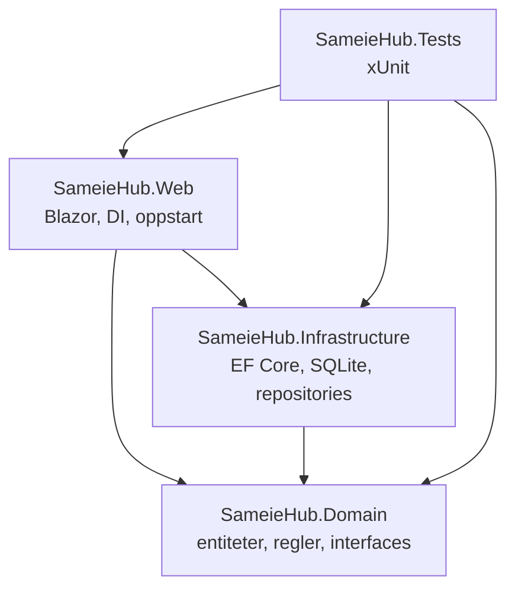
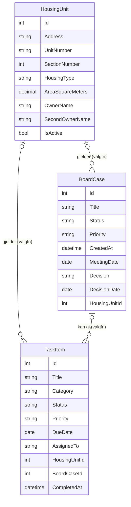
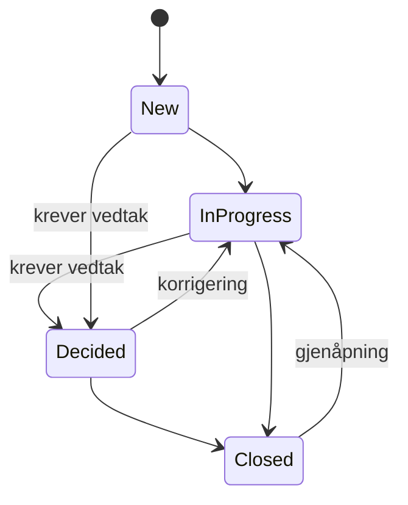
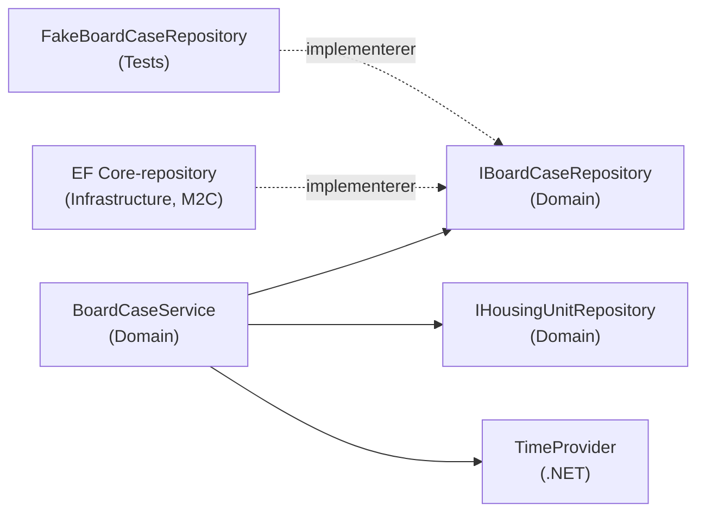
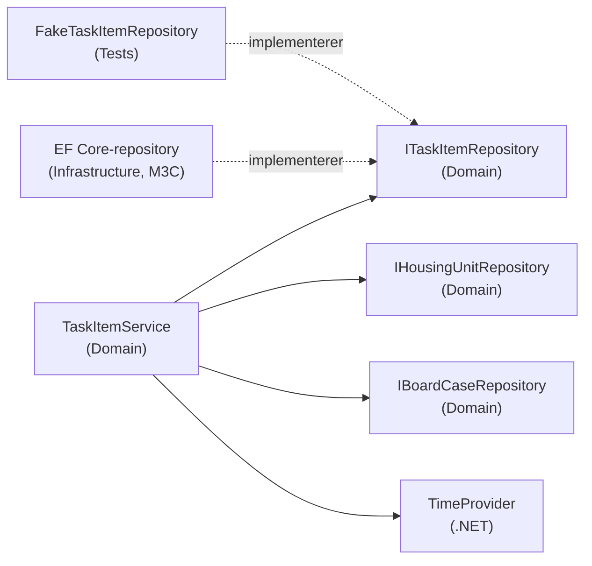
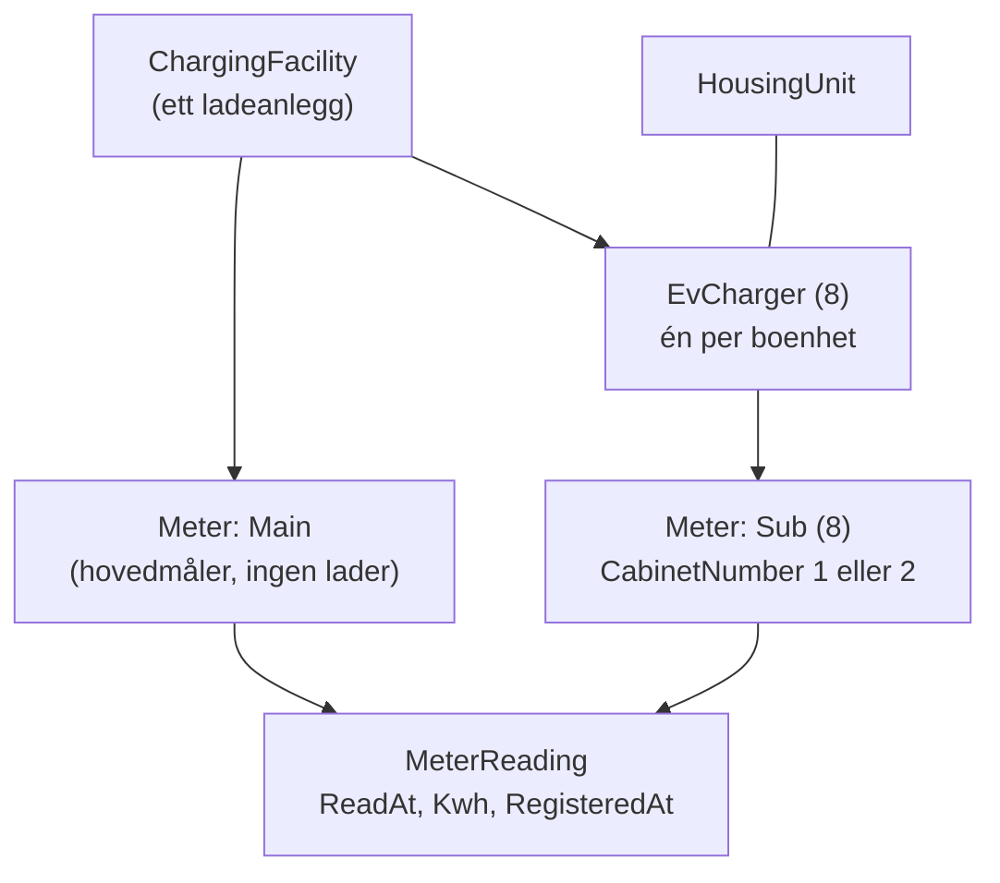
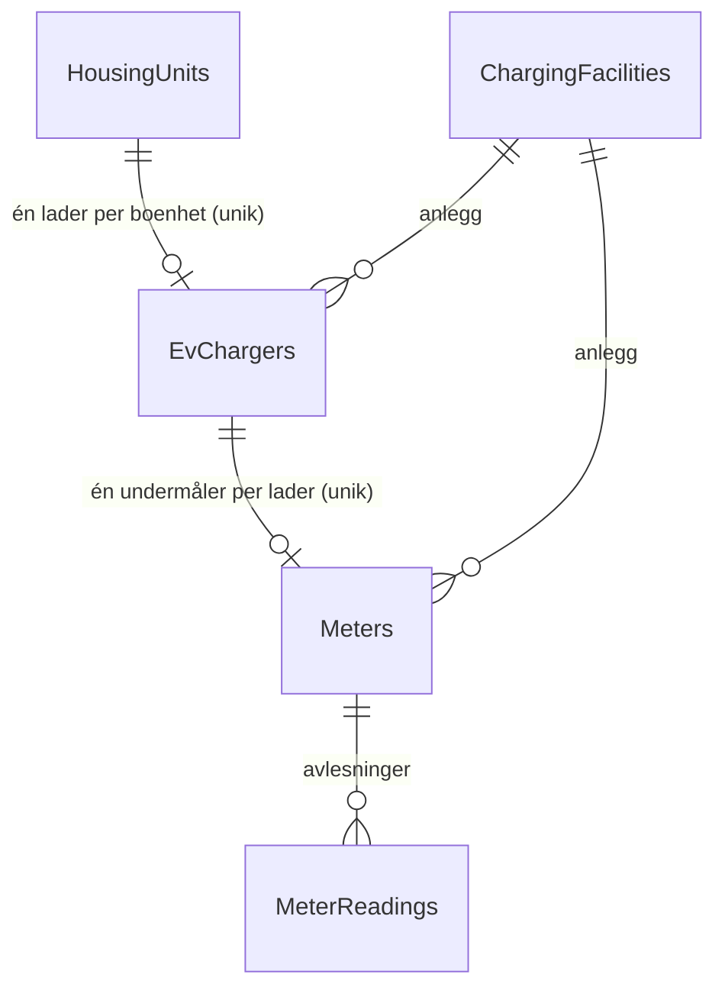
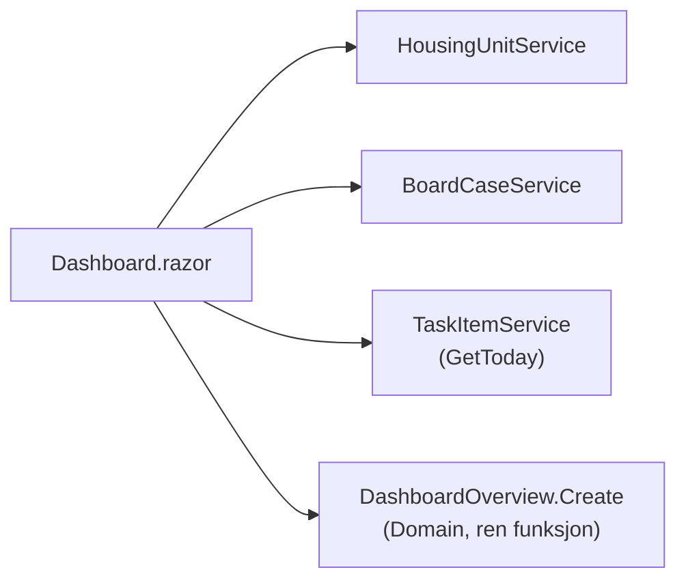
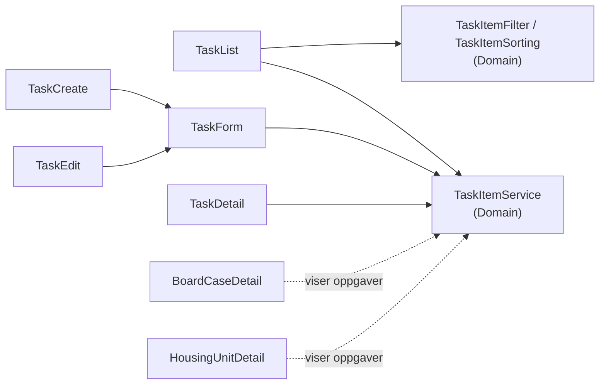

# Arkitektur

## Prosjekter og avhengigheter

| Prosjekt | Ansvar | Refererer |
|---|---|---|
| Domain | Entiteter, enums, repository-interfaces, forretningsregler. Ingen EF/SQLite/Blazor. | – |
| Infrastructure | `DbContext`, repository-implementasjoner, konfigurasjon, migreringer. | Domain |
| Web | Blazor-komponenter, navigasjon, DI og oppstart. | Domain, Infrastructure |
| Tests | Enhetstester (fake repositories), integrasjonstester mot SQLite. | alle |

Hvorfor Web refererer Infrastructure: composition root (`Program.cs`) registrerer konkrete implementasjoner i DI. Komponenter bør likevel bruke Domain-interfaces. Reglene «Domain avhenger ikke av noe» og «Infrastructure avhenger ikke av Web» sikres av `DependencyDirectionTests`.

## Beslutninger
| Beslutning | Alternativ | Begrunnelse |
|---|---|---|
| Blazor Interactive Server | WebAssembly, MAUI/WPF | Én lokal prosess, ingen API, enklest å pakke. |
| SQLite + EF Core | JSON-filer, SQL Server | Én fil å sikkerhetskopiere, ingen server, relasjoner og migreringer. |
| EF Core 10.0.x | EF Core 11 | Pakkene må matche `net10.0` (11 krever net11). |
| 4 prosjekter | Ett prosjekt / flere lag | Nok separasjon til å teste regler uten UI/DB, uten overarkitektur. |
| Repository kun ved konkret nytte | Repository for alt | `DbContext` er allerede en unit of work; interfaces lages når fakes gir testverdi. |

## Datamodell (foreløpig utkast – avklares per milepæl)

Relasjonene er hypoteser; endelige felter og regler besluttes i M1–M3 før koden skrives.

## Domenemodell: HousingUnit (M1A–M1E)

`HousingUnit` har `Id`, `Address`, `UnitNumber`, `SectionNumber`, `HousingType`, `AreaSquareMeters`, eier 1 (`OwnerName`, `OwnerPhoneNumber`, `OwnerEmail`), eier 2 (`SecondOwnerName`, `SecondOwnerPhoneNumber`, `SecondOwnerEmail`), `Notes` og `IsActive`. Alle properties har `private set`.

- **Opprettelse:** `new HousingUnit(address)` (bare adresse) eller `new HousingUnit(details)`.
- **Endring:** `UpdateDetails(HousingUnitDetails)` erstatter alle opplysningene. Alt valideres og normaliseres først, og først deretter tilordnes verdiene, så ugyldig input etterlater aldri objektet halvt oppdatert. `ChangeAddress()` finnes fortsatt.
- **Normalisering:** tekst trimmes; tomme valgfrie tekster blir `null`.
- **Feil:** `ArgumentException` (eller `ArgumentOutOfRangeException`) der `ParamName` er navnet på feltet. Meldingene inneholder aldri selve verdien (personvern).
- **Status:** `Deactivate()` og `Activate()` er idempotente. Inaktive enheter kan fortsatt redigeres. Data beholdes.
- **`Id`:** satt av databasen (se «Lagring» og `AssignId`).
- Reglenes grenser er offentlige konstanter (`HousingUnit.MaxAddressLength` osv.) slik at UI kan bruke de samme tallene.
- **Søk/filter:** `HousingUnitFilter.Apply(units, text, statusFilter)` er ren domenelogikk uten database. Teksten søkes (uten hensyn til store/små bokstaver) i adresse, bolignummer, seksjonsnummer og begge eiernavn. Søk gjøres i minnet fordi antallet boenheter er lite.

### Beslutninger (M1E)
| Beslutning | Alternativer | Begrunnelse |
|---|---|---|
| Seksjonsnummer er `int?` (1–9999) | tekst | Seksjonsnummer er et heltall; heltall gir enkel validering og sortering. Bolignummer med bokstaver (H0101) er eget tekstfelt. |
| `HousingType` er en enum lagret som tekst (`HasConversion<string>`) | enum som tall, fritekst | Lesbar database, tåler omrekkefølge av enum-verdier. Norske navn finnes bare i UI (`HousingTypeText`). |
| Areal er `decimal?` | `double` | Nøyaktig for m². SQLite lagrer det som TEXT; vi sorterer eller summerer ikke på det i databasen. |
| To flate sett med eierfelter | eget `Owner`-objekt/tabell (EF `OwnsOne`, relasjon) | Enklest for maks to eiere. Ingen eierskapsmodell. Feltene heter `Owner…` og `SecondOwner…` (ikke `PhoneNumber`/`Email`) for å gjøre de to settene symmetriske. |
| `HousingUnitDetails` (record) + `UpdateDetails` | stor konstruktør, mange `SetX`-metoder | Én endringsoperasjon med alt-eller-ingenting-validering uten konstruktør med 12 parametere. |
| Feil fra domenet vises ved riktig felt via `ParamName` | duplisere reglene i UI med DataAnnotations | Domenet er eneste kilde til reglene. UI har bare norske meldinger per felt (`HousingUnitFieldMessages`) og `[Required]` på adresse. |
| Ingen lengdegrenser i databasen | `HasMaxLength` | Som i M1C: SQLite håndhever ikke lengde, og grensene håndheves i domenet. |
| `IsActive` med migreringsstandard `true` | `false`/modellstandard | Eksisterende boenheter skal forbli aktive. Standarden er satt i migreringen, ikke i modellen (`HasDefaultValue(true)` ville gjort at EF overstyrte `false`). |

## Domenemodell: BoardCase (M2A)

`BoardCase` er en styresak. Domeneklassen (M2A), repository-kontrakt og tjeneste (M2B) og lagring i SQLite (M2C) finnes; UI kommer i M2D.

| Felt | Type | Regel |
|---|---|---|
| `Id` | `int` | Satt av lagringen via `AssignId` (som `HousingUnit`) |
| `Title` | `string` | Obligatorisk, trimmes, maks 200 tegn |
| `Description` | `string?` | Valgfri, maks 4000 tegn |
| `Status` | `BoardCaseStatus` | `New` ved opprettelse |
| `Priority` | `BoardCasePriority` | `Normal` som standard |
| `CreatedAt` | `DateTime` | UTC, satt ved opprettelse, endres aldri |
| `UpdatedAt` | `DateTime` | UTC. Lik `CreatedAt` til saken endres. Settes bare ved en reell endring (M2B) |
| `MeetingDate` | `DateOnly?` | Valgfri kalenderdato mellom 2000-01-01 og 2100-12-31 |
| `Decision` | `string?` | Valgfri, maks 4000 tegn |
| `DecisionDate` | `DateOnly?` | Valgfri. Når styret fattet vedtaket (M2E). Bare mulig sammen med et vedtak |
| `HousingUnitId` | `int?` | Valgfri; `null` betyr hele sameiet; ellers positiv Id |
| `Notes` | `string?` | Valgfri, maks 2000 tegn |

Alle felt har `private set`. Valgfri tekst trimmes, og tom tekst blir `null`. Feil gir `ArgumentException` der `ParamName` er feltnavnet (samme mønster som `HousingUnit`, slik at UI senere kan vise melding ved riktig felt).

**Metoder:** `new BoardCase(details, createdAt)`, `UpdateDetails(details, now)`, `ChangeStatus(status, now)`, `RegisterDecision(text, decisionDate, now)`, `ClearDecision(now)`, `ToDetails()` og `AssignId(id)`. Parameteren `now` er tidspunktet for endringen (må være UTC); den brukes bare til `UpdatedAt` (se M2B).
`UpdateDetails` tar en `BoardCaseDetails`-record (tittel, beskrivelse, prioritet, møtedato, boenhet og merknader) og er alt-eller-ingenting: alt valideres først. Den dekker dermed «endre tittel og beskrivelse», «endre prioritet», «endre møtedato» og «knytte til eller fjerne kobling til boenhet» (`HousingUnitId = null` fjerner koblingen). Status og vedtak har egne metoder fordi de har regler.

### Statusendringer

Diagrammet viser den vanlige veien. Reglene er bevisst enkle:
- Alle statuser kan endres til alle andre, slik at registreringsfeil kan rettes (inkludert å gjenåpne en avsluttet sak).
- **Eneste regel:** en sak kan bare settes til `Decided` når den har et vedtak.
- En sak kan være vedtatt uten å være avsluttet. `RegisterDecision` endrer ikke status; det gjør `ChangeStatus`.
- `ClearDecision` (for et vedtak registrert ved en feil) er ikke tillatt mens saken er `Decided`; endre status først. Da får en vedtatt sak aldri mangle vedtak.
- Statusendringer logges ikke foreløpig (se «Ikke implementert» under M2C).

### Beslutninger (M2A)
| Beslutning | Alternativer | Begrunnelse |
|---|---|---|
| Enum-verdier starter på 1 | starter på 0 | `default` (0) blir en ugyldig verdi som fanges, i stedet for å bli «Low»/«New» ved en feil. |
| `DateTime` i UTC for `CreatedAt`, `DateOnly` for møtedato | `DateTimeOffset`; `DateTime` for begge | Tidsstempler er UTC, kalenderdatoer har ikke klokkeslett og kan ikke få tidssoneproblemer. |
| Tidspunktet sendes inn i konstruktøren | `DateTime.UtcNow` inni klassen | Gjør klassen testbar. Tjenesten (M2B) leverer tiden via `TimeProvider`. |
| Én `UpdateDetails` + egne metoder for status og vedtak | én metode per felt | Én validering og ingen delvis oppdatering når skjemaet endrer flere felt. Færre metoder å vedlikeholde. |
| Kobling med `int? HousingUnitId` | navigasjonsegenskap `HousingUnit`; mange-til-mange | Enklest. BoardCase kjenner ikke HousingUnit-klassen. Eksistens kontrolleres i tjenesten (M2B). |

## Lagring med EF Core og SQLite (M1C)

- **`SameieHubDbContext`** (Infrastructure/Persistence) konfigurerer `HousingUnit` med Fluent API: `Id` er primærnøkkel (autoinkrement i SQLite), `Address` er påkrevd og `HousingType` lagres som tekst. Domain har ingen EF-attributter. EF fyller `private set`-properties og bruker konstruktøren `HousingUnit(string address)` ved lesing.
- **`EfHousingUnitRepository`** implementerer `IHousingUnitRepository`. Hver metode lager en kortlevd `DbContext` fra `IDbContextFactory`. Lesing bruker `AsNoTracking`. `UpdateAsync` bruker `Update()` fordi enheten kommer fra en annen kontekst.
- **Plassering:** `%LocalAppData%\SameieHub\sameiehub.db` (`DatabaseLocation`). Mappen opprettes ved oppstart. Plasseringen er fast, slik at backup og gjenoppretting (M5) vet hvor filen ligger. Filen ligger utenfor repoet, og `.gitignore` utelukker `*.db`.
- **Oppstart:** `Program.cs` kaller `MigrateSameieHubDatabaseAsync()`, som kjører `Database.MigrateAsync()`. Migreringene er eneste måte skjemaet opprettes på; `EnsureCreated()` brukes ikke.
- **Skjemaendring:** `dotnet ef migrations add <Navn> --project src/SameieHub.Infrastructure --output-dir Persistence/Migrations` (verktøyet er pinnet i `dotnet-tools.json`).

### Beslutning: DbContext og levetid
| Alternativ | Vurdering |
|---|---|
| `AddDbContext` (scoped) | I Blazor Server varer en scope hele brukerøkten (kretsen). Én langlevd kontekst gir utdaterte data og samtidighetsproblemer. Forkastet. |
| **`AddDbContextFactory` + kortlevd kontekst per repository-kall** | Valgt. Trygt og enkelt. Repository og `HousingUnitService` er scoped, men holder bare fabrikken. |

### Beslutning: Id og EF Core
EF Core tildeler `Id` ved `SaveChangesAsync` og setter den på objektet (verifisert i `EfHousingUnitRepositoryTests`). `EfHousingUnitRepository` kaller derfor ikke `AssignId()`; den brukes bare av fake-repoet. Svakheter: `AssignId` er offentlig, og EF og fake setter Id på ulike måter, men begge oppfyller kontrakten «Id er satt etter `AddAsync`», som begge er testet.

### Beslutning: lengder
Ingen maksimal lengde i databasen: SQLite håndhever ikke lengde, og grensene håndheves i `HousingUnit`.

## Brukergrensesnitt (M1D)

- Blazor-komponentene bruker `HousingUnitService` via `@inject`. De kjenner verken `DbContext` eller repository.
- Rendermodus: Interactive Server uten prerendering (`App.razor`). Alternativet, prerendering, ville kjørt `OnInitializedAsync` og dermed databasespørringen to ganger per sidevisning. For en lokal app uten søkemotorer gir prerendering ingen nytte.
- Feilhåndtering ved UI-grensen: `HousingUnitForm` og sidene fanger feil, logger dem (`ILogger`) og viser en norsk melding. `ArgumentException` (domeneregel) og `KeyNotFoundException` (enhet fjernet) får egne meldinger; andre feil logges med full detalj.
- Skjemavalidering: bare adressen har `[Required]` i `HousingUnitFormModel`. Alle andre regler kommer fra domenet: skjemaet fanger `ArgumentException`, leser `ParamName` og viser en norsk melding (`HousingUnitFieldMessages`) ved riktig felt. Se M1E.
- Databasesti kan overstyres med konfigurasjonsnøkkelen `Database:Path` (miljøvariabel `Database__Path`). Brukes til isolert testing; standard er AppData.

### Migreringer
- `InitialCreate` (M1C): tabellen `HousingUnits` med `Id` og `Address`.
- `AddHousingUnitDetails` (M1E): legger til de nye kolonnene (alle valgfrie, unntatt `IsActive` som er `NOT NULL` med standard `true`). Eksisterende rader beholdes, og får `IsActive = true`. Migreringen er testet fra `InitialCreate`-skjemaet med rader satt inn før oppgraderingen (`HousingUnitMigrationTests`). Eksisterende migreringer endres aldri.

## Permanent sletting av boenheter (M1F)

- **Kontrakt:** `IHousingUnitRepository.DeleteAsync(int id)` returnerer `true` hvis en boenhet ble slettet og `false` hvis Id-en ikke finnes. `HousingUnitService.DeleteAsync(id)` kaster `KeyNotFoundException` for ukjent Id (som de andre tjenestemetodene) og `HousingUnitInUseException` (Domain) hvis andre poster refererer til boenheten. Deaktivering og reaktivering er uendret.
- **Hva som slettes:** raden i `HousingUnits`. Eier- og kontaktopplysningene er kolonner i samme rad og forsvinner dermed med den (testet).
- **Referanseintegritet:** tilkoblingen bruker `Foreign Keys=True`, slik at SQLite alltid håndhever fremmednøkler. Fremmednøkler konfigureres med `OnDelete(DeleteBehavior.Restrict)`: **aldri cascade**. Sletting av en refert boenhet gir SQLite-feil 19, og `EfHousingUnitRepository` oversetter den til `HousingUnitInUseException`. Hvordan feilen kjennes igjen er beskrevet under «Fremmednøkkelfeil» i M2C-avsnittet. `try/catch` er her berettiget fordi feilen kan håndteres (UI viser en forståelig melding).
- **Id-er gjenbrukes ikke:** `Id` er `INTEGER PRIMARY KEY AUTOINCREMENT`, så SQLite husker høyeste brukte Id selv om den siste raden slettes (testet). Koden setter aldri Id-er manuelt.
- **Blokkering testet mot ekte relasjon (M2C):** `BoardCases.HousingUnitId` er en ekte fremmednøkkel, og `BoardCaseRelationTests` viser at sletting av en boenhet med styresaker blokkeres. De simulerte testene fra M1F er erstattet. Relasjonen fra `TaskItem` er testet i M3C (`TaskItemRelationTests`).
- **Personvern:** logger inneholder bare Id-en til boenheten, aldri adresse eller eierinformasjon.

| Beslutning | Alternativer | Begrunnelse |
|---|---|---|
| `DeleteAsync` returnerer `bool` | kaste unntak for ukjent Id i repository; ta imot entitet | Repository melder bare fakta; tjenesten bestemmer at ukjent Id er en feil. Ingen ekstra spørring først i tjenesten. |
| Blokkering via databasens fremmednøkkel | sjekke i tjenesten før sletting | Databasen er den eneste som garantert vet om alle referanser, også ved samtidige endringer. Ingen duplisert regel som må vedlikeholdes for hver ny tabell. |
| Ingen cascade delete | cascade | Styresaker og oppgaver er historikk og skal aldri forsvinne som bivirkning. |
| Aktive og inaktive kan slettes | bare inaktive | Feilregistrerte enheter er ofte aktive; bekreftelsen i UI beskytter mot uhell. |

## Styresaktjeneste og repository (M2B)

- **`IBoardCaseRepository`** er lite: `AddAsync`, `GetByIdAsync`, `GetAllAsync`, `UpdateAsync` og `DeleteAsync(id)` (returnerer `false` for ukjent Id). Ingen generisk repository.
- **`BoardCaseService`** (konstruktør: begge repositoryene og `TimeProvider`):
  `RegisterAsync`, `GetByIdAsync`, `GetAllAsync`, `UpdateDetailsAsync`, `ChangeHousingUnitAsync`, `ChangeStatusAsync`, `RegisterDecisionAsync`, `ClearDecisionAsync` og `DeleteAsync`. Domeneklassen eier reglene; tjenesten henter saken, kaller domenemetoden med tidspunktet og lagrer. Ukjent sak gir `KeyNotFoundException`.
- **DI (M2C):** `IBoardCaseRepository` registreres i `AddSameieHubInfrastructure`, og `BoardCaseService` og `TimeProvider.System` i `Program.cs`, som `HousingUnitService`.

### Kobling til boenhet
Domain kjenner bare `int? HousingUnitId`. Tjenesten kontrollerer referansen via `IHousingUnitRepository`:

| Situasjon | Resultat |
|---|---|
| `HousingUnitId = null` | OK. Saken gjelder hele sameiet. |
| Ny kobling (ved registrering, eller en annen enn dagens) til en **eksisterende og aktiv** boenhet | OK |
| Ny kobling til ukjent boenhet | `ArgumentException`, `ParamName = "HousingUnitId"`, ingenting endres |
| Ny kobling til inaktiv boenhet | Samme feil |
| Uendret kobling til en boenhet som senere er deaktivert | **Beholdes**, ingen kontroll. Andre felt kan redigeres som vanlig. |
| Kobling fjernes (`null`) | Alltid tillatt |

Kontrollen skjer før domenemetoden endrer noe, og domenemetoden er alt-eller-ingenting, så ugyldig input gir aldri delvis oppdatering. Feilen skiller ikke «finnes ikke» fra «inaktiv» i parameternavnet; meldingen (engelsk) gjør det. UI viser én norsk melding ved feltet (M2D).

### Tidsstempler
- Tjenesten henter tiden fra `TimeProvider` (`GetUtcNow().UtcDateTime`, alltid UTC) og sender den til domenet. `DateTime.UtcNow` brukes ikke i koden; tester styrer klokken med `ManualTimeProvider`.
- `CreatedAt` settes ved opprettelse og endres aldri. `UpdatedAt` er lik `CreatedAt` til første endring.
- `UpdatedAt` settes **bare når noe faktisk endres**. Ingenting skjer ved: ugyldig input (kaster før noe tilordnes), uendrede verdier (sammenlignes etter normalisering, så «  Tittel » mot «Tittel» er uendret), samme status, samme vedtak, og `ClearDecision` uten vedtak.
- En `now` som ikke er UTC avvises (`ArgumentException`, `ParamName = "now"`).
- Det finnes ingen hendelseslogg. `CreatedAt` og `UpdatedAt` forteller bare når saken ble opprettet og sist endret, ikke hva som ble endret eller av hvem (se M2E).

### Sletting (foreløpig)
- `DeleteAsync(id)` i tjenesten: `KeyNotFoundException` for ukjent Id, ellers sletter den og lar `BoardCaseInUseException` boble opp hvis repoet melder at andre poster refererer til saken.
- Kontrakten er implementert i `EfBoardCaseRepository` (M2C). Det er ingen cascade. Fremmednøkkelen fra `TaskItem` til `BoardCase` er konfigurert med `DeleteBehavior.Restrict` (M3C). `EfBoardCaseRepository.DeleteAsync` oversetter allerede fremmednøkkelbrudd til `BoardCaseInUseException`, og dette er testet mot en ekte `TaskItem`-referanse i M3C (`TaskItemRelationTests`).
- Fake-repoet har `IsDeletionBlocked` for å teste at feilen når frem. Mot databasen er den samme blokkeringen testet med ekte oppgaver (M3C).
- Sletting av en **boenhet** som styresaker refererer til blokkeres av fremmednøkkelen fra `BoardCase.HousingUnitId` (`Restrict`) og er testet i M2C.

### Beslutninger (M2B)
| Beslutning | Alternativer | Begrunnelse |
|---|---|---|
| `UpdatedAt` er ikke-null og lik `CreatedAt` ved opprettelse | `null` til første endring | Ingen nullhåndtering; kan sorteres på «sist endret» uten spesialtilfelle. |
| Domenemetodene tar `now` som parameter | tjenesten setter `UpdatedAt` etter at metoden har returnert `bool`; `TimeProvider` i entiteten | Domenet avgjør selv hva som er en reell endring, og kan ikke glemme å oppdatere tidsstempelet. Ingen tidskilde i entiteten. |
| `ChangeHousingUnitAsync` finnes ved siden av `UpdateDetailsAsync` | bare `UpdateDetailsAsync` | Enkelt kall for «knytt til/fjern boenhet», uten at kalleren må bygge hele `BoardCaseDetails`. Bruker `BoardCase.ToDetails()` og samme kontroll. |
| Ny kobling krever aktiv boenhet; eksisterende kobling beholdes | alltid tillate inaktive; alltid kreve aktive | Historikk skal ikke gå tapt når en boenhet deaktiveres, men nye saker skal ikke knyttes til boenheter som ikke lenger er i bruk. |
| Referansekontroll i tjenesten | fremmednøkkel alene | Gir en forståelig feil før lagring. Fremmednøkkelen er likevel siste sikring (testet i M2C). |
| `BoardCaseInUseException` finnes allerede | innføre den i M3 | Kontrakten er da ferdig, og UI (M2D) kan håndtere den. |

## Lagring av styresaker (M2C)

### Tabellen `BoardCases`
| Kolonne | SQLite-type | Mapping |
|---|---|---|
| `Id` | `INTEGER` | Primærnøkkel, `AUTOINCREMENT` (Id gjenbrukes ikke). Satt på objektet etter `SaveChangesAsync`. |
| `Title` | `TEXT NOT NULL` | |
| `Description`, `Decision`, `Notes` | `TEXT` | Valgfrie |
| `Status`, `Priority` | `TEXT NOT NULL` | Enum som tekst (`HasConversion<string>`), f.eks. `InProgress`, `High` |
| `CreatedAt`, `UpdatedAt` | `TEXT NOT NULL` | UTC, se under |
| `MeetingDate` | `TEXT` | `DateOnly?` lagres av EF som `yyyy-MM-dd` |
| `HousingUnitId` | `INTEGER` | Valgfri fremmednøkkel til `HousingUnits(Id)` |

Mappingen ligger i `SameieHubDbContext` (Fluent API). `BoardCase` har ingen EF-attributter, beholder `private set`, og har en privat parameterløs konstruktør som bare EF bruker. Det er ingen navigasjonsegenskaper: relasjonen er konfigurert med `HasOne<HousingUnit>().WithMany().HasForeignKey(...)`, så `BoardCase` kjenner fortsatt bare `int? HousingUnitId`.

### Fremmednøkkel til boenhet
- `FK_BoardCases_HousingUnits_HousingUnitId` med `ON DELETE RESTRICT` og en indeks på kolonnen. Ingen cascade og ingen automatisk nullstilling.
- `NULL` betyr at saken gjelder hele sameiet. Databasen krever ikke at en referert boenhet er aktiv; den regelen ligger i `BoardCaseService` (ny kobling).
- Ugyldig referanse (ukjent boenhet) avvises av databasen med `DbUpdateException` (SQLite 787) også hvis tjenesten omgås. Dette oversettes ikke til noen annen feil.
- En boenhet som har styresaker kan ikke slettes (`HousingUnitInUseException`). Den kan slettes når koblingen er fjernet eller styresaken slettet.

### Fremmednøkkelfeil
Feilen kjennes igjen på SQLites **utvidede feilkode**, ikke på meldingsteksten (`SqliteConstraintErrors.IsForeignKeyViolation`). Målt mot SQLite:

| Situasjon | Utvidet kode |
|---|---|
| Sette inn/oppdatere rad med referanse til manglende rad | 787 (`SQLITE_CONSTRAINT_FOREIGNKEY`) |
| Slette en rad som andre refererer til, med `ON DELETE RESTRICT` | **1811** (`SQLITE_CONSTRAINT_TRIGGER`) |
| Unique / primærnøkkel / not null | 2067 / 1555 / 1299 (ikke fremmednøkkel) |

Nøkkelpunkt: RESTRICT rapporteres som 1811, ikke 787. Forventningen om bare 787 var grunnen til at M1F først måtte bruke meldingsteksten. Sjekken godtar nå 787 og 1811 (med feilkode 19) og er felles for `EfHousingUnitRepository` og `EfBoardCaseRepository`. Databasen har ingen andre triggere, så 1811 betyr her alltid en begrenset fremmednøkkel. Andre databasefeil oversettes ikke til fremmednøkkelfeil (enhetstestet). Dermed erstatter den M1F-sjekken som brukte meldingsteksten.

### UTC for tidsstempler
- Domenet garanterer UTC (`DateTimeKind.Utc`, kontrollert i konstruktøren og i endringsmetodene).
- SQLite lagrer `DateTime` som tekst uten tidssone (`2026-11-18 10:30:00`), og EF leser den tilbake som `Unspecified`. En enkel `ValueConverter` (`DateTime.SpecifyKind(value, Utc)` ved lesing) gjør at verdiene alltid får `Kind = Utc`. Ingen tidssonekonvertering skjer, så klokkeslettet endres aldri.
- Presisjon: 7 desimaler (100 ns), og verdiene er identiske før og etter lagring (testet).
- `CreatedAt` beholdes ved endring, og `UpdatedAt` endres ikke ved lesing (testet).

### Repository
`EfBoardCaseRepository` følger `EfHousingUnitRepository`: en kortlevd `DbContext` per operasjon fra `IDbContextFactory`, `AsNoTracking` ved lesing, `Update()` for frakoblede entiteter, og `DeleteAsync` som returnerer `false` for ukjent Id.

### Migreringer
`AddBoardCases` oppretter bare tabellen og indeksen; eksisterende tabeller og rader røres ikke. Testet fra en tom database og fra en database på `AddHousingUnitDetails`-skjemaet (M1F) med boenheter og personopplysninger, som er uendrede etter migreringen (`BoardCaseMigrationTests`). Eksisterende migreringer er ikke endret, og `EnsureCreated()` brukes ikke.

### Ikke implementert
- **Endringshistorikk:** det finnes bare `CreatedAt` og `UpdatedAt`. Ingen logg over statusendringer, vedtak eller hvem som endret hva.
- Blazor-sider for styresaker (M2D).
- Fremmednøkkel fra `TaskItem` (M3).

## Brukergrensesnitt for styresaker (M2D)

- **Sider** (`Components/Pages/BoardCases/`): `BoardCaseList`, `BoardCaseDetail`, `BoardCaseCreate`, `BoardCaseEdit` og det delte `BoardCaseForm`. Alle bruker `BoardCaseService` og (for boenhetsvalg og visning) `HousingUnitService`; ingen bruker `DbContext` eller repository direkte.
- **Filter og sortering ligger i Domain** (`BoardCaseFilter`, `BoardCaseFilterCriteria`, `BoardCaseSorting`, `BoardCaseSortOrder`), som `HousingUnitFilter`. Alle saker leses og filtreres i minnet, fordi antallet saker i et lite sameie er lite. Dette gir testbar logikk uten UI og uten spørrelag.
- **Saksnummer** er `Id`. Søk på tall matcher saksnummeret eksakt (så «2» ikke finner sak 12); ellers søkes tittel og beskrivelse.
- **Status og vedtak** håndheves av domenet; UI omgår aldri reglene. Hver handling på detaljsiden (`RunActionAsync`) fanger `ArgumentException` og `InvalidOperationException` (regelbrudd) og viser en norsk melding som er skrevet for akkurat den handlingen. `KeyNotFoundException` gir «finnes ikke lenger», og alle andre feil logges (kun unntaket, aldri vedtaksteksten) og gir en generell databasemelding. `InvalidOperationException` brukes av domenet for regelbrudd; ekte databasefeil er `SqliteException`/`DbUpdateException` og blir derfor ikke feiltolket som regelbrudd.
- **Boenhetsvalg i skjemaet:** siden bestemmer hvilke boenheter som tilbys (`BoardCaseCreate`: aktive; `BoardCaseEdit`: aktive pluss den koblede, selv om den er deaktivert). Skjemaet (`BoardCaseForm`) mottar bare listen. Tjenesten kontrollerer fortsatt at en ny kobling er aktiv.
- **Feil ved feltet:** `ParamName` fra domenet/tjenesten (`Title`, `Description`, `Priority`, `MeetingDate`, `HousingUnitId`, `Notes`) slås opp i `BoardCaseFieldMessages` for en norsk melding ved riktig felt, som for boenheter. Bare tittel har `[Required]` i skjemamodellen.
- **Norsk dato og tid:** `NorwegianDateFormat` viser UTC-tider i norsk tid (`Europe/Oslo`, reservevei `W. Europe Standard Time`) som `dd.MM.yyyy HH:mm`, og datoer som `dd.MM.yyyy`. Lagring er uendret (UTC).
- **Boenhetens detaljside** henter alle saker og viser de som har `HousingUnitId` lik boenhetens Id (nyeste først). Beskyttelsen mot sletting av boenheter med styresaker er uendret (fremmednøkkel, M2C).
- Ikke i M2D: endringshistorikk, oppgavekobling (M3). Vedtaksdato og snarvei fra boenhet kom i M2E.

## Vedtaksdato og snarvei fra boenhet (M2E)

### Vedtaksdato
- `BoardCase.DecisionDate` (`DateOnly?`) er datoen styret fattet vedtaket. Den er ikke opprettelsesdatoen, endringsdatoen eller møtedatoen, og den gjettes aldri ut fra dem. Eksisterende saker har `NULL`.
- **Regler:**
  - Datoen finnes bare sammen med et vedtak. `RegisterDecision(text, decisionDate, now)` krever vedtakstekst og er det eneste stedet datoen settes.
  - Datoen kan stå tom selv om vedtak er registrert, og den kan korrigeres (samme metode, ny dato). Én metode registrerer og korrigerer både tekst og dato, så ugyldig input aldri gir delvis oppdatering (alt valideres før noe tilordnes).
  - `null` som dato tømmer datoen. Kalleren sender derfor alltid med den ønskede datoen; det finnes ingen standardverdi som kunne slette en dato ved et uhell.
  - `ClearDecision(now)` fjerner vedtaket **og** datoen. Den er fortsatt ikke tillatt mens saken er `Decided`.
  - `Decided` krever fortsatt vedtakstekst, men ikke dato.
  - Gyldig område er 01.01.2000–31.12.2100 (som møtedato). Det finnes ingen sammenheng med opprettelsestidspunktet, fordi et vedtak kan ha blitt fattet før saken ble registrert; heller ingen regel mot fremtidige datoer.
  - `UpdatedAt` settes bare ved en reell endring (ny tekst eller ny dato), via `TimeProvider` i tjenesten. Samme tekst og dato gir ingen endring.
- **Database:** migreringen `AddBoardCaseDecisionDate` legger til én nullable `TEXT`-kolonne (`yyyy-MM-dd`). Eksisterende saker beholdes uendret (testet fra `AddBoardCases`-skjemaet med saker, vedtak og tider).
- **UI:** vedtakskortet på styresakens detaljside viser vedtaksteksten og «Vedtaksdato: dd.MM.yyyy» (eller «Ikke registrert») i en tydelig boks, og har et datofelt ved siden av vedtaksteksten. Ugyldig dato gir «Vedtaksdatoen må være mellom 01.01.2000 og 31.12.2100.» uten å endre noe lagret.

### Snarvei «Registrer styresak» fra boenhet
- Boenhetens detaljside har knappen «Registrer styresak» i seksjonen «Styresaker», som åpner `/styresaker/ny?boenhet={id}`. Knappen vises **ikke** for inaktive boenheter.
- Registreringssiden stoler ikke på ID-en i adressen: den forhåndsvelger boenheten bare hvis den finnes i listen over **aktive** boenheter. Ellers vises «Boenheten fra lenken finnes ikke eller er inaktiv, så den er ikke valgt …» og skjemaet starter på «Hele sameiet».
- Forhåndsvalget er bare et startforslag. Ved lagring gjelder tjenestens og domenets validering som før (ny kobling krever aktiv boenhet), så en manipulert adresse kan ikke omgå reglene.
- Eksisterende saker knyttet til inaktive boenheter fungerer som før (kobling beholdes, vises som «(inaktiv)», kan redigeres).

### Endringshistorikk (ikke implementert)
`CreatedAt` og `UpdatedAt` forteller **ikke** hvilke endringer som ble gjort eller av hvem; de kan ikke brukes som protokoll. Hvis SameieHub skal brukes til formell protokollføring kan en hendelseshistorikk (egen tabell med tidspunkt, type endring og gamle/nye verdier) vurderes senere. Den er bevisst ikke laget nå.

### Gjenstår etter M2 (M2 er godkjent)
1. ~~**Oppgavekobling (M3):**~~ gjort i M3C: fremmednøkkel fra `TaskItem` til `BoardCase` med `Restrict`, og `BoardCaseInUseException` testet mot ekte referanse.
2. **Dashboard (M4):** åpne saker og kommende møter (data finnes).
3. **Beslutning:** er `CreatedAt`/`UpdatedAt` nok til v1.0, eller skal historikk lages senere?

## Domenemodell: TaskItem (M3A)

`TaskItem` er en oppgave. Vedlikehold er en **kategori** av oppgaver, ikke et eget system. Domeneklassen (M3A) og repository-kontrakt og tjeneste (M3B) finnes; database (M3C) og UI (M3D) finnes.

| Felt | Type | Regel |
|---|---|---|
| `Id` | `int` | Satt av lagringen via `AssignId` (som de andre modulene) |
| `Title` | `string` | Obligatorisk, trimmes, maks 200 tegn |
| `Description` | `string?` | Valgfri, maks 4000 tegn |
| `Category` | `TaskItemCategory` | `General` (Generell) eller `Maintenance` (Vedlikehold). Standard `General` |
| `Status` | `TaskItemStatus` | `NotStarted` (Ikke startet), `InProgress` (Pågår), `Completed` (Fullført). Standard `NotStarted` |
| `Priority` | `TaskItemPriority` | `Low`, `Normal`, `High`. Standard `Normal` |
| `DueDate` | `DateOnly?` | Valgfri kalenderdato mellom 2000-01-01 og 2100-12-31 |
| `AssignedTo` | `string?` | Valgfritt navn på ansvarlig, maks 100 tegn. Bare en tekst, ikke en kobling til en person |
| `HousingUnitId` | `int?` | Valgfri; `null` = ingen boenhet; ellers positiv Id |
| `BoardCaseId` | `int?` | Valgfri; `null` = ingen styresak; ellers positiv Id |
| `CreatedAt` | `DateTime` | UTC, settes ved opprettelse, endres aldri |
| `UpdatedAt` | `DateTime` | UTC. Lik `CreatedAt` til oppgaven endres. Settes bare ved en reell endring |
| `CompletedAt` | `DateTime?` | UTC. Satt bare når status er `Completed` |
| `Notes` | `string?` | Valgfri, maks 2000 tegn |

Alle felt har `private set`. Tekst trimmes, og blank valgfri tekst blir `null`. Feil gir `ArgumentException` (eller `ArgumentOutOfRangeException`) der `ParamName` er feltnavnet, som for `HousingUnit` og `BoardCase`. Enum-verdier starter på 1, så `default` (0) avvises.

**Metoder:** `new TaskItem(details, createdAt)`, `UpdateDetails(details, now)`, `ChangeStatus(status, now)`, `IsOverdue(today)`, `ToDetails()` og `AssignId(id)`. `TaskItemDetails` (record) samler tittel, beskrivelse, kategori, prioritet, frist, ansvarlig, boenhet, styresak og merknader. `UpdateDetails` er alt-eller-ingenting (alt valideres før noe tilordnes) og endrer verken status eller `CompletedAt`.

### Status og fullføring
- **Start**, **fullfør** og **gjenåpne** er alle `ChangeStatus`. Hvilken som helst status kan endres til hvilken som helst annen, slik at registreringsfeil kan rettes. Det finnes ingen egne `Start`/`Complete`/`Reopen`-metoder.
- Fra en ikke-fullført status til `Completed`: `CompletedAt` settes til tidspunktet som sendes inn (`now`, UTC).
- Ut av `Completed` (gjenåpning, til `InProgress` eller `NotStarted`): `CompletedAt = null`. En ny fullføring gir et nytt tidspunkt.
- Samme status på nytt endrer verken `CompletedAt` eller `UpdatedAt`.
- Dermed gjelder alltid: `Status == Completed` hvis og bare hvis `CompletedAt != null`. Det lagres ingen historikk over tidligere fullføringer.
- En `now` som ikke er UTC avvises (`ArgumentException`, `ParamName = "now"`). Tiden hentes av tjenesten via `TimeProvider` (M3B); domenet kaller aldri klokken selv.

### Forfalt
`IsOverdue(DateOnly today)` er true når oppgaven **ikke er fullført**, **har en frist** og **fristen er tidligere enn `today`**. Frist i dag er ikke forfalt før neste dag. En fullført oppgave er aldri forfalt, og en gjenåpnet oppgave med passert frist er forfalt igjen. Dagens dato sendes inn (`DateOnly`), så metoden kan testes uten klokke og bruker ikke `DateTime.Today`. Forfalt er en **beregnet egenskap** som ikke lagres i SQLite.

### Koblinger (planlagt)
- En oppgave kan være uten kobling, knyttet til én boenhet, til én styresak, eller til begge. Koblingene er uavhengige: oppgavens boenhet trenger ikke være lik styresakens boenhet, og styresaken kan gjelde hele sameiet.
- Domenet kjenner bare `int?` (positive Id-er), uten navigasjonsegenskaper, som `BoardCase.HousingUnitId`.
- **M3B (tjenesten, gjort):** kontrollerer at refererte objekter finnes. En **ny** kobling til en boenhet krever en **aktiv** boenhet; en **uendret** eksisterende kobling til en senere deaktivert boenhet beholdes og kan fortsatt redigeres (samme regel som for styresaker). Ny kobling til en styresak krever at den finnes (alle statuser er tillatt).
- **M3C (database, gjort):** fremmednøkler til `HousingUnits` og `BoardCases` med `DeleteBehavior.Restrict` (aldri cascade). Da blokkeres sletting av en boenhet eller styresak som har oppgaver, via `HousingUnitInUseException` og `BoardCaseInUseException`.

### Beslutninger (M3A)
| Beslutning | Alternativer | Begrunnelse |
|---|---|---|
| Egen `TaskItemPriority` | gjenbruke `BoardCasePriority` | Samme tre verdier, men oppgaver og styresaker utvikler seg uavhengig, og `TaskItem` slipper å kjenne et styresakbegrep. Koster tre linjer. |
| Enum-navn med `TaskItem`-prefiks (`TaskItemStatus`, `TaskItemCategory`) | `TaskStatus`, `TaskCategory` | `TaskStatus` kolliderer med `System.Threading.Tasks.TaskStatus` (implisitt `using`). Prefikset gir også samme navngivning for alle tre. |
| `CompletedAt` styres av `ChangeStatus` | egen `Complete()`/`Reopen()`, eller felt som settes utenfra | Én metode, én regel, og invarianten «fullført ⇔ `CompletedAt` finnes» kan ikke brytes. |
| Gjenåpning går til hvilken som helst ikke-fullført status | alltid `InProgress` | Enklere og lar brukeren rette feil. |
| `AssignedTo` er tekst | eget personobjekt | Nok for v1.0; ingen personregister. |
| Hjelpemetodene for normalisering er kopiert privat inn i `TaskItem` | felles baseklasse/hjelpeklasse | Fire–fem små metoder per klasse. En felles hjelper ville gitt en refaktorering av M1/M2 uten stor gevinst; kan vurderes senere. |

## Oppgavetjeneste og repository (M3B)

- **`ITaskItemRepository`** har samme lille kontrakt som `IBoardCaseRepository`: `AddAsync` (tilordner positiv Id), `GetByIdAsync`, `GetAllAsync`, `UpdateAsync` og `DeleteAsync(id)` (`true` ved sletting, `false` for ukjent Id). Ingen generisk repository.
- **`TaskItemService`** (konstruktør: de tre repositoryene og `TimeProvider`): `RegisterAsync`, `GetByIdAsync`, `GetAllAsync`, `UpdateDetailsAsync`, `ChangeHousingUnitAsync`, `ChangeBoardCaseAsync`, `ChangeStatusAsync`, `DeleteAsync`, `GetToday()` og `GetOverdueAsync()`. Domeneklassen eier reglene; tjenesten henter oppgaven, kontrollerer referanser, kaller domenemetoden med tiden og lagrer. Ukjent oppgave gir `KeyNotFoundException`.
- Registrert i DI i M3C sammen med `EfTaskItemRepository` (`ITaskItemRepository` og `TaskItemService`).

### Kontroll av koblinger
| Situasjon | Resultat |
|---|---|
| Boenhet `null` / styresak `null` | OK |
| Ny kobling til **eksisterende og aktiv** boenhet | OK |
| Ny kobling til ukjent eller inaktiv boenhet | `ArgumentException`, `ParamName = "HousingUnitId"` |
| Uendret kobling til en boenhet som senere er deaktivert | **Beholdes**; andre felt kan redigeres, status kan endres |
| Ny kobling til **eksisterende** styresak (alle statuser, også `Closed`) | OK |
| Ny kobling til ukjent styresak | `ArgumentException`, `ParamName = "BoardCaseId"` |
| Koblinger fjernes (`null`) | Alltid tillatt |
| Både boenhet og styresak | OK. Uavhengige: styresakens boenhet kopieres aldri, og styresaken kan gjelde en annen boenhet eller hele sameiet |

Bare **endrede** koblinger kontrolleres (`details.HousingUnitId != task.HousingUnitId`), som i `BoardCaseService`.

### Atomisk oppdatering
`UpdateDetailsAsync` kontrollerer først en endret boenhetskobling, så en endret styresakskobling, og først deretter kalles `TaskItem.UpdateDetails`, som validerer alle øvrige felt før noe tilordnes. Alt skjer før `UpdateAsync` lagrer, så hvis én verdi er ugyldig (en av referansene eller et vanlig felt) endres ingenting, også når begge referansene endres samtidig. `ChangeHousingUnitAsync` og `ChangeBoardCaseAsync` bruker samme vei via `TaskItem.ToDetails()`.

### Tid, status og tidsstempler
- Tiden kommer fra `TimeProvider` (`GetUtcNow().UtcDateTime`, alltid UTC). `CreatedAt` settes ved registrering og endres aldri. `UpdatedAt` endres bare ved reell endring. `CompletedAt` settes ved overgang til `Completed` og fjernes ved gjenåpning; samme status på nytt endrer ingenting. Redigering av en fullført oppgave er tillatt og beholder `CompletedAt`. Det finnes ingen statushistorikk.

### Forfalt og «i dag»
- `GetToday()` gir dagens dato i **norsk tid** (`NorwegianTime.DateOf`, `Europe/Oslo`), ikke systemets tidssone og ikke UTC-dato. Nær midnatt kan norsk dato være en dag foran UTC (testet for vinter og sommertid). Tiden hentes fra `TimeProvider`, så tester styrer «i dag» med `ManualTimeProvider`.
- `GetOverdueAsync()` leser alle oppgaver og filtrerer i minnet med `TaskItem.IsOverdue(GetToday())`, tidligste frist først. Antallet er lite, så det finnes ingen eget repository-spørsmål. Oversikt og dashboard kan bruke samme to metoder (`GetToday()` per rad, `GetOverdueAsync().Count` for telling). Forfalt lagres aldri i databasen, og det finnes ingen dashboardtjeneste.
- `NorwegianTime` ligger i Domain og brukes også av `NorwegianDateFormat` i Web (den hadde en egen kopi av tidssoneoppslaget; den er fjernet).

### Sletting
`DeleteAsync` kaster `KeyNotFoundException` for ukjent Id og sletter ellers bare oppgaven. Boenheten og styresaken den peker på berøres aldri, og det er ingen cascade. Oppgaver blir ikke referert av andre tabeller, så ingen `InUse`-unntak trengs. Bekreftelse kommer i M3D.

## Oppgaver i databasen (M3C)

- **Tabell:** `TaskItems` (migrering `AddTaskItems`). Mappingen er Fluent API i `SameieHubDbContext.ConfigureTaskItem`, samme mønster som `BoardCase`. `TaskItem` har en privat parameterløs konstruktør som bare EF Core bruker.
- **To valgfrie, ekte fremmednøkler:** `HousingUnitId` → `HousingUnits.Id` og `BoardCaseId` → `BoardCases.Id`, begge `DeleteBehavior.Restrict`. Ingen cascade, ingen automatisk nullstilling og ingen navigasjonsegenskaper. Oppgaven og styresaken trenger ikke gjelde samme boenhet. EF lager hver sin indeks på de to fremmednøklene; det er ingen indeks på `DueDate`.
- **Sletting:** en boenhet eller styresak med oppgaver kan ikke slettes (`HousingUnitInUseException`, `BoardCaseInUseException`), og ingenting slettes. Når koblingen fjernes (`ChangeHousingUnitAsync`/`ChangeBoardCaseAsync` med `null`) eller oppgaven slettes, kan boenheten/styresaken slettes. Sletting av en oppgave påvirker aldri boenhet eller styresak. Ugyldig Id direkte mot repositoryet gir `DbUpdateException` (SQLite 787), men tjenesten stopper det først.
- **Klassifisering av feil:** RESTRICT-brudd ved sletting rapporteres som utvidet kode 1811 (trigger), som alle triggere deler. `SqliteConstraintErrors.IsForeignKeyViolation` godtar derfor 1811 bare når meldingen også nevner «FOREIGN KEY». En egendefinert trigger med `RAISE(ABORT, ...)` gir dermed ikke feilaktig «i bruk»-feil (testet).
- **Tid og dato:** `CreatedAt`, `UpdatedAt` og `CompletedAt` lagres som UTC-tekst og leses tilbake med `DateTimeKind.Utc` (`UtcDateTimeConverter`, også for `CompletedAt` som kan være `null`). `DueDate` lagres som ren dato (`yyyy-MM-dd`). Enumer lagres som lesbar tekst. `CompletedAt` er `null` for uferdige oppgaver, og gjenåpning nullstiller den også etter omstart.
- **Forfalt lagres ikke.** Det beregnes i `TaskItemService` mot norsk dato (`NorwegianTime`), aldri i SQLite.
- **Migrering:** kun ny tabell, to fremmednøkler og to indekser; eksisterende migreringer er uendret. Testet fra skjemaet etter M2E (`AddBoardCaseDecisionDate`) med data, og fra tom database (`TaskItemMigrationTests`).
- **Gjenstår:** dashboard (M4), backup (M5).

## Elbillading: domenemodell (M4E-A)

Domenelaget og testene ble laget i M4E-A. Lagringen (database, migrering, repositories og atomiske transaksjoner) kom i M4E-B, beskrevet i neste avsnitt. Brukergrensesnittet (M4E-C) er beskrevet i avsnittet «Elbillading: brukergrensesnitt (M4E-C)». Demodata (M4E-D) er ikke laget, og demoen bruker fortsatt merknader for ladere.

**Det fysiske anlegget:** én felles hovedmåler, to sikringsskap med fire undermålere («minusmålere») i hvert, altså åtte undermålere, én til hver boenhets elbillader. Undermålerne er ikke innebygd i ladeboksene. Alle målerstander registreres for hånd. Ingen fjernstyring, API-integrasjon eller automatisk avlesning.

- **Klasser (Domain):** `ChargingFacility`, `EvCharger` (boenhet, nummer, produsent, modell, `ChargerStatus`, har husstanden elbil, merknader), `Meter` (`MeterKind` Main/Sub, `EvChargerId` for undermåler, `CabinetNumber` 1 eller 2) og `MeterReading` (`ReadAt` i UTC, `Kwh` som `decimal` med inntil tre desimaler, `RegisteredAt`, `UpdatedAt`, merknader). Fire repository-grensesnitt i `ChargingRepositories.cs`. `ChargingService` samler oppsett, registrering og korrigering.
- **Status er adskilt fra boenheten og fra målerne.** `ChargerStatus` (I bruk, Ikke i bruk, Midlertidig deaktivert) er administrativ. Den hindrer verken avlesning eller registrering av undermåleren, og laderen beholder måleren og all historikk. En inaktiv boenhet påvirker ikke laderen.
- **Én lader per boenhet:** kontrolleres i tjenesten (`EvChargerAlreadyExistsException`); databasen får en unik begrensning i M4E-B. Registrering av en lader oppretter også undermåleren.
- **Felles målerlogikk:** `MeterHistory` har reglene og beregningene for alle målere, uavhengig av om det er hoved- eller undermåler.

### Regler (forslag, lagt inn i koden og testene)

| Tema | Regel |
|---|---|
| Målerstand | Akkumulert verdi i kWh, 0–9 999 999,999, maks tre desimaler (flere avvises, ikke rundes). Aldri negativ. Målerstander summeres aldri som forbruk. |
| Første avlesning | Startverdi uten forbruk. |
| Forbruk | Forbruk = målerstand − forrige avlesning av samme måler i tid. Beregnes alltid, lagres aldri. Samme verdi som forrige gir 0 kWh (reelt nullforbruk). |
| Kronologi | En avlesning kan ikke være lavere enn en tidligere eller høyere enn en senere avlesning av samme måler (`MeterReadingSequenceException`, som oppgir naboavlesningen). Etterregistrering mellom to avlesninger er tillatt hvis verdien passer. |
| Sammenfallende tidspunkt | To avlesninger av samme måler kan ikke ha nøyaktig samme tidspunkt (dato og klokkeslett). Samme dag med ulikt klokkeslett er greit. Ulike målere kan ha samme tidspunkt. Tidspunktet kan ikke ligge frem i tid. |
| Registrering av alle målere samlet | `RegisterReadingSetAsync`: ett felles tidspunkt, hovedmåler først og så undermålerne. Settet lagres ikke som egen post; avlesningene deler bare `ReadAt`. |
| Delvis utfylt | Tomt felt betyr «ikke avlest», aldri null kWh. Null må skrives som 0. Minst én verdi kreves. Alt kontrolleres først; er én verdi ugyldig, lagres ingenting. Et sett kan fullføres senere ved å registrere de manglende målerne med samme tidspunkt. |
| Korrigering | `CorrectReadingAsync` endrer dato, verdi og merknad etter de samme reglene som ved registrering (uten selve avlesningen som sammenligningsgrunnlag). Ved feil endres ingenting. `RegisteredAt` beholdes, `UpdatedAt` settes. Forbruk og avstemming beregnes på nytt neste gang. Feilaktige avlesninger kan også slettes; de øvrige følger fortsatt kronologien. |
| Avstemming | Differanse = hovedmålerforbruk − sum undermålerforbruk. Prosent = differanse / hovedmålerforbruk × 100 når hovedmålerforbruket ikke er 0. Positiv differanse betyr at hovedmåleren målte mer enn undermålerne, negativ at undermålerne tilsammen viser mer. |
| Sammenlignbar periode | Hver måler bruker avlesningen nærmest start og slutt av perioden, men høyst 24 timer unna (`MeterHistory.DefaultTolerance`). Ved lik avstand velges den tidligste. Perioden er normalt mellom to hovedmåleravlesninger (`ChargingReconciler.MainMeterPeriods`). |
| Ufullstendig | Mangler hovedmåleren eller en undermåler avlesning nær start eller slutt (eller har ingen avlesninger), er avstemmingen ufullstendig. Da finnes ingen differanse eller prosent, og de manglende målerne listes med årsak (`MissingStart`, `MissingEnd`, `MissingBoth`, `NoReadings`, `SameReading`). Manglende forbruk estimeres aldri, og en deaktivert lader antas ikke å ha brukt null. |

### Beslutninger (M4E-A)

| Beslutning | Alternativ | Begrunnelse |
|---|---|---|
| Ett `Meter`-objekt for både hoved- og undermåler | Egne klasser | Felles regler og beregninger i `MeterHistory`; ingen duplisering. |
| Avlesningstidspunkt som UTC `DateTime` (dato og klokkeslett) | Bare dato | Kravet er dato og klokkeslett, og to avlesninger på samme dag kan være ulike. Brukeren skriver norsk tid som konverteres i brukergrensesnittet (M4E-C). |
| Sikringsskap som `CabinetNumber` (1 eller 2) på undermåleren | Eget skapregister | Enkelt, og dekker behovet. |
| Avlesningssett lagres ikke som egen post | `ReadingSet`-tabell | Enklere skjema og database; sett kan fullføres og korrigeres per avlesning. |
| Toleranse på 24 timer for «samme tidspunkt» | Krav om identisk tidspunkt | Håndavlesninger skjer sjelden på minuttet. Toleransen kan endres ved kall. |
| Ingen proratering av forbruk på kalenderdager | Fordele forbruk | Ville gitt anslag som ser ut som målinger. Eventuelt senere som eksplisitt valg. |

**Fremtidig integrasjon:** modellen har ingen felt for eksterne nøkler eller leverandører. En senere integrasjon kan registrere avlesninger gjennom `RegisterReadingAsync` med de samme reglene. Målerbytte er ikke støttet (en ny måler må i dag behandles som ny startverdi etter en avklaring).

## Elbillading: lagring (M4E-B)

Domenemodellen fra M4E-A er lagret med EF Core 10 og SQLite. Ingen brukergrensesnitt og ingen demodata er laget.

### Tabellene

| Tabell | Viktige kolonner | Håndheves av databasen |
|---|---|---|
| `ChargingFacilities` | `Id`, `Name`, `Notes`, `CreatedAt` | `CHECK (Id = 1)`: bare ett anlegg (autoinkrement starter på 1 og gjenbruker ikke Id-er, så et andre anlegg ville fått Id 2 og avvises) |
| `EvChargers` | `ChargingFacilityId`, `HousingUnitId`, `ChargerNumber`, `Manufacturer`, `Model`, `Status` (tekst), `HasElectricVehicle` (nullbar), `Notes`, `CreatedAt`, `UpdatedAt` | Unik indeks på `HousingUnitId` (én lader per boenhet) |
| `Meters` | `ChargingFacilityId`, `Kind` (`Main`/`Sub`, tekst), `EvChargerId` (null for hovedmåler), `CabinetNumber`, `Name`, `Notes`, `CreatedAt` | Unik indeks på `EvChargerId` (én undermåler per lader; flere NULL er tillatt i SQLite, så hovedmåleren påvirkes ikke). Unik delvis indeks på `ChargingFacilityId` `WHERE Kind = 'Main'` (én hovedmåler). `CHECK`: hovedmåler har ingen lader og intet skap, undermåler har lader og skap 1 eller 2 |
| `MeterReadings` | `MeterId`, `ReadAt` (UTC), `Kwh` (tekst, se under), `RegisteredAt`, `UpdatedAt`, `Notes` | Unik indeks på (`MeterId`, `ReadAt`): ingen duplikater. `CHECK (CAST(Kwh AS REAL) >= 0)` |

Alle fremmednøkler er `DeleteBehavior.Restrict`, uten cascade. Det betyr at en boenhet med lader, en lader med måler, en måler med avlesninger og et anlegg med innhold ikke kan slettes. Å slette en boenhet som har en lader gir den samme `HousingUnitInUseException` som for styresaker og oppgaver, fordi `EfHousingUnitRepository` oversetter alle fremmednøkkelbrudd. En avlesning kan slettes uten at måleren forsvinner.

Under utviklingen avdekket testen `Database_RefusesMetersThatBreakTheKindCabinetAndChargerRules` en hullet regel: `"CabinetNumber" IN (1, 2)` er ikke usant for `NULL` i SQL, så en undermåler uten skapnummer slapp gjennom. Kontrollen har derfor også `"CabinetNumber" IS NOT NULL`. Migreringen var ikke committet da, så den ble laget på nytt i stedet for å lage en ekstra rettelsesmigrering.

### Desimaler uten presisjonstap
SQLite har ingen eksakt desimaltype (bare heltall, flyttall, tekst og blob). EF Core-leverandøren for SQLite lagrer derfor `decimal` som **TEXT** med den eksakte verdien, for eksempel `'1234.567'`. Null skrives `'0.0'`, og tall med færre desimaler får ikke tilføyd nuller (`'10.5'`). Det er derfor ingen avrunding eller flyttallsfeil (`0.1 + 0.2` blir ikke `0.30000000000000004`). Domenet tillater høyst tre desimaler, og testene leser tilbake `0`, `0.001`, `0.125`, `10.5`, `1234.567` og `9999999.999` uten tap, og kontrollerer at kolonnen har typen `text`.

Begrensning: siden verdiene er tekst, kan SQLite ikke sortere eller summere dem riktig. Det gjør vi heller ikke i databasen: forbruk beregnes i C# (`MeterHistory`) av verdier som er hentet ut. `CHECK`-kontrollen mot negative verdier bruker `CAST(... AS REAL)`, som er nøyaktig nok til å skille negative fra ikke-negative.

### Atomisk lagring
Kravet var at en feil aldri skal etterlate halve data. Løsningen er liten og spesifikk i stedet for en generell Unit of Work:

| Operasjon | Hvordan |
|---|---|
| Avlesningssett for opptil ni målere | `IMeterReadingRepository.AddRangeAsync(readings)`: alle avlesningene settes inn i **én eksplisitt databasetransaksjon** (`BeginTransactionAsync`, `SaveChangesAsync`, `CommitAsync`). `ChargingService.RegisterReadingSetAsync` validerer alt først (som i M4E-A), og lagrer så med ett kall. |
| Lader og undermåler | `IEvChargerRepository.AddWithSubMeterAsync(charger, createSubMeter)`: laderen lagres, Id-en brukes til å lage undermåleren, og begge committes sammen. |
| Anlegg og hovedmåler | `IChargingFacilityRepository.AddWithMainMeterAsync(facility, createMainMeter)`: samme mønster. |

Hvorfor en `Func<int, Meter>` i kontrakten? Undermåleren trenger laderens Id, som databasen deler ut ved lagring. Funksjonen lar repositoryet gi Id-en videre uten at tjenesten må lagre først og så lagre igjen (to trinn kan feile hver for seg). Alternativene var en generell Unit of Work eller transaksjoner i tjenesten, som ville krevd at Domain kjente til databasetransaksjoner.

**Dette er en endring i domenekontraktene fra M4E-A, med en konkret grunn:** `IEvChargerRepository.AddAsync` og `IChargingFacilityRepository.AddAsync` er erstattet av `AddWithSubMeterAsync` og `AddWithMainMeterAsync` (en lader eller et anlegg skal aldri finnes uten måler), og `IMeterReadingRepository` fikk `AddRangeAsync`. Den tidligere «rydd opp etterpå»-koden i `ChargingService` (som slettet allerede lagrede avlesninger ved feil) er fjernet, siden databasen nå ruller tilbake.

Unntak fra databasen oversettes i repositoryene: unik indeks på `EvChargers.HousingUnitId` gir `EvChargerAlreadyExistsException`, `CHECK` på anleggstabellen gir `ChargingFacilityAlreadyExistsException`, og en duplisert (måler, tidspunkt) gir `ArgumentException` med `ParamName = "ReadAt"`, samme feil som tjenesten gir når den oppdager duplikatet først. `SqliteConstraintErrors` fikk `IsUniqueViolation` (koder 2067/1555 og indeksnavn i meldingen) og `IsCheckViolation` (kode 275 og navn).

### Avstemming og «tilnærmet» (liten endring i Domain)
`MeterConsumption` fikk `IsApproximate`, og `ChargingReconciliation` fikk `HasApproximateReadings`. En avlesning regnes som tilnærmet når den ikke er nøyaktig på periodens start eller slutt (den ble funnet innenfor 24-timers toleransen). Tallene gjelder da intervallet mellom avlesningene, ikke nøyaktig perioden. Avstemmingen er fortsatt fullstendig hvis alle målere har avlesninger innenfor toleransen. Ingenting estimeres, og manglende avlesning er aldri null. Målerbytte er ikke støttet.

### Migrering
`AddChargingFacility` (20261120…) oppretter bare de fire tabellene og indeksene. Ingen eksisterende tabeller berøres, og ingen data opprettes. Den fungerer på en tom database og på en database med boenheter, styresaker og oppgaver (testet i `ChargingMigrationTests`).

### Oppstart og DI
`AddSameieHubInfrastructure` registrerer de fire repositoryene (scoped), og `Program.cs` registrerer `ChargingService` (scoped). Vanlig oppstart oppretter ingen anlegg, ladere eller målere: tabellene er tomme, og det er testet. Oppstarten ble også kontrollert manuelt mot en isolert database. Brukerens ordinære database ble ikke brukt.

## Demodata (M4D, utvidet i M4E-D)

`Infrastructure/Demo/DemoDatabaseSeeder` oppretter det fiktive Fiktivdalen Sameie (8 boenheter, 12 styresaker, 20 oppgaver og et ladeanlegg). `DemoChargingPlan` inneholder det faste ladeinnholdet (ladere, skap, status, startverdier, forbruk per periode og rundenes tidspunkt). Seederen oppretter ladedata fra planen, og fullstendighetskontrollen sammenligner databasen med den samme planen, så de to ikke kan komme i utakt. Innholdet og kommandoene er beskrevet i [DEMO.md](DEMO.md).

- **Eksplisitt kommando:** `dotnet run --project src/SameieHub.Web -- --seed-demo` (skriptet `scripts/demo.ps1` setter `Database__Path`). Seederen kjøres aldri ved vanlig oppstart. `Program.cs` avviser kommandoen (og den skrivebeskyttede `--check-demo`) før noe opprettes med mindre den normaliserte, absolutte stien er nøyaktig `DemoDatabaseLocation.GetPath()` (`%LOCALAPPDATA%\SameieHubDemo\sameiehub-demo.db`), se `IsDemoDatabasePath`. Valg av database ved vanlig oppstart er uendret.
- **Ekte tjenester:** seederen bruker `HousingUnitService`, `BoardCaseService`, `TaskItemService` og `ChargingService` med repositories og migreringer, ingen SQL. En liten privat `DemoClock` flytter tiden bakover mens dataene opprettes, slik at registrerings- og fullføringstidspunkt blir spredt over månedene før i dag uten å gå forbi nåtid. Frister, møtedatoer og avlesninger regnes fra dagens norske dato (avlesningene kl. 08:00 norsk tid, konvertert til UTC). Kronologireglene til `ChargingService` gjelder også for demodataene.
- **`InspectAsync` og fem tilstander (`DemoDatabaseState`):** tom, komplett, eldre demo uten ladedata, delvis opprettet og andre data. `SeedAsync` bruker tilstanden: tom gir opprettelse, komplett gjør ingenting, og de tre andre gir `DemoDatabaseOutdatedException`, `DemoDatabaseIncompleteException` eller `DemoDatabaseNotEmptyException`. Ingen av feilene endrer databasen. `--check-demo` bruker bare `InspectAsync`.
- **Komplett betyr riktig innhold:** boenhetene, den siste styresaken og oppgaven, anleggets navn, én lader per boenhet med riktig nummer og sikringsskap, og at hver målers planlagte målerstander er de første avlesningene. Avlesninger registrert senere påvirker ikke kontrollen; slettede eller korrigerte demoavlesninger gjør det. En separat versjonsmarkør ble vurdert og ikke valgt (se [DESIGN_DECISIONS.md](DESIGN_DECISIONS.md)).
- **Feil under opprettelse:** `CreateDemoDataSafelyAsync` fjerner boenheter, styresaker og oppgaver hvis noe feiler før ladedata (databasen var tom fra start). Ladere, målere og avlesninger kan ikke slettes gjennom repositoryene, med vilje. Feiler opprettelsen av ladedata, kastes `DemoDatabaseIncompleteException` med den opprinnelige feilen som indre unntak, og neste kjøring sier at demoen må nullstilles. Nullstilling sletter hele demofilen, så ingen fremmednøkler må ryddes.
- **Hvorfor i Infrastructure og i `Program.cs`:** ingen nye prosjekter eller pakker; seederen trenger bare repository-grensesnittene.
- **Carport** er tekst i `HousingUnit.Notes`. Laderne er egne entiteter, og merknadene nevner dem ikke lenger, så informasjonen ikke blir motstridende.

### Oppstart med dobbeltklikk (M4E-D)
`scripts/Start-demo.cmd` kjører `demo.ps1 launch` med `-NoProfile -ExecutionPolicy Bypass` for denne prosessen. `launch` sjekker `dotnet` og port 5100, oppretter demoen om filen mangler, sjekker en eksisterende demo (`--check-demo`) og starter appen som en barneprosess. Den åpner nettleseren først når `http://localhost:5100` svarer med 200, rapporterer oppstartsfeil og stopper hele prosesstreet (`taskkill /T`) når vinduet lukkes. `Nullstill-demo.cmd` spør og kjører `demo.ps1 reset`. Ingen permanent konfigurasjon endres, og den ordinære databasen brukes ikke.

## Dashboard (M4)

`Pages/Dashboard.razor` (rute `/`) leser fra de eksisterende tjenestene `HousingUnitService`, `BoardCaseService` og `TaskItemService`, og gir dataene til den rene klassen `DashboardOverview` i Domain. Det finnes ingen `DashboardService`, ingen nytt repository og ingen lagrede tall. Dashboardet endrer aldri data.

- **Hvorfor en hjelpeklasse:** `DashboardOverview.Create(boenheter, styresaker, oppgaver, i dag)` har ingen avhengigheter, så alle regler testes uten Blazor og uten klokke. «I dag» er norsk dato fra `TaskItemService.GetToday()`; siden leser den ved hver lasting.
- **Tall:** aktive boenheter = `IsActive`; åpne styresaker = status ikke `Closed`; åpne oppgaver = status ikke `Completed`; forfalte oppgaver = åpne oppgaver der `TaskItem.IsOverdue(i dag)`. Fullførte oppgaver teller aldri som åpne eller forfalte.
- **Oppfølging:** åpne oppgaver med frist senest `i dag + 7 dager` (altså forfalte, frist i dag og nær frist), sortert på frist (eldst først), så høyest prioritet, så laveste Id; maks 8. Oppgaver uten frist tas ikke med.
- **Styresaker:** åpne saker, sist oppdaterte først (`UpdatedAt`), maks 5.
- **Kommende datoer:** møtedatoer på åpne saker fra i dag og 60 dager frem, og oppgavefrister fra dag 8 til dag 60 (de nærmere fristene ligger i oppfølgingslisten, så de gjentas ikke). Sortert på dato; ved lik dato kommer styremøte før frist; maks 8.
- **Feil:** leses ikke alle tre kildene, vises en feilmelding og «Prøv igjen», ikke nuller. Feil logges uten tekst fra dataene.
- **Lenken «Forfalte oppgaver»:** `TaskList` leser `?forfalt=1` og starter med «Bare forfalte» avkrysset.

### Beslutninger (M4)

| Beslutning | Alternativ | Begrunnelse |
|---|---|---|
| Ren `DashboardOverview` i Domain | `DashboardService` med repositories | Ingen ny avhengighet eller lag; reglene kan testes direkte. |
| Oppfølgingsvindu på 7 dager | Alle åpne oppgaver med frist | Listen skal vise det som haster; resten finnes i «Kommende datoer» og oppgavelisten. |
| Frister etter dag 7 i «Kommende datoer» | Gjenta oppgavene fra oppfølgingslisten | Unngår duplisering uten at noen frister faller utenfor. Et styremøte vises både i styresaklisten (møtedato-kolonnen) og i «Kommende datoer», fordi det gir en samlet datooversikt. |
| «Åpne styresaker» lenker til hele listen | Filtrert visning | Styresaklisten har ikke filter «åpne»; å bygge det bare for dashboardet ville vært uforholdsmessig. |
| Manuell «Oppdater oversikten» | Timer eller sanntid | Enkelt og forutsigbart for ett lokalt program. |

## Oppgaver i brukergrensesnittet (M3D)

Filene ligger i `Web/Components/Pages/TaskItems/` etter samme mønster som styresaker: `TaskList` (`/oppgaver`), `TaskCreate`, `TaskEdit`, `TaskForm` (felles skjema) med `TaskFormModel`, `TaskDetail`, `TaskText` (norske navn og CSS-klasser), `TaskFieldMessages` (feilmeldinger per felt), `TaskStatusBadge`, `TaskPriorityBadge` og `TaskDueDate` (frist med «Forfalt»/«Frist i dag»). Den gamle plassholderen er fjernet.

- **Filter og sortering i Domain:** `TaskItemFilter.Apply` og `TaskItemSorting.Sort` er rene funksjoner uten UI og database (samme mønster som `BoardCaseFilter`), og er enhetstestet uten Blazor. `TaskItemFilterCriteria.OverdueOn` tar dagens norske dato som parameter, så testene kontrollerer midnattsgrensen uten klokke. `OpenOnly` skjuler fullførte oppgaver, men ignoreres når en bestemt status er valgt.
- **Forfall:** siden henter «i dag» fra `TaskItemService.GetToday()` ved hver visning og bruker `TaskItem.IsOverdue`. Ingenting lagres.
- **Status:** alle statusendringer går via `TaskItemService.ChangeStatusAsync`. «Marker som fullført» og «Gjenåpne» er bare knapper som kaller den med en bestemt status, så forretningslogikken finnes ett sted. Gjenåpning gir «Pågår».
- **Forhåndsvalg fra URL:** `TaskCreate` leser `boenhet` og `styresak` som tekst og tolker dem med `int.TryParse`; verdien godtas bare hvis boenheten er aktiv eller styresaken finnes. Ellers vises en melding, og ingenting forhåndsvelges. Skjemaet sender `TaskItemDetails` til tjenesten, som uansett kontrollerer koblingene på nytt.
- **Feil:** databasefeil logges uten skjemaverdier eller fritekst og vises som en generell melding. Testene sjekker at tittel og merknader ikke havner i loggen.
- **Oppgaveseksjon på andre sider:** `BoardCaseDetail` og `HousingUnitDetail` injiserer `TaskItemService` og viser oppgavene sine (sortert etter frist). Det gjør at begge sidene også feiler hvis oppgaver ikke kan leses, på samme måte som styresakslisten på boenhetssiden.

### Beslutninger (M3D)

| Beslutning | Alternativ | Begrunnelse |
|---|---|---|
| Standard viser ikke fullførte oppgaver, med «Alle» og «Fullførte» i samme statusvalg | Egen avkrysning for fullførte | Ett valg er enklere og følger kravet; samme filtermønster som styresaker. |
| Standardsortering på frist, uten frist og fullførte sist | Nyeste først (som styresaker) | Forfalte oppgaver må være lette å finne uten ekstra klikk. |
| Gjenåpning gir «Pågår» | «Ikke startet» | Samme valg som for styresaker; en oppgave som har vært fullført har vært i arbeid. Brukeren kan velge annen status. |
| Handlingskolonnen skjules på smal skjerm | Vannrett rulling i tabellen | Målt i nettleser: ellers fikk siden vannrett rulling ved 375 px. Tittelen er lenke til detaljsiden. |
| Søk dekker ikke merknader | Søk i alle tekstfelt | Merknader kan inneholde sensitive opplysninger og er ikke nødvendige for å finne en oppgave. |

### Beslutninger (M3B)
| Beslutning | Alternativer | Begrunnelse |
|---|---|---|
| `GetToday()` og `GetOverdueAsync()` i tjenesten | egen dashboardtjeneste; kolonne i databasen | Minst mulig kode; filtrering i minnet; ingen skjult systemklokke. |
| `NorwegianTime` i Domain | la tjenesten bruke `TimeProvider.GetLocalNow()` | `GetLocalNow()` følger PC-ens tidssone; norsk dato skal gjelde uansett. |
| Referansekontroll i tjenesten, bare for endrede koblinger | kontroll av alle koblinger hver gang | En senere deaktivert boenhet skal ikke blokkere redigering. |
| Styresak kan være i alle statuser | bare åpne saker | Oppgaver kan følge opp et vedtak også etter at saken er avsluttet. |
| Hjelpemetodene for referansekontroll er skrevet i `TaskItemService` | felles hjelper med `BoardCaseService` | To små metoder; en felles hjelper ville gitt endringer i M2. |

## Elbillading: brukergrensesnitt (M4E-C)

Sidene ligger i `Web/Components/Pages/Charging/`. Razor-sidene bruker bare `ChargingService`, `HousingUnitService` og `ChargingOverview`/`ChargingReconciler` fra Domain; ingen side kaller et repository direkte.

**Domeneendring før UI:** en avstemming er bare **fullstendig** når hovedmåleren og nøyaktig åtte *ulike* undermålere (`ChargingFacility.ExpectedSubMeterCount`) er satt opp og har dokumentert forbruk. Med sju eller færre undermålere er avstemmingen ufullstendig, og differansen beregnes ikke. Regelen ligger i `ChargingReconciler` (testbar), ikke i Razor. `ChargingOverview` (tall og rader for oversikten) beregnes også i Domain.

**Samlet registrering:** `ReadingSetCreate` leser skjemaet, kontrollerer hver målerstand med `MeterReading.CheckKwh` (så regelen finnes ett sted) og kaller `ChargingService.RegisterReadingSetAsync`. `MeterReadingSequenceException` har `MeterId`, så feilen vises ved riktig felt. Et avlesningssett lagres ikke som egen post; settet er avlesninger med samme `ReadAt`, og et delvis sett kan fullføres senere.

**Tid:** `ChargingInput` konverterer norsk lokal tid til UTC via `NorwegianTime.TryConvertToUtc`. Blazor leverer verdien fra `datetime-local` med sekunder (`yyyy-MM-ddTHH:mm:ss`) selv om nettleseren viser `HH:mm`; parseren godtar begge formater. Dette ble oppdaget i nettlesertesten og ikke av bUnit, fordi bUnit sender teksten som den er.

| Beslutning | Alternativ | Begrunnelse |
|---|---|---|
| Perioder til avstemming velges fra hovedmålerens avlesninger | Fri datovelger | Gir bare perioder som faktisk er avlest; ingen tilfeldige datoer som gir «mangler» overalt. |
| Tomt felt = ikke avlest, aldri 0 | Tomt tolkes som 0 | Manglende verdi skal aldri bli et tall som endrer differansen. |
| Statusen til laderen er administrativ og stopper ikke avlesninger | Blokkere avlesning for «Ikke i bruk» | Måleren teller strøm uansett; forbruket må kunne dokumenteres. |
| Korrigering og sletting per avlesning med nabokontroll | Redigerbar hel tabell | Hver endring kontrolleres mot kronologien, og sletting krever bekreftelse. |
| Ingen automatisk anslag av manglende verdier | Interpolere | Avstemmingen skal vise hva som er dokumentert, ikke hva som antas. |
