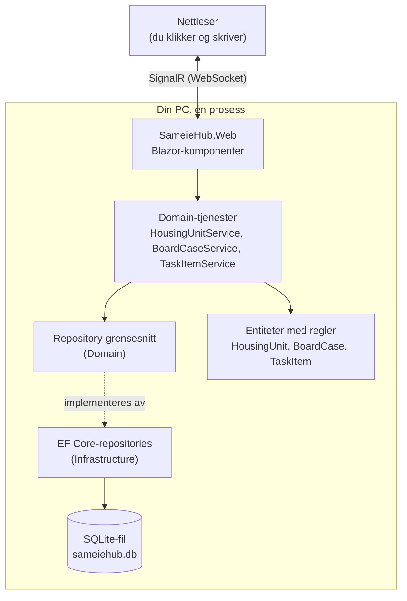
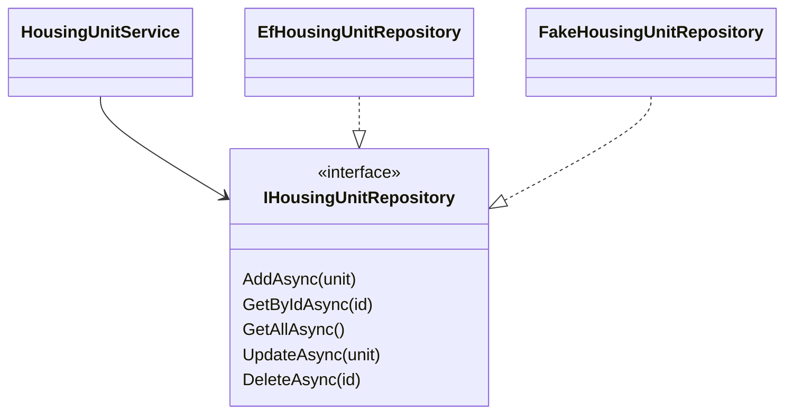
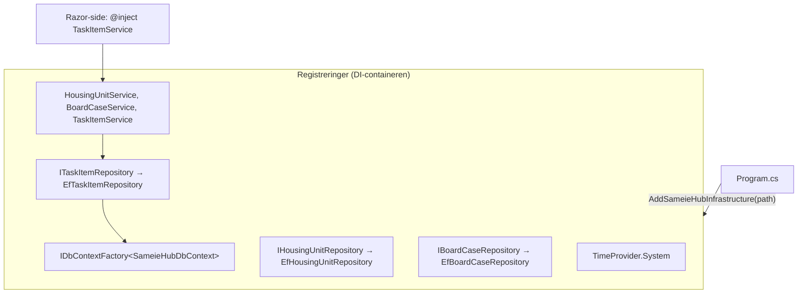
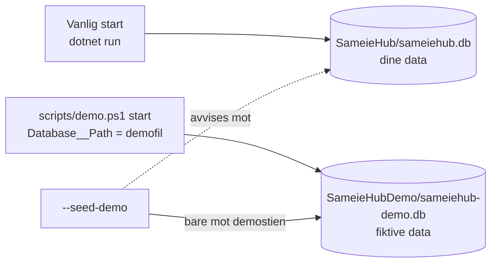

# Arkitekturen forklart

Dette dokumentet forklarer hvordan SameieHub er bygd, fra bunnen av, med konkrete eksempler fra koden. Mappestrukturen står i [PROJECT_STRUCTURE.md](PROJECT_STRUCTURE.md), kodedetaljer i [CODE_WALKTHROUGH.md](CODE_WALKTHROUGH.md), og begrunnelsene i [DESIGN_DECISIONS.md](DESIGN_DECISIONS.md). Den korte, historiske arkitekturdokumentasjonen som ble skrevet underveis ligger i [ARCHITECTURE.md](ARCHITECTURE.md) og er ikke endret.

Elbillading finnes som domenelag (M4E-A) og lagring (M4E-B), men uten brukergrensesnitt. Eksemplene her bruker boenheter, styresaker og oppgaver, som er ferdige gjennom alle lag. Elbilladelagringen følger de samme mønstrene og er beskrevet i [ARCHITECTURE.md](ARCHITECTURE.md), avsnittet «Elbillading: lagring (M4E-B)».

## 1. Det store bildet

SameieHub er ett .NET-program som kjører lokalt på PC-en din. Du åpner det i nettleseren, men serveren og databasen ligger på samme maskin. Det finnes ingen egen API-server og ingen sky.



## 2. Blazor Interactive Server

Blazor lar deg skrive nettsider i C# (`.razor`-filer) i stedet for JavaScript. Med **Interactive Server** kjører komponentene på serveren. Nettleseren har en åpen tilkobling (SignalR) til serveren. Når du klikker en knapp, sendes klikket til serveren, C#-koden kjører der, og serveren sender de små endringene i HTML-en tilbake.

Konsekvenser som er viktige å forstå:

- **Koden kan snakke direkte med tjenestene og databasen**, fordi den kjører på serveren. Ingen REST-API er nødvendig. (CLAUDE.md sier eksplisitt «ingen separat API».)
- **Hver åpen nettleserfane er en «krets» (circuit)** med egen DI-«scope». Tjenester registrert som `AddScoped` lever like lenge som kretsen.
- **Prerendering er slått av** i `Components/App.razor` (`new InteractiveServerRenderMode(prerender: false)`). Ellers ville sidene hentet data to ganger: én gang ved første serverrendering og én gang når den levende kretsen startet.
- Hvis forbindelsen brytes, viser `ReconnectModal` en melding.

## 3. Lagdelingen og ansvar

| Lag | Prosjekt | Ansvar | Kjenner til |
|---|---|---|---|
| Presentasjon | `SameieHub.Web` | Vise sider, lese skjema, vise norske meldinger | Domain, Infrastructure (bare i `Program.cs` for oppsett) |
| Applikasjon/forretning | `SameieHub.Domain` | Entiteter og regler, tjenester (bruksscenarier), grensesnitt | Ingenting av oss |
| Lagring | `SameieHub.Infrastructure` | EF Core, SQLite, migreringer | Domain |

Dette er en forenklet «ren arkitektur». Pilene peker alltid innover mot Domain (se diagrammet i [PROJECT_STRUCTURE.md](PROJECT_STRUCTURE.md)), og en arkitekturtest (`DependencyDirectionTests`) vokter det.

### Hvorfor ikke bare skrive databasekode i Razor-komponentene?
Det ville gått raskere i starten (`@inject SameieHubDbContext` og `context.HousingUnits.Add(...)` i skjemaet). Vi har valgt bort det av disse grunnene (kort, utdypet i [DESIGN_DECISIONS.md](DESIGN_DECISIONS.md)):

1. **Reglene ville blitt spredt og duplisert.** «Adressen må fylles ut og maks 200 tegn» ligger nå på ett sted (`HousingUnit`), og alle sider får den automatisk.
2. **Testing.** Reglene testes i millisekunder uten nettleser og database. Sidene testes med fake repositories.
3. **Utskiftbarhet.** Domain vet ikke at det finnes SQLite.
4. **Lesbarhet.** Komponenten sier *hva* som skal skje (`HousingUnitService.RegisterAsync`), ikke *hvordan* det lagres.

Prisen er flere klasser og at en enkel «lagre»-handling går gjennom flere ledd.

## 4. Domenemodeller (entiteter)

En entitet er en klasse som representerer noe med identitet, for eksempel `HousingUnit` (har en `Id`). Viktige trekk, vist med `HousingUnit` og `TaskItem`:

- `private set`: ingen kan endre egenskapene utenfra. Endring skjer via metoder som validerer (`UpdateDetails`, `ChangeStatus`).
- **Konstruktøren validerer**, så et ugyldig objekt kan ikke opprettes.
- **`Details`-records** (`HousingUnitDetails`, `TaskItemDetails`) samler de redigerbare verdiene. Skjemaet bygger en record og sender den inn. Dette skiller «det brukeren skrev» fra «tilstanden til entiteten».
- **Alt eller ingenting:** `UpdateDetails` validerer alle verdier først og tilordner først deretter, slik at en feil aldri gir et halvt oppdatert objekt.

## 5. Services

En tjeneste (f.eks. `TaskItemService`) er et bruksscenario: «registrer en oppgave», «fullfør en oppgave». Den:

- henter det den trenger via repository-grensesnitt,
- ber entiteten om å gjøre selve regelsjekken og endringen,
- lagrer via repositoryet,
- kaster forståelige unntak (`KeyNotFoundException` hvis noe ikke finnes).

Tjenesten inneholder regler som krysser flere objekter. Eksempel: `TaskItemService` sjekker at en ny boenhetskobling peker på en **aktiv** boenhet, noe en enkelt `TaskItem` ikke kan vite selv.

## 6. Interfaces og repositories

Et **grensesnitt** (`interface`) er en kontrakt: «dette kan gjøres», uten å si hvordan. `IHousingUnitRepository` sier at man kan `AddAsync`, `GetByIdAsync`, `GetAllAsync`, `UpdateAsync` og `DeleteAsync`. Domain eier kontrakten. Infrastructure leverer en implementasjon (`EfHousingUnitRepository`), og testene leverer en annen (`FakeHousingUnitRepository`, som bare bruker en `Dictionary` i minnet).



Dette er «Repository Pattern». CLAUDE.md sier at mønsteret bare skal brukes når det gir konkret nytte. Nytten her er tydelig: fake repositories gjør tjeneste- og UI-testene raske og deterministiske.

## 7. EF Core, SQLite, DbContext og DbContextFactory

- **SQLite** er en database som er en enkelt fil. Ingen databaseserver å installere. Passer til et lokalt program med én bruker.
- **EF Core** er en O/R-mapper: den oversetter mellom C#-objekter og tabellrader og genererer SQL.
- **`SameieHubDbContext`** er «inngangen» til databasen. `DbSet<HousingUnit>` representerer tabellen. `OnModelCreating` beskriver detaljer koden alene ikke uttrykker (fremmednøkler, enum som tekst, UTC-konvertering).
- **`IDbContextFactory`**: i Blazor Server lever en krets lenge, og en `DbContext` er ikke trådsikker og er ment å være kortlivet. Derfor lager hvert repository-kall en ny `DbContext` med `await using var context = await _contextFactory.CreateDbContextAsync();` og kaster den etter kallet. Fordelen er at det ikke samles «spøkelsesdata» i en lenge levende kontekst, og at to samtidige handlinger ikke deler en kontekst. Ulempen er at objekter fra en kontekst er «frakoblet» (derfor `AsNoTracking()` ved lesing og `Update(...)` ved lagring av frakoblede objekter).
- **Tilkoblingsstreng:** `Data Source=<sti>;Foreign Keys=True`. SQLite håndhever ikke fremmednøkler uten denne.

## 8. Dependency Injection (DI)

DI betyr at en klasse ikke lager sine egne avhengigheter, men får dem utlevert. `TaskItemService` har en konstruktør som ber om `ITaskItemRepository`, `IHousingUnitRepository`, `IBoardCaseRepository` og `TimeProvider`. Hvem som leverer, bestemmes **ett sted**: `Program.cs` og `ServiceCollectionExtensions`.



Levetider i `Program.cs`: tjenester og repositories er **scoped** (én per krets), `TimeProvider` er **singleton**, og `DbContextFactory` er (som standard i EF Core) singleton. I testene bytter vi bare registreringene: `UiTestBase` registrerer fake repositories og en `ManualTimeProvider`, mens `SqliteTestDatabase` registrerer ekte EF-repositories mot en temp-fil.

`TimeProvider` er verdt å merke seg: tjenestene spør `TimeProvider` om tiden i stedet for å bruke `DateTime.UtcNow`. Da kan testene «flytte klokken».

## 9. Migreringer

En migrering er en versjonert beskrivelse av hvordan databaseskjemaet endres. Når du endrer en entitet og kjører `dotnet ef migrations add Navn`, sammenligner EF den nye modellen med `SameieHubDbContextModelSnapshot` og skriver en ny fil med `Up`/`Down`.

Ved oppstart kjører `MigrateSameieHubDatabaseAsync()` alle migreringer som mangler. Den som starter programmet første gang får altså en ferdig database, og en gammel database oppgraderes uten å miste data. Vi bruker aldri `EnsureCreated()`, fordi det ikke kan oppgradere et eksisterende skjema. Oppgraderingstester (`TaskItemMigrationTests`, `BoardCaseMigrationTests`) migrerer til en eldre versjon, legger inn data og migrerer videre, for å bevise at data bevares.

## 10. Fremmednøkler og `RESTRICT`

`BoardCase.HousingUnitId` og begge koblingene på `TaskItem` er ekte fremmednøkler med `DeleteBehavior.Restrict`. Det betyr at databasen **nekter** å slette en boenhet som har styresaker eller oppgaver, i stedet for å slette dem også (cascade) eller nullstille koblingen. Det er valgt for å unngå at data forsvinner stille.

Når SQLite nekter, kaster EF en `DbUpdateException`. `EfHousingUnitRepository.DeleteAsync` fanger den når `SqliteConstraintErrors.IsForeignKeyViolation` sier at det er et fremmednøkkelbrudd, og kaster `HousingUnitInUseException`. Siden viser da «kan ikke slettes fordi den er knyttet til …». Det er målt (ikke antatt) at SQLite melder `RESTRICT` ved sletting som utvidet kode 1811 og manglende referanse ved lagring som 787.

## 11. Validering og feilhåndtering

Validering skjer på tre nivåer, og hvert nivå har sitt ansvar:

| Nivå | Hva | Eksempel |
|---|---|---|
| Skjema (Web) | Bare «obligatorisk» for tittel/adresse, via `[Required]` i `…FormModel`, og at en dato kan tolkes. | «Tittelen må fylles ut.» |
| Domain | Alle reelle regler: lengder, tallområder, gyldige verdier. Kaster `ArgumentException` med `ParamName` lik egenskapsnavnet. | `TaskItem` med frist før år 2000 |
| Database | Siste sikkerhetsnett: `NOT NULL`, fremmednøkler. | `Restrict` |

Kjeden for en feil: Domain kaster `ArgumentException("…", "DueDate")` → skjemaet (`TaskForm`) fanger den, slår opp `TaskFieldMessages["DueDate"]` og viser en norsk melding **ved riktig felt**. Ukjente feil (databasen er utilgjengelig) fanges av en generell `catch (Exception)` som logger **uten brukerens tekst** og viser «Kunne ikke lagre …».

`try/catch` brukes bare der feilen faktisk kan håndteres (CLAUDE.md), og aldri som tom `catch`.

## 12. Tid: UTC og norsk kalenderdato

- **Tidspunkt lagres i UTC** (`CreatedAt`, `UpdatedAt`, `CompletedAt`). UTC har ingen sommertid og er entydig.
- **SQLite mister tidssoneinformasjonen** og EF leser verdiene tilbake som `DateTimeKind.Unspecified`. Derfor har `SameieHubDbContext` en `UtcDateTimeConverter` som markerer dem som UTC igjen ved lesing.
- **Vist tid er norsk tid:** `NorwegianDateFormat.DateTime(utc)` i Web bruker `NorwegianTime.FromUtc`.
- **Datoer uten klokkeslett** (`DueDate`, `MeetingDate`, `DecisionDate`) er `DateOnly` og lagres som `yyyy-MM-dd`.
- **«I dag» er norsk dato**, ikke UTC-dato: `NorwegianTime.DateOf(...)`. Mellom 00:00 og 01:00/02:00 norsk tid er UTC-datoen en dag bak. En test (`Render_NearMidnight_UsesTheNorwegianDate`) viser at en oppgave med frist «i går» regnes som forfalt kl. 00:30 norsk tid selv om UTC-datoen fortsatt er i går.
- **«Forfalt» lagres aldri.** Det beregnes (`TaskItem.IsOverdue(today)`), slik at det alltid stemmer.

## 13. Fra klikk til database og tilbake

Eksempel: du trykker «Registrer oppgave» på `/oppgaver/ny`.

```mermaid
sequenceDiagram
    actor Bruker
    participant Form as TaskForm.razor
    participant Create as TaskCreate.razor
    participant Svc as TaskItemService
    participant Ent as TaskItem
    participant Repo as EfTaskItemRepository
    participant Db as SQLite

    Bruker->>Form: Trykker «Registrer oppgave»
    Form->>Form: Validerer [Required] (tittel)
    Form->>Create: OnSave(TaskItemDetails)
    Create->>Svc: RegisterAsync(details)
    Svc->>Svc: Sjekker at boenhet er aktiv og styresak finnes
    Svc->>Ent: new TaskItem(details, nå i UTC)
    Ent-->>Svc: ArgumentException hvis ugyldig
    Svc->>Repo: AddAsync(task)
    Repo->>Db: INSERT (ny DbContext, SaveChanges)
    Db-->>Repo: ny Id
    Repo-->>Svc: task.Id er satt
    Svc-->>Create: task
    Create->>Bruker: NavigateTo(/oppgaver/{id}?status=opprettet)
    Note over Form: Ved ArgumentException: feilmelding ved feltet
```

Tilbake (visning av oppgaven): `TaskDetail` kaller `TaskItemService.GetByIdAsync(id)` → `EfTaskItemRepository.GetByIdAsync` (ny `DbContext`, `AsNoTracking`) → `TaskItem` → siden viser feltene, med `NorwegianDateFormat` for tider og `TaskDueDate` for forfalt/frist i dag.

## 14. Testing

Testene følger lagene (se tabellen i [PROJECT_STRUCTURE.md](PROJECT_STRUCTURE.md)):

| Type | Verktøy | Hva som er ekte |
|---|---|---|
| Enhetstester (Domain) | xUnit + fake repositories | Entiteter og tjenester. Ingen database. |
| Integrasjonstester (Infrastructure) | xUnit + SQLite-fil | Ekte migreringer og ekte SQLite. Aldri EF InMemory, fordi den ikke håndhever fremmednøkler. |
| Komponenttester (Web) | bUnit + fakes | Razor-komponenter rendres i minnet uten nettleser. |
| Arkitekturtest | xUnit + refleksjon | At Domain ikke refererer EF/ASP.NET. |
| Nettleser | Manuelt (AI-agenten styrte en nettleser) | Hele stakken mot en isolert temp-database. Dokumentert i [TESTING.md](TESTING.md). |

**Test doubles:** en *fake* er en enkel, fungerende erstatning (`FakeTaskItemRepository` lagrer i en dictionary). Noen fakes kan simulere feil (`IsFailing` kaster `IOException` for å teste feilmeldinger). `ManualTimeProvider` er en klokke som bare går når testen sier det. Vi bruker ikke et mock-bibliotek.

**TDD:** for forretningslogikk skrives testen først og kjøres for å se den feile av riktig grunn, før koden skrives (CLAUDE.md). I dokumentasjonen står det der dette ikke var mulig (for eksempel kompileringsfeil som «rød fase»).

## 15. Demo kontra ordinær database

Appen bruker alltid den databasefilen `Database:Path` peker på, ellers `%LOCALAPPDATA%\SameieHub\sameiehub.db`. Demoen er en **egen fil** (`%LOCALAPPDATA%\SameieHubDemo\sameiehub-demo.db`).



Sikkerhetsreglene (alle testet i `DemoDatabaseSeederTests`): seeding kjører bare hvis stien er nøyaktig demostien (normalisert), bare mot en tom database eller en komplett demo (ingen endring), en delvis opprettet demo gir feil, og `reset` nekter å slette en demo som kjører. Vanlig oppstart seeder aldri. Detaljer: [DEMO.md](DEMO.md).

## 16. Hva som mangler (ærlig status)

- Elbillading: domenelag (M4E-A) og lagring (M4E-B) finnes med tester. Sider (M4E-C) og demodata (M4E-D) gjenstår.
- Backup/gjenoppretting og pakking for kjøring uten .NET SDK (M5) er ikke laget, selv om det er et krav for v1.0.
- Ingen endringshistorikk: `UpdatedAt` viser bare *når*, ikke *hva* som ble endret.
