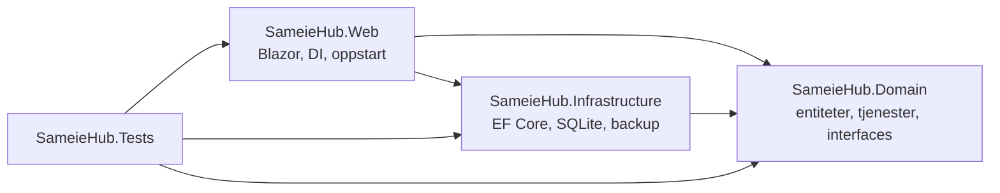
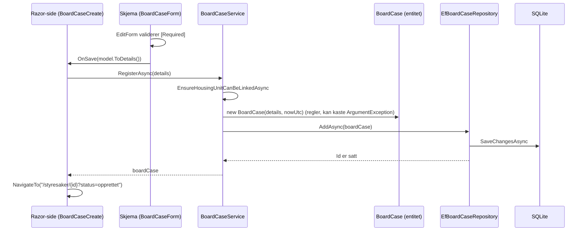

# Møtemodulen: arkitekturen som finnes, og hvor en ny modul kobles inn

Dette beskriver **faktisk kode** på commit `eb1e1f1`. Det er ikke en design av møtemodulen. Funksjonelle valg tas av prosjekteieren (se [MEETING_MODULE_IMPLEMENTATION_PLAN.md](MEETING_MODULE_IMPLEMENTATION_PLAN.md), «Åpne beslutninger»). Filreferanser: [MEETING_MODULE_REFERENCE.md](MEETING_MODULE_REFERENCE.md).

**Prinsipp:** ingen nye arkitekturmønstre uten behov. Møtemodulen skal se ut som resten av programmet.

## 1. Fire prosjekter

| Prosjekt | Innhold | Får ikke |
|---|---|---|
| `Domain` | Entiteter, `…Details`, enums, **tjenester**, repository-interfaces, forretningsregler | referere EF Core, SQLite, ASP.NET eller Blazor (testet) |
| `Infrastructure` | `SameieHubDbContext`, `Ef…Repository`, migreringer, backup/restore, demo | referere `Web` (testet) |
| `Web` | Razor-sider og komponenter, `Hosting/` (oppstart, Windows-modus), DI | inneholde forretningsregler |
| `Tests` | xUnit, fake repositories, SQLite-tester, bUnit | |

Avhengighetene går innover: domenet vet ikke hvem som bruker det.

## 2. Dataflyten, fra klikk til disk

Feil går motsatt vei: domenet kaster `ArgumentException` med `ParamName` = egenskapsnavnet → `BoardCaseForm.SaveAsync` fanger den og viser `BoardCaseFieldMessages`-meldingen ved feltet. `InvalidOperationException` brukes for regler om tilstand (f.eks. vedtatt uten vedtak), `KeyNotFoundException` for «finnes ikke», og egne `…InUseException` ved slettevern.

### 2.1 Blazor-side

- Kjører **på serveren** (Interactive Server). Klikk sendes over en forbindelse til serveren, som oppdaterer siden. Ingen prerender (`App.razor`).
- Standardmønster for en side: `_isLoading`, `_loadError`, `LoadAsync` med `try/catch`, `Logger.LogError` uten skjemaverdier, tom-tilstand, «Finner ikke»-visning.
- Skjemaet (`BoardCaseForm`) er en egen komponent som får `OnSave` som delegat, og vern mot dobbel innsending (`_isSaving`).
- Detaljsiden bruker `RunActionAsync` (vern mot dobbeltklikk, norske meldinger).
- UI-teksten er norsk, koden engelsk. Oversettelser ligger i `…Text.cs`.

### 2.2 Tjeneste (domene)

Tjenesten har **brukstilfellene** og regler som trenger flere kilder (finnes boenheten? er den aktiv?). Regler om en enkelt entitet hører hjemme **i entiteten**. Tjenesten får `TimeProvider` slik at tid kan styres i tester, og lagrer alltid UTC.

### 2.3 Repository

Interfacet i `Domain` beskriver det domenet trenger. `Ef…Repository` implementerer det. Hver metode bruker sin egen `DbContext` fra `IDbContextFactory` (Blazor Server har lange forbindelser; en delt kontekst ville blitt stående). `AsNoTracking` ved lesing; `Update` ved lagring lagrer alle verdier.

**Konsekvens for møter:** entitetene har **ingen navigasjonsegenskaper eller samlinger**. Koblinger er bare id-er (`HousingUnitId`, `BoardCaseId`), og fremmednøkkelen konfigureres med `HasOne<T>().WithMany()` uten egenskap. Trenger et møte agendapunkter, bør de trolig bli en **egen entitet med `MeetingId`** (egen tabell og eget repository eller egne metoder), og ikke en `List<AgendaItem>` inne i `Meeting`. Lagres flere ting i ett, bruk en transaksjon (`AddWithMainMeterAsync`-mønsteret). Endres dette valget, må det begrunnes (se `DESIGN_DECISIONS.md`).

### 2.4 EF Core og SQLite

- Skjemaet lages **bare av migreringer**. De anvendes automatisk ved oppstart (`MigrateSameieHubDatabaseAsync`, og `DatabaseUpgrader` i Windows-versjonen, med kopi først).
- `enum` lagres som tekst (`HasConversion<string>()`), `DateTime` som UTC (`UtcDateTimeConverter`), `DateOnly` som tekst `yyyy-MM-dd`, `decimal` som tekst.
- Fremmednøkler er `DeleteBehavior.Restrict` (aldri cascade). `Foreign Keys=True` i tilkoblingsstrengen.
- Lengdekontroll skjer i domenet, ikke i databasen. CHECK-regler brukes der databasen selv må vokte (elbillading).

## 3. Dependency Injection

| Registreres | Hvor | Levetid |
|---|---|---|
| Repositories, `IDbContextFactory`, backup, restore | `ServiceCollectionExtensions.AddSameieHubInfrastructure` | repositories `Scoped`, resten `Singleton` |
| Tjenester (`…Service`), `TimeProvider.System`, Blazor | `Hosting/WebAppSetup.AddServices` | tjenester `Scoped` |
| Samme tjenester i tester | `SqliteTestDatabase.BuildProvider` og `UiTestBase` | |

**Ny tjeneste må registreres tre steder** (app, SQLite-test, bUnit-test). `Scoped` i Blazor Server betyr «en per brukerforbindelse».

## 4. Sikkerhet og Windows-modus

- Alle nye sider og kall beskyttes automatisk av tilgangsvakten i Windows-modus (`AccessGuardMiddleware` står først). Det er ikke noe å gjøre for en ny side.
- Kjent begrensning: en åpen forbindelse beholder tilgang etter at sesjonen utløper (`WINDOWS_ACCEPTANCE_REPORT.md`, punkt 3). Møtemodulen endrer ikke dette.
- Utviklingsmodus har ingen innlogging.

## 5. Personopplysninger

Deltakere og referat vil inneholde navn og meninger. Regler fra `CLAUDE.md` gjelder: bare i lokal database; **aldri i logger, tester, seed-data eller commits**. Logg unntakstype, ikke innhold (slik `BoardCaseForm` gjør). Testdata må være tydelig fiktive. Databasen er ikke kryptert, og sikkerhetskopien inneholder alt.

## 6. Slik kobles en ny entitet inn (sjekkliste)

Rekkefølgen er domene først. Hvert punkt peker på forbildet.

1. **Domain:** entitet (`BoardCase.cs`), `…Details` (`BoardCaseDetails.cs`), enums, regler og tester.
2. **Domain:** repository-interface (`IBoardCaseRepository.cs`), eventuell `…InUseException`.
3. **Domain:** tjeneste (`BoardCaseService.cs`) og tester med fake (`FakeBoardCaseRepository.cs`).
4. **Infrastructure:** `DbSet` og `Configure…` i `SameieHubDbContext.cs`.
5. **Infrastructure:** `Ef…Repository.cs`, registrer i `ServiceCollectionExtensions.cs`.
6. **Migrering:** `dotnet ef migrations add …`; les filen (spesielt `onDelete`), og lag migreringstest.
7. **Web:** registrer tjenesten i `WebAppSetup.cs`; legg til i `SqliteTestDatabase` og `UiTestBase`.
8. **Web:** mappe `Components/Pages/Meetings/` med liste, opprett, detalj, rediger, skjema, skjemamodell, feltmeldinger, tekster.
9. **Navigasjon:** `NavMenu.razor` (kun hvis godkjent) og `NavigationConsistencyTests`.
10. **Tverrgående, bevisst valg for hver:**
    - `BackupContentSummary` og sammenligningstabellen på `BackupPage.razor` (viser antall møter?).
    - `DatabaseTestFiles.SnapshotAsync` og `DatabaseTestData.FillAllModulesAsync` (nye tabeller skal dekkes av backup- og restoretestene).
    - `DashboardOverview` og `Dashboard.razor` (kommende møter).
    - `DemoDatabaseSeeder` (demoinnhold, kan vente).
    - Testene og tekstene som i dag sier at SameieHub **ikke** holder styr på møter (se referansen, del 4).
    - Brukerveiledningen og `UI_DESIGN.md`, `ARCHITECTURE.md`, `TESTING.md`.

### Hva som skjer automatisk

- Sikkerhetskopien er hele databasefilen, så nye tabeller er med.
- Gamle sikkerhetskopier blir «Older» ved gjenoppretting og oppgraderes (testes allerede generelt; legg til en test med møtetabellene).
- Windows-versjonen lager kopi i `pre-migration` før en ny migrering.
- Tilgangsvakten dekker nye sider.

## 7. Den ene tingen å tenke ekstra på: dagens «møtedato» og «vedtak»

`BoardCase` har allerede `MeetingDate` («Registrert møtedato»), `Decision` og `DecisionDate`. Dashbordet viser `MeetingDate` som «Kommende saker med møtedato», og tekster sier uttrykkelig at det ikke er et bekreftet møte. En møteentitet **dupliserer** noe av dette hvis det ikke tenkes gjennom: hvem er sannheten for datoen, og hvor lagres et vedtak fattet i et møte? Det må avgjøres **før** datamodellen låses, og eventuelle eksisterende data må migreres uten tap. Se åpne beslutninger i implementasjonsplanen.
