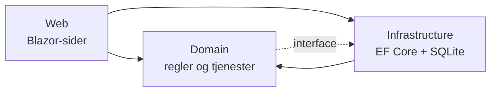

# Presentasjonsguide

En kort guide til å presentere SameieHub for lærere på Kodehode (og eventuelt arbeidsgivere), med øvingsspørsmål og forslag til svar. Svarene er skrevet ut fra den faktiske koden og dokumentasjonen. **Les dem, og omformuler med egne ord.** Det er bedre å si «det vet jeg ikke helt, men jeg tror …» enn å gjenta et svar du ikke forstår. Der svaret avhenger av hva *du* har gjort eller ment, står **«Må bekreftes av prosjekteier»**.

Bakgrunn: [ARCHITECTURE_EXPLAINED.md](ARCHITECTURE_EXPLAINED.md), [CODE_WALKTHROUGH.md](CODE_WALKTHROUGH.md), [DESIGN_DECISIONS.md](DESIGN_DECISIONS.md), [MY_CONTRIBUTIONS.md](MY_CONTRIBUTIONS.md), [DEMO.md](DEMO.md).

## 1. Kort introduksjon (30 sekunder)

> SameieHub er et lokalt administrasjonsprogram for et lite sameie med tomannsboliger. Det samler boenheter og eiere, styresaker med vedtak, og oppgaver og vedlikehold med frister, og viser det på et dashboard. Det er bygget med C#, .NET 10, Blazor og SQLite. Jeg har brukt en AI-agent til å skrive koden, styrt gjennom milepæler som jeg definerte og godkjente.

## 2. Problemet SameieHub løser

- Et lite sameie trenger oversikt over **hvem som eier hva**, **hvilke saker styret behandler og hva som ble vedtatt**, og **hva som skal gjøres og når**.
- Programmet er lokalt, uten innlogging og sky, fordi dataene inneholder personopplysninger og brukeren er én person (styret).
- Elbillading (hovedmåler og undermålere, avstemming) har domene, lagring og sider; demodata mangler (M4E-D).
- **Må bekreftes av prosjekteier:** hvordan problemet løses i dag, og hvorfor akkurat dette trengs.

## 3. Hvordan arkitekturen fungerer (to minutter)

Tegn eller vis dette (fra [ARCHITECTURE_EXPLAINED.md](ARCHITECTURE_EXPLAINED.md)):



Si det slik:
1. **Domain** inneholder reglene (`HousingUnit`, `TaskItem` …) og tjenestene (`TaskItemService`). Den vet ingenting om database eller nettleser.
2. **Infrastructure** lagrer i SQLite med EF Core. Den implementerer grensesnittene Domain definerer (`IHousingUnitRepository` → `EfHousingUnitRepository`).
3. **Web** viser sidene. Den kaller tjenestene via Dependency Injection.
4. En arkitekturtest (`DependencyDirectionTests`) sørger for at Domain aldri begynner å bruke EF Core eller Blazor.

## 4. Hva du bør demonstrere (5–8 minutter)

Bruk demoen (den vanlige databasen din berøres ikke):

```powershell
.\scripts\demo.ps1 create
.\scripts\demo.ps1 start
```
Åpne http://localhost:5100. Forslag til rekkefølge:

1. **Dashboard:** statistikkort, oppfølgingslisten (forfalt, frist i dag), kommende møter. Klikk «Forfalte oppgaver» (åpner filtrert liste).
2. **Boenheter:** åtte boenheter, åpne en med to eiere. Vis at elbillader og carport står i *merknader* (og forklar at en egen elbilladermodul er planlagt, men bare domenelaget og lagringen er laget, ikke sidene).
3. **Styresaker:** en vedtatt sak med vedtaksdato, og oppgavene som hører til.
4. **Oppgaver:** søk («Ola Eksempel»), filter, sortering. Marker en forfalt oppgave som fullført og gå tilbake til dashboardet: tallet endres («Oppdater oversikten»).
5. **Sikker sletting:** prøv å slette en boenhet som har oppgaver. Vis meldingen, og forklar `RESTRICT`.
6. **Mobil:** gjør nettleservinduet smalt (375 px).
7. **Kode (2 minutter):** åpne `TaskItem.cs` (`IsOverdue`, `ChangeStatus`) og en test (`TaskItemTests`), og vis `dotnet test`.

Hvis noe går galt i demoen: `.\scripts\demo.ps1 reset` (stopp appen først).

## 5. Hvorfor teknologistakken

Se [DESIGN_DECISIONS.md](DESIGN_DECISIONS.md). Kort:
- **C#/.NET 10:** stakken ble definert i prosjektbeskrivelsen. **Må bekreftes av prosjekteier** om det var kursets krav.
- **Blazor Interactive Server:** én lokal prosess, ingen API, direkte tilgang til tjenestene (dokumentert i `ARCHITECTURE.md`; WPF og WebAssembly var alternativene).
- **SQLite + EF Core:** én fil, ingen server, ekte fremmednøkler og migreringer.
- **xUnit og bUnit:** raske tester av regler og komponenter, ekte SQLite for lagringstester.

## 6. Hvordan jeg bruker og kontrollerer AI-agenter

- Agenten får **ett milepælsoppdrag av gangen** med tydelige krav og forbud (ingen nye prosjekter eller pakker uten godkjenning, personvernregler, kodestil).
- Den må **vise bevis**: build, test, CI, kontrollrapport og forklaringer.
- Jeg **godkjenner eksplisitt** før neste milepæl.
- Regler i `CLAUDE.md` gjelder hver økt (test først for forretningslogikk, enkel kode, ingen personopplysninger i logger).
- Jeg har bedt om endringer når noe var feil eller uklart (for eksempel to svakheter i demo-seeding).
- **Ærlig:** AI-agenten har skrevet koden. Min rolle er krav, prioritering, godkjenning og at jeg lærer å forklare det. **Må bekreftes av prosjekteier:** nøyaktig hvordan jeg kontrollerer resultatene i praksis.

## 7. Hva jeg selv har bidratt med

Se [MY_CONTRIBUTIONS.md](MY_CONTRIBUTIONS.md) (roller for deg, ChatGPT og Claude Code, arkitekturbidrag og læringsmål). Kort: krav og avgrensninger, milepælsplan, godkjenninger, tilbakemeldinger som endret produktet (to eiere, sikker sletting, demo-sikkerhet, målermodellen), og regler for personvern og kodestil.

## 8. Hva jeg har lært (skriv med egne ord)

Forslag til punkter, **må bekreftes av prosjekteier:** lagdeling og Dependency Injection; hvorfor domeneregler ikke hører hjemme i UI; EF Core og migreringer; fremmednøkler; UTC og norsk dato; testing med fakes og ekte SQLite; hvordan man styrer og kontrollerer en AI-agent.

## 9. Planlagt videreutvikling

- Elbillading ferdig: database og migrering (M4E-B), UI med samlet registrering av hovedmåler og åtte undermålere og avstemming (M4E-C), demodata (M4E-D). Domenelaget og lagringen finnes i dag (M4E-A og M4E-B).
- Backup/gjenoppretting og pakking uten .NET SDK (M5): obligatorisk før v1.0.
- Mulige senere ideer: integrasjon mot ladeleverandør, endringshistorikk.

## 10. Spørsmål og forslag til svar

### 1. Hva er forskjellen på en `class` og en `record`, og hvorfor bruker dere begge?
En `class` brukes for objekter med identitet og atferd (`HousingUnit` har en `Id` og regler). En `record` er for «bare verdier»: to records med samme innhold er like. Vi bruker `record` til `TaskItemDetails`, `MeterReadingDetails` osv., slik at skjemaet kan sende en samlet pakke med verdier til tjenesten, og `with` kan lage en endret kopi. Entiteter er `class`, fordi to oppgaver med lik tittel fortsatt er to forskjellige oppgaver.

### 2. Hvorfor har egenskapene `private set`?
For at ingen utenfra kan sette objektet i en ugyldig tilstand. Skal `Address` endres, må man gå via `ChangeAddress` eller `UpdateDetails`, som validerer. Hvis alt var `{ get; set; }`, kunne en side sette en tom adresse uten å gå gjennom reglene.

### 3. Hva er et interface, og hvorfor trenger `HousingUnitService` et?
`IHousingUnitRepository` er en kontrakt: hvilke lagringsoperasjoner som finnes, uten implementasjon. Tjenesten bruker bare kontrakten. I appen leveres `EfHousingUnitRepository` (SQLite), i testene `FakeHousingUnitRepository` (en `Dictionary`). Det gir raske tester uten database og holder EF Core utenfor Domain.

### 4. Forklar Dependency Injection med et eksempel fra prosjektet.
`TaskItemService` har en konstruktør som ber om `ITaskItemRepository`, `IHousingUnitRepository`, `IBoardCaseRepository` og `TimeProvider`. Den lager dem ikke selv. I `Program.cs` og `ServiceCollectionExtensions` registrerer vi hvilke implementasjoner som skal brukes (`AddScoped<ITaskItemRepository, EfTaskItemRepository>()`). Når en Razor-side ber om `TaskItemService` med `@inject`, bygger DI-containeren hele kjeden. I testene registrerer vi fakes i stedet.

### 5. Hvorfor `IDbContextFactory` og ikke bare å injisere `DbContext`?
I Blazor Server lever en «krets» (en åpen nettleserfane) lenge, og en scoped `DbContext` ville levd like lenge. Det gir utdaterte data og problemer ved samtidige operasjoner. Med factory lager hver repository-metode en ny, kortlevd kontekst. Prisen er at objektene er frakoblet, så vi bruker `AsNoTracking()` ved lesing og `Update(...)` ved lagring. Dette er en dokumentert beslutning i `ARCHITECTURE.md`.

### 6. Hva er en migrering, og hva skjer hvis dere endrer en gammel?
En migrering er en versjonert, kodet beskrivelse av en skjemaendring (`Up`/`Down`). EF sammenligner modellen med `SameieHubDbContextModelSnapshot` og genererer neste. Ved oppstart kjører `MigrateAsync()` alle som mangler. En allerede kjørt migrering skal aldri endres: databaser som har kjørt den vil ikke kjøre den på nytt, og skjemaene vil divergere. Endringer gjøres med en ny migrering. Vi har oppgraderingstester som migrerer til en eldre versjon, setter inn data og migrerer videre.

### 7. Hvorfor SQLite og ikke SQL Server?
Det er et lokalt program for én bruker. SQLite er én fil, ingen server å installere, og enkel å sikkerhetskopiere. Vi får likevel ekte fremmednøkler og migreringer. Begrensninger vi har støtt på: fremmednøkler må slås på (`Foreign Keys=True`), `DateTime` lagres uten tidssone, og `decimal` lagres som tekst. SQL Server ville vært riktig for flere samtidige brukere.

### 8. Hva er forskjellen på `Restrict` og `Cascade`, og hvorfor valgte dere `Restrict`?
`Cascade` ville slettet oppgaver og styresaker automatisk når boenheten slettes. `Restrict` nekter sletting så lenge noe peker på raden. Vi vil aldri miste data stille, så databasen nekter, repositoryet oversetter feilen til `HousingUnitInUseException`, og brukeren får en melding om å fjerne koblingene først.

### 9. Hvordan vet dere at en SQLite-feil faktisk er et fremmednøkkelbrudd?
Vi sjekker SQLites utvidede feilkode, ikke meldingsteksten: 787 ved lagring med ugyldig referanse og 1811 ved sletting med `RESTRICT`. Koden 1811 deles av alle triggere, så vi sjekker også at meldingen nevner FOREIGN KEY. Det ble avdekket med en test med en egendefinert trigger, som først ble feiltolket som «i bruk». (`SqliteConstraintErrors`, `TaskItemRelationTests`).

### 10. Hvor skjer valideringen, og hvorfor ikke i skjemaet?
Reglene ligger i Domain (`HousingUnit`, `TaskItem`): lengder, områder, gyldig e-post. Skjemaet sjekker bare «obligatorisk» med `[Required]`. Da gjelder reglene uansett hvilken side eller test som lager data. Domain kaster `ArgumentException` med `ParamName` lik feltnavnet, og skjemaet slår opp en norsk melding og viser den ved riktig felt.

### 11. Hva betyr «alt eller ingenting» i `UpdateDetails`?
Metoden validerer alle verdier først, og tilordner egenskapene først etterpå. Hvis én verdi er ugyldig, kastes en feil før noe er endret, så objektet aldri blir halvt oppdatert. Det er testet («ugyldig verdi endrer ingenting»).

### 12. Hvorfor lagrer dere tid i UTC, og hvordan beregnes «forfalt»?
UTC er entydig uten sommertid. Visning og «i dag» regnes i norsk tid (`NorwegianTime`). «Forfalt» lagres aldri, men beregnes: `TaskItem.IsOverdue(today)` er sant hvis oppgaven ikke er fullført og fristen er før i dag. Fordi `today` sendes inn, kan testene prøve «dagen etter fristen». En test viser at en oppgave med frist 18. november er forfalt kl. 00:30 norsk tid 19. november, selv om UTC-dagen fortsatt er den 18.

### 13. Dere bruker ikke EF Core InMemory i testene. Hvorfor?
InMemory-leverandøren er ikke en ekte relasjonsdatabase og håndhever ikke fremmednøkler. Våre viktigste regler (sletting blokkeres, migreringer bevarer data) krever ekte SQLite, så `SqliteTestDatabase` lager en temp-fil med de ekte migreringene. Enhetstestene bruker i stedet fake repositories.

### 14. Hva er forskjellen på en fake og en mock, og hva bruker dere?
En fake er en enkel, ekte fungerende erstatning (en `Dictionary` som lagrer objekter). En mock programmeres per test og verifiserer kall. Vi bruker fakes og ingen mock-bibliotek, fordi de er lettere å lese for en nybegynner. Noen fakes kan simulere feil (`IsFailing`), og `ManualTimeProvider` er en klokke testen styrer.

### 15. Fakes lyver jo litt. Hvordan vet dere at databasekoden virker?
Riktig: en fake etterligner kontrakten, ikke SQL. Derfor har vi også integrasjonstester mot ekte SQLite for alt som avhenger av databasen: lagring og omstart, fremmednøkler, sletting, migrering fra eldre skjema og demo-seeding. I tillegg er hele appen kjørt manuelt i nettleser mot en isolert database.

### 16. Hvordan vet dere at AI-generert kode er riktig?
Ikke fordi den er generert. Kontrollene er: (1) automatiske tester, også skrevet av agenten, så testene må selv vurderes kritisk; (2) CI på en ren maskin; (3) arkitekturtest; (4) kontrollrapport og forklaring per milepæl som jeg leser; (5) manuell nettlesertest; (6) at jeg godkjenner hver milepæl; (7) at koden er skrevet enkelt nok til at en student kan lese den. **Må bekreftes av prosjekteier:** hvilke av disse du selv gjør, og hva du har funnet.

### 17. Hva har *du* gjort, og hva har agenten gjort?
Agenten skrev koden, testene og dokumentasjonen. Jeg definerte krav og avgrensninger, delte arbeidet i milepæler, godkjente eller ba om endringer, og satte reglene (personvern, kodestil, git). Eksempler på endringer jeg ba om: to eiere per boenhet, sikker sletting, trygg demo, og målermodellen for elbillading. **Må bekreftes av prosjekteier:** gjennomgå [MY_CONTRIBUTIONS.md](MY_CONTRIBUTIONS.md) og rett til det som faktisk stemmer.

### 18. Hva er svakhetene ved løsningen?
Ærlig liste: ingen backup/gjenoppretting ennå (obligatorisk før v1.0), ingen innlogging eller flere brukere, ingen endringshistorikk (`UpdatedAt` viser bare *når*), programmet antar norsk tidssone, SQLite er begrenset til én bruker, elbilladingsmodulen har ingen demodata ennå, og testantallet sier ikke alt om kvaliteten. Fire prosjekter er også mer struktur enn et så lite program strengt trenger.

### 19. Hvordan ville dere håndtert flere brukere?
Det krever innlogging og autorisasjon, en database som støtter samtidighet (for eksempel SQL Server eller PostgreSQL i stedet for SQLite), konfliktløsning ved samtidige endringer og en revisjonslogg. Fordi Domain og Infrastructure er adskilt, ville bytte av database i hovedsak berøre Infrastructure og migreringer, men innlogging og samtidighet krever også endringer i Web.

### 20. Hva ville dere gjort annerledes?
Dette må være **ditt eget svar**, basert på hva du faktisk opplevde. Ting repoet viser som du kan ta utgangspunkt i: krav som ble oppdaget underveis (to eiere, vedtaksdato, målermodellen for elbillading), at backup er et krav men ligger sist i planen, og at en tidlig arbeidsform («studentoppgaver») ble byttet ut. **Må bekreftes av prosjekteier.**

## 11. Før du presenterer: sjekkliste

- [ ] `dotnet test SameieHub.slnx` er grønn lokalt, og CI-merket i README er grønt.
- [ ] Demodatabasen er nullstilt (`.\scripts\demo.ps1 reset`) slik at datoene passer til i dag.
- [ ] Du kan forklare ett komplett forløp fra klikk til database (sekvensdiagrammet i [ARCHITECTURE_EXPLAINED.md](ARCHITECTURE_EXPLAINED.md)).
- [ ] Du har lest og rettet [MY_CONTRIBUTIONS.md](MY_CONTRIBUTIONS.md), og kan stå inne for hvert punkt.
- [ ] Du er klar over hva som **ikke** er ferdig (elbillading utover domene og lagring, backup, pakking).
