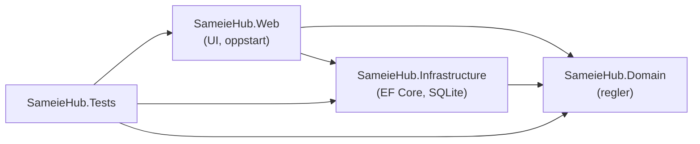

# Prosjektstruktur

Denne filen forklarer hva som ligger hvor i SameieHub, og hvorfor. Den er skrevet ut fra de faktiske filene i repoet (kontrollert mot `git ls-files`). For hvordan delene samarbeider, se [ARCHITECTURE_EXPLAINED.md](ARCHITECTURE_EXPLAINED.md). For kode, se [CODE_WALKTHROUGH.md](CODE_WALKTHROUGH.md).

**Status for elbillading:** bare domenelaget (M4E-A) finnes (klassene `EvCharger`, `Meter`, `MeterReading`, `ChargingService` med flere og tester). Databasemapping, migrering, repository-implementasjoner, brukergrensesnitt og demodata for elbillading er **ikke** laget. Det er derfor ingen elbilside i `Web`, ingen elbilladetabell i migreringene og ingen elbilladetjeneste i `Program.cs`.

## Oversikt

```
SameieHub/
├── SameieHub.slnx                  løsningsfilen (lister de fire prosjektene)
├── CLAUDE.md                       arbeidsregler for AI-agenten (Claude Code)
├── README.md                       kort introduksjon, status, kom-i-gang
├── .editorconfig                   kodestil (innrykk, namespaces, var)
├── .gitattributes / .gitignore     linjeskift og hva git ignorerer
├── dotnet-tools.json               låser verktøyet dotnet-ef til 10.0.15
├── .github/workflows/ci.yml        GitHub Actions: restore, build, test
├── docs/                           dokumentasjon (se docs/README.md)
├── scripts/demo.ps1                demokommandoer (create/start/reset/info)
├── src/
│   ├── SameieHub.Domain/           forretningsregler, uten EF/Blazor
│   ├── SameieHub.Infrastructure/   EF Core, SQLite, migreringer, demo-seeder
│   └── SameieHub.Web/              Blazor-appen: sider, oppstart, DI
└── tests/SameieHub.Tests/          xUnit- og bUnit-tester
```

Omtrentlig størrelse (linjer med C#/Razor, uten migreringer): Domain 42 filer / ca. 3 400 linjer, Infrastructure 9 / ca. 950, Web 44 / ca. 4 100, Tests 54 / ca. 14 200. Testkoden er altså omtrent like stor som all produksjonskode til sammen. 65 commits.

## Hvorfor fire prosjekter?



Pilene er `ProjectReference` i `.csproj`-filene. Retningen er viktig: **Domain kjenner ingen av de andre**. Det gir tre konkrete gevinster:

1. **Reglene kan testes uten database og uten nettleser.** `TaskItemTests` oppretter en `TaskItem` i minnet og sjekker reglene direkte.
2. **Teknologi kan byttes uten å røre reglene.** Domain har ingen pakkeavhengigheter (se `SameieHub.Domain.csproj`: bare `net10.0`, `Nullable` og `ImplicitUsings`). Infrastructure har EF Core-pakkene, Web har Blazor.
3. **Retningen vokses ikke skjev.** Testen `Architecture/DependencyDirectionTests.cs` feiler hvis Domain begynner å referere EF Core, SQLite, ASP.NET, Infrastructure eller Web, eller hvis Infrastructure refererer Web.

Ulempen er flere filer og litt mer «pynt» (grensesnitt, mapping mellom lagene) enn om alt lå i ett prosjekt. For et så lite program kunne ett prosjekt fungert. Se [DESIGN_DECISIONS.md](DESIGN_DECISIONS.md) for avveiningen.

## Rotfiler

| Fil | Hva den gjør / hvorfor | Hva skjer ved endring |
|---|---|---|
| `SameieHub.slnx` | Ny, XML-basert løsningsfil som lister de fire prosjektene. Brukes av `dotnet build/test SameieHub.slnx` og av CI. | Et prosjekt som ikke står her, bygges og testes ikke av CI. |
| `CLAUDE.md` | Prosjektregler for AI-agenten: mål, avgrensninger, kodekonvensjoner, test- og git-regler, milepælsarbeid. Les av Claude Code ved hver økt. | Endrer hvordan agenten jobber, ikke hvordan appen virker. |
| `README.md` | Første inntrykk, status, kom-i-gang, lenker til dokumentasjon. | Ingen effekt på bygg. |
| `.editorconfig` | Kodestil: UTF-8, 4 mellomrom, file-scoped namespaces (`warning`), `using` utenfor namespace, `var`-regler, klammer. | Stilbrudd vises som advarsler i editor/bygg. |
| `.gitattributes` | `* text=auto`: normaliserer linjeskift. Gir «LF will be replaced by CRLF»-meldinger på Windows. | Påvirker bare linjeskift i git. |
| `.gitignore` | Standard Visual Studio-liste pluss regler som holder databasefiler, hemmeligheter og backuper utenfor git. | Feil her kan gjøre at databasefiler havner i repoet. |
| `dotnet-tools.json` | Lokalt verktøymanifest: `dotnet-ef` 10.0.15 (`rollForward: false`). `dotnet tool restore` henter det. | Annen versjon kan gi migreringer som ikke passer EF Core 10.0.15. |
| `.github/workflows/ci.yml` | Se under. | Kan stoppe eller endre kvalitetskontrollen. |
| `scripts/demo.ps1` | Se under. | Påvirker bare demo. |

### `.github/workflows/ci.yml`
Kjører ved push til `main` og på pull requests, på `windows-latest`: `actions/checkout@v4`, `actions/setup-dotnet@v4` (10.0.x), så `dotnet restore SameieHub.slnx`, `dotnet build ... --configuration Release` og `dotnet test ... --no-build --configuration Release`. Dette er det automatiske sikkerhetsnettet: en rød CI betyr at noe ikke bygger eller at en test feiler på en ren maskin (ikke bare på min).

### `scripts/demo.ps1`
PowerShell-skript med fire kommandoer: `create` (kjører `dotnet run ... -- --seed-demo` mot demodatabasen), `start` (kjører appen mot demodatabasen på port 5100), `reset` (sletter demodatabasen, men bare hvis den ikke er i bruk, og lager den på nytt) og `info`. Skriptet setter `Database__Path` midlertidig og setter miljøvariablene tilbake etterpå. Se [DEMO.md](DEMO.md).

## `src/SameieHub.Domain`

Ren C#. **Ingen** EF Core, SQLite eller Blazor. Her ligger alt som er «sant» om sameiet, uavhengig av hvordan det lagres og vises.

Mønsteret går igjen per område (boenhet, styresak, oppgave, elbillading): en **entitet** med regler, en **Details-record** for redigerbare verdier, **enums**, et **repository-grensesnitt**, en **tjeneste** og ofte rene **filter/sorterings**-klasser.

### Boenheter
| Fil | Innhold |
|---|---|
| `HousingUnit.cs` | Entiteten. Validerer adresse, seksjonsnummer, areal, to eiere (navn/telefon/e-post), merknader. `private set` på alle egenskaper, `UpdateDetails` validerer alt først, `Deactivate`/`Activate`. |
| `HousingUnitDetails.cs` | `record` med alle redigerbare felt. Brukes av skjema og tjeneste. |
| `HousingType.cs` | `enum`: Duplex, DetachedHouse, TerracedHouse, Apartment, Other. |
| `HousingUnitService.cs` | Bruksscenarier: registrer, hent, endre, (de)aktiver, slett. Snakker bare mot `IHousingUnitRepository`. |
| `IHousingUnitRepository.cs` | Kontrakt for lagring. Implementeres i Infrastructure (EF) og i tester (fake). |
| `HousingUnitFilter.cs`, `HousingUnitStatusFilter.cs` | Ren søke/filterlogikk (adresse, begge eiernavn, aktiv/inaktiv). |
| `HousingUnitInUseException.cs` | Kastes når en boenhet ikke kan slettes fordi andre poster peker på den. |

### Styresaker
`BoardCase.cs` (entitet med status, prioritet, møtedato, vedtak og vedtaksdato, `UpdatedAt`), `BoardCaseDetails.cs`, `BoardCaseStatus.cs` (New, InProgress, Decided, Closed), `BoardCasePriority.cs`, `BoardCaseService.cs` (regler for kobling til aktiv boenhet, status og vedtak), `IBoardCaseRepository.cs`, `BoardCaseFilter.cs`, `BoardCaseSorting.cs`, `BoardCaseInUseException.cs`.

### Oppgaver
`TaskItem.cs` (entitet: status, `CompletedAt`, `IsOverdue`, to valgfrie koblinger), `TaskItemDetails.cs`, `TaskItemStatus.cs`, `TaskItemCategory.cs` (General, Maintenance), `TaskItemPriority.cs`, `TaskItemService.cs`, `ITaskItemRepository.cs`, `TaskItemFilter.cs`, `TaskItemSorting.cs`.

### Felles
| Fil | Innhold |
|---|---|
| `NorwegianTime.cs` | Konverterer UTC til norsk tid og finner «dagens norske dato» (`Europe/Oslo`, med Windows-navnet som reserve). Brukes av oppgavetjenesten og av UI. |
| `DashboardOverview.cs` | Ren beregning av dashboard-tall og lister (`DashboardOverview.Create(...)`). Ingen avhengigheter. |
| `TextRules.cs` | `internal` hjelpeklasse for tekstvalidering som deles av elbilladeklassene. |

### Elbillading (bare domene, M4E-A)
| Fil | Innhold |
|---|---|
| `ChargingFacility.cs` | Det ene ladeanlegget. |
| `EvCharger.cs`, `EvChargerDetails.cs`, `ChargerStatus.cs` | Laderen til en boenhet, og administrativ status (InUse, NotInUse, TemporarilyDisabled). |
| `Meter.cs` | `Meter` med `MeterKind` (Main/Sub) og `CabinetNumber` 1 eller 2 for undermålere. |
| `MeterReading.cs`, `MeterReadingDetails.cs` | En avlesning (UTC-tidspunkt, kWh med inntil tre desimaler). |
| `MeterHistory.cs` | Felles regler og beregninger for alle målere: sortering, forbruk mellom avlesninger, nærmeste avlesning, kronologikontroll. |
| `ChargingReconciliation.cs` | Avstemming: hovedmåler mot summen av undermålere, uten å estimere manglende data. |
| `ChargingReadingSet.cs` | Records for samlet registrering av hovedmåler og undermålere. |
| `ChargingService.cs` | Oppsett, registrering, korrigering og avstemming. |
| `ChargingRepositories.cs` | Fire grensesnitt (anlegg, lader, måler, avlesning). **Ingen implementasjon i Infrastructure ennå.** |
| `ChargingExceptions.cs` | `EvChargerAlreadyExistsException`, `ChargingFacilityAlreadyExistsException`, `MeterReadingSequenceException`. |

## `src/SameieHub.Infrastructure`

Kobler Domain til en ekte database. Avhenger av Domain og av pakkene `Microsoft.EntityFrameworkCore.Sqlite` og `Microsoft.EntityFrameworkCore.Design` (10.0.15, pinnet fordi EF Core 11 ikke passer med `net10.0`).

| Fil | Hva den gjør | Brukes av |
|---|---|---|
| `ServiceCollectionExtensions.cs` | `AddSameieHubInfrastructure(path)`: oppretter mappen, registrerer `IDbContextFactory` med tilkoblingsstrengen `Data Source=...;Foreign Keys=True` og registrerer de tre EF-repositoryene. `MigrateSameieHubDatabaseAsync()` kjører `Database.MigrateAsync()`. | `Program.cs`, `SqliteTestDatabase` |
| `Persistence/SameieHubDbContext.cs` | EF Core-kartet: tre `DbSet`, enum som tekst, UTC-konvertering, tre fremmednøkler med `DeleteBehavior.Restrict`. Endring her krever ny migrering. | Alle EF-repositories |
| `Persistence/EfHousingUnitRepository.cs`, `EfBoardCaseRepository.cs`, `EfTaskItemRepository.cs` | Implementerer repository-grensesnittene med en kortlivet `DbContext` per operasjon. `Delete` oversetter fremmednøkkelbrudd til `…InUseException`. | Tjenestene i Domain (via DI) |
| `Persistence/SqliteConstraintErrors.cs` | Kjenner igjen et fremmednøkkelbrudd i SQLite på feilkoden (19 med 787, eller 1811 når meldingen også nevner FOREIGN KEY). | Repositoryene |
| `Persistence/DatabaseLocation.cs` | Standardsti: `%LOCALAPPDATA%\SameieHub\sameiehub.db`. | `Program.cs` |
| `Persistence/DesignTimeDbContextFactory.cs` | Brukes bare av `dotnet ef` når migreringer lages (`design-time.db`, åpnes aldri for ekte data). | Verktøyet `dotnet ef` |
| `Demo/DemoDatabaseSeeder.cs` | Oppretter det fiktive Fiktivdalen Sameie via de ekte tjenestene. Inneholder også `DemoDatabaseLocation` og unntakene. | `Program.cs` (bare med `--seed-demo`), tester |

### Migreringene (`Persistence/Migrations/`)
Genererte filer (`dotnet ef migrations add`). Hver migrering har en `Up` (gjør endringen) og en `Down`, og en `.Designer.cs`-fil med et øyeblikksbilde av modellen den gangen. `SameieHubDbContextModelSnapshot.cs` er det nyeste bildet av hele modellen; EF sammenligner modellen med det for å lage neste migrering.

| Migrering | Hva |
|---|---|
| `20261117121842_InitialCreate` | Tabellen `HousingUnits` med bare `Id` og `Address`. |
| `20261117130611_AddHousingUnitDetails` | Flere kolonner på `HousingUnits`: bolignummer, seksjonsnummer, boligtype, areal, eier 1 og eier 2 (navn, telefon, e-post), merknader og `IsActive`. |
| `20261118120607_AddBoardCases` | `BoardCases` med fremmednøkkel til `HousingUnits` (Restrict). |
| `20261118130406_AddBoardCaseDecisionDate` | Vedtaksdato. |
| `20261119083132_AddTaskItems` | `TaskItems` med to valgfrie fremmednøkler (Restrict) og to indekser. |

**Ikke endre en migrering som allerede er brukt.** En database som har kjørt den vil ikke kjøre den på nytt, og skjemaene vil da divergere. Endringer gjøres med en ny migrering. Fordi filene er genererte, leses de, men redigeres ikke for hånd (unntaket var en bevisst standardverdi for `IsActive`, gjort før migreringen ble brukt).

## `src/SameieHub.Web`

Blazor Web App med Interactive Server. Avhenger av Domain og Infrastructure.

| Fil / mappe | Innhold |
|---|---|
| `Program.cs` | Appens inngang og «komposisjonsrot»: velger databasesti, registrerer tjenester i DI, migrerer databasen, håndterer `--seed-demo`, setter opp pipelinen. |
| `appsettings.json`, `appsettings.Development.json` | Loggnivåer og `AllowedHosts`. Databasesti settes ikke her, men med `Database:Path`/`Database__Path`. |
| `Properties/launchSettings.json` | Visual Studio/`dotnet run`-profiler: `http://localhost:5254` og `https://localhost:7113`. |
| `Components/App.razor` | HTML-skallet: stiler, `Routes`, Blazor-skriptet. Slår av prerendering (`InteractiveServerRenderMode(prerender: false)`). |
| `Components/Routes.razor` | Ruteren: finner siden som matcher URL-en. |
| `Components/_Imports.razor` | Felles `@using` for alle komponenter. |
| `Components/Layout/` | `MainLayout` (sidemeny + innhold), `NavMenu` (mørk meny, `/`, `/boenheter`, `/styresaker`, `/oppgaver`), `ReconnectModal` (vises hvis forbindelsen til serveren brytes). `.razor.css`/`.razor.js` hører til komponenten. |
| `Components/Shared/` | `PageHeader`, `DetailItem`, `NorwegianDateFormat` (`dd.MM.yyyy`, UTC til norsk tid), `ComingSoon` (ubrukt plassholder). |
| `Components/Pages/Dashboard.razor` | Startsiden (`/`). |
| `Components/Pages/HousingUnits/` | Liste, opprett, rediger, detalj, felles skjema (`HousingUnitForm`), `HousingUnitFormModel`, `HousingUnitFieldMessages` (norske feilmeldinger per felt), merker og tekster. |
| `Components/Pages/BoardCases/` | Tilsvarende for styresaker (`/styresaker...`). |
| `Components/Pages/TaskItems/` | Tilsvarende for oppgaver (`/oppgaver...`) og `TaskDueDate` (forfalt/frist i dag). |
| `Components/Pages/Error.razor`, `NotFound.razor` | Feil- og ikke-funnet-sider. |
| `wwwroot/app.css`, `favicon.png` | Egen CSS (mørk meny, lys flate, blå aksent) og ikon. `wwwroot/lib/` er Bootstrap (ikke gjennomgått fil for fil; tredjepartskode). |

Hver modul har samme form: **List** → **Create/Edit** (begge bruker **Form**) → **Detail**. Skjema bruker en `…FormModel` (feltene i skjemaet) og `…ToDetails()` før de går til tjenesten.

## `tests/SameieHub.Tests`

Én testprosjekt med xUnit (`Fact`/`Theory`), bUnit for Razor-komponenter og coverlet. Mappene speiler lagene:

| Mappe | Hva testes | Eksempler |
|---|---|---|
| `Domain/` | Regler og tjenester i minnet, med fake repositories. | `HousingUnitTests`, `TaskItemServiceTests`, `ChargingReconcilerTests`, `DashboardOverviewTests` |
| `Infrastructure/` | Ekte SQLite-fil, ekte migreringer: lagring, omstart, fremmednøkler, migrering fra gammelt skjema, demo-seeding. | `TaskItemRelationTests`, `TaskItemMigrationTests`, `DemoDatabaseSeederTests` |
| `Web/` | Razor-sider med bUnit og fake repositories. | `TaskListTests`, `DashboardTests`, `UiTestBase` (felles oppsett) |
| `Architecture/` | At avhengighetsretningen holdes. | `DependencyDirectionTests` |
| `Fakes/` | Testdobler: `FakeHousingUnitRepository`, `FakeBoardCaseRepository`, `FakeTaskItemRepository`, `FakeChargingRepositories`, `FailableHousingUnitRepository`, `ManualTimeProvider` (klokke testen styrer), `CapturingLoggerProvider` (samler logg). | |

`Infrastructure/SqliteTestDatabase.cs` er det viktigste hjelpeverktøyet: lager en temp-fil, kjører de ekte migreringene, og kan «restarte» applikasjonen mot samme fil (`RestartAsync`) eller migrere til en bestemt eldre migrering for oppgraderingstester.

## Hva er generert, og hva er skrevet for hånd?

| Gruppe | Forklaring |
|---|---|
| Genererte | `Persistence/Migrations/*` (EF-verktøyet), `obj/` og `bin/` (ignorert av git), `wwwroot/lib/bootstrap/*` (tredjepart). |
| Skrevet for hånd (av AI-agenten, styrt av milepælsbeskrivelsene) | Alt annet i `src/` og `tests/`, samt dokumentasjonen. |

Se [MY_CONTRIBUTIONS.md](MY_CONTRIBUTIONS.md) for hvem som har gjort hva i arbeidsflyten.

## Avhengigheter mellom viktige filer (kort)

- `Program.cs` → `ServiceCollectionExtensions.AddSameieHubInfrastructure` → `SameieHubDbContext` + `Ef…Repository`.
- Razor-sidene `@inject` tjenestene (`HousingUnitService` osv.). Tjenestene får `I…Repository` i konstruktøren. DI-containeren gir dem `Ef…Repository`.
- `Ef…Repository` bruker `IDbContextFactory<SameieHubDbContext>` og `SqliteConstraintErrors`.
- Endres en entitet i Domain (nytt felt som lagres), må `SameieHubDbContext` kontrolleres og en **ny migrering** lages, ellers feiler testene med «pending model changes».
- Endres tilkoblingsstrengen (`Foreign Keys=True`) vil fremmednøkler ikke lenger håndheves av SQLite.
