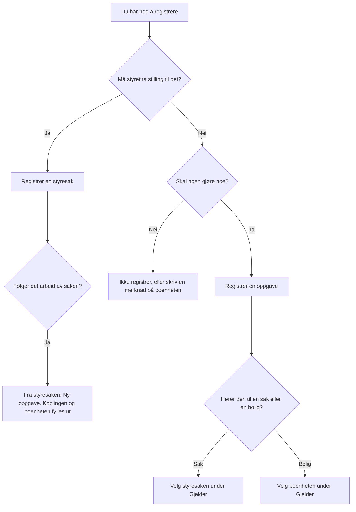

# Plan for forenkling av brukeropplevelsen (M5D)

Dette er en **analyse og designplan**. Planen er gjennomgått og godkjent med presiseringene i [avsnitt 0](#0-godkjente-designvalg-og-status). R0 (felles byggeklosser) er laget; ingen eksisterende side er endret, og domenet og databasen er urørt.

Målet er at et vanlig styremedlem uten IT-bakgrunn skal kunne bruke SameieHub uten opplæring: se hva som må gjøres nå, vite hvor ting registreres, og finne informasjonen igjen. All viktig funksjonalitet beholdes. Møteadministrasjon er **ikke** en del av planen; den er reservert for eierens egen utvikling, og planen sier bare hvor den bør få plass.

Planen bygger på [USABILITY_REVIEW.md](USABILITY_REVIEW.md) (funnene `F-xx`), [UI_DESIGN.md](UI_DESIGN.md), [REQUIREMENTS.md](REQUIREMENTS.md) og [ARCHITECTURE.md](ARCHITECTURE.md), på gjennomgang av alle Razor-sider, og på en ny måling i nettleser mot demodata (kopi av databasen; ingen data er endret).

## 0. Godkjente designvalg og status

Eieren har godkjent planen med disse valgene (svarer på spørsmålene i avsnitt 11):

| # | Valg |
|---|---|
| 1 | Menypunktet «Dashboard» heter **«Oversikt»**. |
| 2 | **Hamburgermenyen beholdes** på mobil (ingen fast tabellinje). |
| 3 | Oppgaver kan **fullføres direkte fra listen**, med tydelig bekreftelse og «Angre». |
| 4 | **Kategori** beholdes og ligger under «Flere valg». |
| 5 | **Prioritet** beholdes; «Høy» skal vises tydelig. |
| 6 | **Ingen bygningsmodell** og ingen flere boenheter per styresak. |
| 7 | **Ikke utled et bekreftet styremøte** fra møtedatoen på en styresak. Oversikt bruker **«Kommende saker med møtedato»** i stedet for «Neste styremøte» frem til møteadministrasjon finnes. |
| 8 | Forskjellen på styresak og oppgave forklares enkelt og likt overalt (avsnitt 4.1). |
| 9 | Utskrift venter til møteadministrasjon finnes. |
| 10 | Rekkefølge: **R0 → R2 → R1 → R3 → R4 → R5 → R6 → R7**. |

**Regler som gjelder alle milepæler:**

- Nødvendige lenker skjules ikke. Opprettes en oppgave fra en styresak, er den koblede styresaken alltid synlig, selv om andre valgfrie felt ligger under «Flere valg».
- Forhåndsutfylling er et redigerbart forslag, ikke en forretningsregel.
- Feil, advarsler og nødvendig informasjon skjules aldri. Et felt med feil åpner «Flere valg» automatisk.
- Sletting er tydelig adskilt og krever bekreftelse.
- Møteadministrasjon er ikke en del av redesignet.

**Justert plan:** «Neste styremøte» (avsnitt 3, 5.2 og R1) leses som **«Kommende saker med møtedato»**: åpne saker med møtedato, sortert på dato, uten å påstå at et møte er bekreftet.

**Status:** R0 ferdig (se avsnitt 9b). R2 er neste og er ikke startet.

## 1. Kort oppsummering

1. **For mye vises samtidig.** Forsiden er 2 614 px høy med fem seksjoner og fire statistikkort. Oppgavelisten har 31 knapper og 8 filterfelt synlig samtidig. Styresakssiden har 7 seksjoner. Det er ikke fordi det finnes for mye funksjonalitet, men fordi alt vises likt hele tiden.
2. **Brukeren vet ikke hva som er «styresak» og hva som er «oppgave».** Skjemaene forklarer det ikke, og koblingene til boenhet og styresak står som to like valg uten veiledning («Oppgaven og styresaken trenger ikke gjelde samme boenhet»).
3. **Anbefalingen:** behold datamodellen og alle funksjoner. Gjør i stedet (a) hver side til *én* hovedhandling med resten bak «Flere valg», (b) lister til korte rader med det som trengs for å velge, (c) detaljsider til «det viktigste først» med metadata og farlige handlinger lenger ned, (d) skjemaer med få obligatoriske felt og «Flere valg» for resten, og (e) en kort veiledning om forskjellen på styresak og oppgave der man registrerer.
4. **Nesten alt er rent UI-arbeid.** Ingen endring i database eller domeneregler er nødvendig for kjernen i planen. Det som *kunne* kreve det (flere boenheter per sak, bygningsnivå, sameiets navn) er ikke foreslått nå (punkt 9).
5. **Gjennomføres i små milepæler (R0–R7)**, der hver kan godkjennes og rulles tilbake for seg. Størst risiko er de mange UI-testene som sjekker tekst og markup; det håndteres først (R0).

## 2. Problemer i dagens brukergrensesnitt

Målt i nettleser (bredde ca. 1024 px) mot demodata:

| Side | Høyde | Synlige knapper og lenker | Synlige felt | Seksjoner / kort | Hovedproblem |
|---|---:|---:|---:|---:|---|
| Forside | 2 614 px | 7 | 0 | 5 seksjoner + 4 tallkort | Alt har lik vekt: oppfølging, styresaker, elbillading, datoer og hurtighandlinger. Møtedatoer og frister vises to ganger. |
| Oppgaveliste | 2 610 px | 31 | 8 | 5 tallkort | Ansvarlig og knapper ligger utenfor skjermen. Seks filtre. «Åpne» og «Rediger» på hver rad. |
| Styresakliste | 1 726 px | 25 | 5 | 5 tallkort | Viser «Opprettet» og «Sist oppdatert» med klokkeslett, men ikke møtedato. |
| Styresak (detalj) | 1 793 px | 5 | 3 | 7 | Slett, vedtak, status, oppgaver og metadata ligger i like store kort. |
| Oppgave (detalj) | 1 206 px | 4 | 1 | 5 | «Marker som fullført» ligger nederst; bekreftelsen vises øverst, utenfor skjermen. |
| Boenhetsdetalj | 1 481 px | 6 | 0 | 7 | Eier, kontakt, saker, oppgaver, elbillader og slett ligger i like store kort. |
| Nytt oppgaveskjema | 1 228 px | 2 | 9 | 3 | Ni felt vises likt. Kategori, prioritet og merknader konkurrerer med tittel og frist. |
| Nytt styresakskjema | 1 050 px | 2 | 6 | 2 | Samme. |
| Elbillingsoversikt | 1 569 px | 4 | 0 | 3 + 8 tallkort | Åtte tallkort før man ser laderne. |
| Avlesningsskjema | 1 975 px | 2 | 11 | 5 | Lang side, men naturlig lang (ni målere). |
| Sikkerhetskopi | 876 px | 1 | 1 | 2 | Allerede enkel. |

**Gjennomgående mønstre som skaper støy:**
- **Tallkort på alle sider** (forside 4, oppgaver 5, styresaker 5, boenheter 3, elbillading 8 + 4). De svarer sjelden på et spørsmål brukeren har.
- **Alle felt og kort har lik visuell vekt.** Det finnes ingen tydelig «dette er det viktigste».
- **Flere likeverdige knapper per rad og side** («Åpne», «Rediger», «Slett», «Endre status», «Registrer …»).
- **Tidsstempler og interne nummer** (opprettet, sist oppdatert, «ID 1») vises før innholdet.
- **Tabeller som sprenger bredden** (USABILITY_REVIEW F-04/F-05/F-31).
- **Mangler veiledning der brukeren velger** (styresak eller oppgave? hvilken boenhet?).
- **Konsekvente handlingsplasseringer finnes ikke:** «Rediger» står øverst på noen sider, status og fullfør nederst, og slett i en egen sone helt nederst.

Det er også mye som fungerer og **bør beholdes:** norsk språk, tomtilstander med veiledning, skjemaer der bare tittel/adresse er påkrevd, tydelige bekreftelser ved sletting, «Forfalt» i både tekst og farge, og at ingenting skjules som er kritisk.

## 3. Foreslått informasjonsarkitektur

### 3.1 Hovedmeny

| # | Menyvalg (nytt navn) | Nå | Hva hører hjemme her |
|---|---|---|---|
| 1 | **Oversikt** | Dashboard | «Hva må gjøres nå?» og neste styremøte. Ingen registrering. |
| 2 | **Styresaker** | Styresaker | Saker styret behandler, møtedato, vedtak, og oppgavene som følger av dem. |
| 3 | **Oppgaver** | Oppgaver | Alt som skal gjøres, med ansvarlig og frist (også vedlikehold). |
| 4 | **Boenheter** | Boenheter | Registeret over boligene, eiere og kontaktinformasjon. Oppslagsverk, ikke hverdagsside. |
| 5 | **Elbillading** | Elbillading | Ladere, avlesninger og avstemming. |
| – | *(reservert)* **Møter** | – | Eierens egen utvikling. Se punkt 3.3. |
| 6 | **Sikkerhetskopi** (nederst, skilt fra resten) | Sikkerhetskopi | Sikkerhetskopi og gjenoppretting. Navnet kan bli «Innstillinger» når det finnes mer enn ett valg. |

Rekkefølgen følger hvor ofte styremedlemmer bruker dem: det de gjør (saker og oppgaver) står før registeret (boenheter). Menyen har fortsatt seks punkter, og det er ingen undermenyer. Hver modul har ellers de samme tre sidene (liste, detalj, skjema), og elbillading har faner (punkt 3.2).

«Oversikt» er et bedre norsk ord enn «Dashboard» for en som ikke jobber med IT.

### 3.2 Hvor hver funksjon hører hjemme

| Funksjon | Hjemmested | Også tilgjengelig fra |
|---|---|---|
| Se hva som er forfalt eller haster | Oversikt | Oppgaver («Forfalte») |
| Neste styremøte og sakene på det | Oversikt (avledet av møtedato på åpne saker) | Styresaker |
| Registrere styresak | Styresaker (+ Ny styresak) | «+ Ny»-valg i toppen |
| Registrere vedtak | Styresaksdetalj | – |
| Registrere oppgave | Oppgaver (+ Ny oppgave) | Fra en styresak, fra en boenhet |
| Fullføre / gjenåpne oppgave | Oppgavedetalj (hovedknapp) og raden i listen | – |
| Legge inn eier og kontaktinfo | Boenheter | – |
| Deaktivere eller slette boenhet | Boenhetsdetalj, under «Flere handlinger» | – |
| Registrere elbilavlesning | Elbillading › Registrer avlesning | Oversikt (lenke) |
| Se avstemming og differanse | Elbillading › Avstemming | Oversikt (kort sammendrag) |
| Laste ned og gjenopprette data | Sikkerhetskopi | Beskjed på Oversikt etter gjenoppretting |

**Elbillading får faner** i stedet for flere knapper: **Oversikt · Registrer avlesning · Avstemming**. Ladere og målerhistorikk nås fra oversiktstabellen. Det er samme sider som i dag, bare samlet under en felles tabellinje. (UI-endring.)

### 3.3 Fremtidig møteadministrasjon (reservert, ikke bygget)

- **Plass i menyen:** mellom *Styresaker* og *Oppgaver*, fordi et møte samler saker og skaper oppgaver. Menypunktet skal ikke vises før funksjonen finnes (ingen plassholder).
- **Forberedt i planen uten å bygge noe:** styresaker har allerede *møtedato*, og Oversikt og styresaklisten viser den. Når møter får en egen modell, kan «Neste styremøte»-kortet på Oversikt peke på møtesiden i stedet for å regne seg frem til datoen.
- **Ingen endring i domenet nå.**

## 4. Arbeidsflyt: styresak og oppgave

### 4.1 Forskjellen i én setning (skal stå i grensesnittet)

- **Styresak:** noe styret skal *behandle og eventuelt vedta*, for eksempel «Skal vi bytte fellesbelysning?». Har møtedato og vedtak.
- **Oppgave:** noe som skal *gjøres av noen innen en frist*, for eksempel «Hente inn tre tilbud». Har ansvarlig og frist.



### 4.2 Tre vanlige situasjoner

| Situasjon | Anbefalt flyt | Finnes i dag? |
|---|---|---|
| **Eier melder lekkasje** | Fra boenheten: «Ny styresak for denne boenheten» → i saken: «Ny oppgave» (kobling og boenhet er forhåndsutfylt) | Ja (snarveiene `?boenhet=` og `?styresak=`). Bare synligheten og forhåndsutfyllingen av boenhet fra saken er ny (UI). |
| **Rutine, for eksempel tømme sluk** | Oppgaver › Ny oppgave. Ingen styresak. Ansvarlig og frist | Ja |
| **Styret skal vedta noe større** | Styresaker › Ny styresak med møtedato → vedtak registreres på saken → oppgaver opprettes fra saken | Ja |

### 4.3 Boenhetskoblingen (uten dobbeltarbeid)

Dagens regler er riktige og beholdes: både styresak og oppgave kan knyttes til én boenhet eller til «hele sameiet», og en oppgave kan ha en annen boenhet enn sin sak. Problemet er forklaringen og at brukeren må velge to ganger.

| Forslag | Type | Beskrivelse |
|---|---|---|
| Felles etikett **«Gjelder»** med valgene «Hele sameiet» (standard) eller en boenhet | UI | Erstatter «Tilknyttet boenhet». «Hele sameiet» vises som en fast, synlig verdi, ikke som tomt valg. |
| **Oppgave fra styresak arver boenheten som forslag** | UI | Når «Ny oppgave» åpnes fra en sak, forhåndsvelges sakens boenhet, og brukeren kan endre. |
| **«Hører til styresak» ligger under «Flere valg»**, men er forhåndsutfylt når man kommer fra en sak | UI | Færre valg for rutineoppgaver. |
| Fra boenheten: **«Ny oppgave» og «Ny styresak»** | UI (finnes som snarvei) | Samme sted som listen over boenhetens saker og oppgaver. |
| Sakens side viser **«2 av 3 oppgaver er fullført»** | UI (avledet av eksisterende data) | Gir oversikt uten ny regel. |
| Når siste oppgave på en sak er fullført: **hint** «Alle oppgavene er fullført. Vil du avslutte saken?» | UI | Bare et forslag, ingen automatisk statusendring. |

### 4.4 Å finne informasjonen igjen

| Spørsmål | Hvor brukeren finner svaret |
|---|---|
| «Hva må gjøres nå?» | Oversikt › «Må gjøres nå» |
| «Hva skal vi behandle på neste møte?» | Oversikt › «Neste styremøte»; Styresaker sortert på møtedato |
| «Hva er skjedd med lekkasjen hos 12B?» | Boenhetens side (saker og oppgaver) eller søk i Styresaker |
| «Hva ble vedtatt om belysningen?» | Styresaker › sak › Vedtak |
| «Hvem har ansvar for dette?» | Oppgavelisten (ansvarlig er alltid synlig) |

**Ingen global søkefunksjon foreslås.** Søket i hver liste (som finnes) dekker behovet for et sameie med åtte boliger. Hvis tester viser at brukerne leter på tvers av moduler, kan det vurderes som et eget senere forslag (se punkt 11).

## 5. Foreslåtte skjermbilder

Hver side beskrives med: **Må ses nå · Kan skjules · Mest synlige handlinger · Kan fjernes fra visningen · Kobling til andre moduler.** Tallene i parentes er mål for ca. 1024 px bredde.

### 5.1 Felles mønster for alle sider

```
┌ Sidetittel                                  [Hovedhandling] [⋯ Flere] ┐
│ Kort forklaring (valgfri)                                            │
├──────────────────────────────────────────────────────────────────────┤
│ Innhold                                                              │
└──────────────────────────────────────────────────────────────────────┘
```

- **Maks én fylt hovedknapp** per side, øverst til høyre. Alt annet er omrisset knapp eller tekstlenke.
- **«⋯ Flere handlinger»** (en vanlig meny, tilgjengelig med tastatur) samler det som er sjeldent. **Irreversible handlinger som sletting skjules ikke:** de flyttes til en tydelig, adskilt «Flere handlinger» nederst på siden og krever bekreftelse som i dag.
- **Feil og advarsler vises alltid øverst og er aldri skjult.**
- **Statusmeldinger vises ved handlingen** (og ikke bare øverst på siden).

### 5.2 Oversikt (forsiden)

**Må ses nå:** (1) *Må gjøres nå*: forfalte og snart forfalne oppgaver (maks 5, forfalt først), (2) *Neste styremøte*: dato og sakene som ligger på den, (3) tre tall: Forfalte, Åpne oppgaver, Åpne saker.
**Kan skjules:** elbillingsstatus (liten linje), kommende datoer utover neste styremøte og frister de neste dagene.
**Mest synlige handlinger:** «+ Ny» (valg: oppgave, styresak, boenhet) i toppen, og «Se alle oppgaver».
**Kan fjernes fra visningen:** tallkortet «Aktive boenheter» (sjelden endret, finnes i Boenheter), den egne «Kommende datoer»-seksjonen (innholdet flyttes inn i «Må gjøres nå» og «Neste styremøte»), og «Hurtighandlinger» (erstattes av «+ Ny»).
**Kobling:** hver rad er en lenke til oppgave/sak. Elbillinglinjen: «Siste avstemming: fullstendig, +15 kWh. [Registrer avlesning]».

```
Oversikt                                              [ + Ny ▾ ]
Status for sameiet per 23.11.2026

[ Beskjed om gjenoppretting, hvis den finnes ]

┌ Forfalt  7 ┐ ┌ Åpne oppgaver 15 ┐ ┌ Åpne saker 10 ┐

Må gjøres nå                                  Se alle oppgaver
 ● Tømme sluk og takrenner før frost   Forfalt 12.11   Ikke tildelt
 ● Innhente pristilbud på LED          Forfalt 17.11   Lise Prøve
 ● Dokumentere fuktskade 12B           Forfalt 19.11   Nils Demo
 … (maks 5)

Neste styremøte  26.11.2026                   Se alle saker
 • Henvendelse om lekkasje ved 12B   (Under behandling)

Elbillading: siste avstemming fullstendig, +15 kWh   [Registrer avlesning]
```

Målt effekt: fra 2 614 px / 5 seksjoner / 7 knapper til omtrent 900–1 200 px og ett skjermbilde på PC.

### 5.3 Lister (felles regler)

- **Hurtigfaner øverst** i stedet for rader med nedtrekkslister: *Åpne · Forfalte · Fullførte* (oppgaver), *Åpne · Vedtatt · Avsluttet* (styresaker), *Aktive · Inaktive* (boenheter).
- **Søk** øverst, og **«Flere filtre»** (kategori, prioritet, boenhet, styresak, sortering) som en lukket del. Aktive filtre vises som små merker som kan fjernes, så brukeren aldri glemmer at et filter er på.
- **Én rad = ett klikk.** Tittelen er lenken. «Åpne»-/«Rediger»-knappene fjernes fra raden (redigering finnes på detaljsiden).
- **Tallkortene fjernes** fra listene. De erstattes av antall i fanene («Åpne 15 · Forfalte 7 · Fullførte 5»).
- **Mobil:** rader blir kort uten sideveis rulling (tittel, status, frist/ansvarlig under).

**Oppgaveliste (wireframe):**

```
Oppgaver                                               [ + Ny oppgave ]
[Åpne 15] [Forfalte 7] [Fullførte 5]        🔍 Søk …   [Flere filtre ▾]

 ☐ Tømme sluk og takrenner før frost
     Hele sameiet · Ansvarlig: –                     Forfalt 12.11.   Ikke startet
 ☐ Innhente pristilbud på LED-fellesbelysning
     Sak #4 Utskifting av fellesbelysning · Lise Prøve   Forfalt 17.11.   Pågår
 ☐ Bestille servicebesøk for elbilladerne
     Sak #2 · Ola Eksempel                           Frist 24.11.     Ikke startet
```

- **Må ses:** tittel, **ansvarlig**, **frist** (med «Forfalt» i tekst og farge), status, og hva den gjelder (sak/boenhet).
- **Kan skjules:** kategori og prioritet (vises som et lite merke bare når prioritet er «Høy», og ellers først på detaljsiden), opprettet og oppdatert.
- **Mest synlige handlinger:** «+ Ny oppgave», og avkrysningsboksen til venstre for å **fullføre direkte** (bruker eksisterende statusendring; den kan angres med «Gjenåpne» fra Fullførte).
- **Kobling:** «Sak #4 …» og boenhet er lenker.

**Styresakliste:** kolonner *Sak · Status · Møtedato · Gjelder* (boenhet eller «Hele sameiet»); sortert på møtedato (nærmeste først) som standard for «Åpne». «Opprettet» og «Sist oppdatert» fjernes fra listen.

**Boenhetsliste:** *Adresse · Eier(e) · Status*; bolignummer vises bare hvis det ikke allerede står i adressen; «Åpne» og «Rediger» fjernes (raden er lenken). Kontaktinformasjon vises på detaljsiden.

### 5.4 Detaljsider

**Styresak (wireframe):**

```
← Styresaker
Henvendelse om lekkasje ved Fiktivdalen 12B          [ Endre status ▾ ]  [⋯]
Under behandling · Høy prioritet · Møte 26.11.2026 · Gjelder: Fiktivdalen 12B

Beskrivelse
 Eier melder om fuktskader i vegg mot carporten etter regnvær.

Vedtak
 Ingen vedtak er registrert.                         [ Registrer vedtak ]

Oppgaver til saken  (0 av 1 fullført)                 [ + Ny oppgave ]
 ☐ Midlertidig tetting av lekkasje 12B     Frist 21.11. Forfalt   Pågår

▸ Detaljer   (merknader, opprettet, sist oppdatert)
─────────────────────────────────────────────
Flere handlinger:  Rediger saken · Slett saken …
```

- **Må ses:** tittel, status, møtedato, hva saken gjelder, beskrivelse, vedtak (eller «ikke registrert») og oppgavene.
- **Kan skjules til den trengs:** vedtaksskjemaet (åpnes av «Registrer vedtak»), merknader og tidsstempler («Detaljer»).
- **Mest synlige handlinger:** «Endre status» (en meny med de fire statusene, og regelen om vedtak forklart når «Vedtatt» velges uten vedtak), «Registrer vedtak», «+ Ny oppgave».
- **Kan fjernes fra visningen:** det store «Saksinformasjon»-kortet (innholdet flyttes til én linje under tittelen), «Sist oppdatert» og «Opprettet» som egne rader.
- **Kobling:** boenhet og oppgaver er lenker; «+ Ny oppgave» forhåndsfyller sak og boenhet.
- **Sletting** ligger nederst, adskilt og med bekreftelse (som i dag).

**Oppgave:**

```
← Oppgaver
Bestille servicebesøk for elbilladerne        [ ✓ Marker som fullført ]  [⋯]
Ikke startet · Høy prioritet · Frist 24.11.2026 · Ansvarlig: Ola Eksempel
Gjelder: Hele sameiet · Hører til: Sak #2 Service på elbilladeanlegget

Beskrivelse   (ikke registrert)

▸ Detaljer (kategori, merknader, opprettet, sist oppdatert)
Flere handlinger:  Sett til «Pågår» · Rediger · Slett oppgaven …
```

- **Mest synlige handling:** «Marker som fullført» i overskriften (og «Gjenåpne» når den er fullført). **Bekreftelsen vises ved siden av knappen** (løser F-07).
- «Endre status»-nedtrekksmenyen fjernes som egen seksjon; «Pågår» ligger under «Flere handlinger».

**Boenhet:**

```
← Boenheter
Fiktivdalen 10A    Aktiv                                [ Rediger ]  [⋯]

Eier 1  Ola Eksempel   📞 +47 000 00 101   ✉ ola.eksempel@…
Eier 2  Kari Eksempel                       ✉ kari.eksempel@…

Åpne saker og oppgaver                    [ + Ny sak ] [ + Ny oppgave ]
 (ingen)
Elbillader: I bruk · skap 1 · 6125,4 kWh (20.11.)      [ Se laderen ]

▸ Boliginformasjon (bolignummer, seksjon, type, areal, merknader)
Flere handlinger:  Deaktiver (skjuler boenheten, beholder alt) · Slett …
```

- **Må ses:** eier(e) og kontakt, hva som pågår på boligen, elbillader.
- **Kan skjules:** boliginformasjon og merknader («Boliginformasjon» åpnes ved behov).
- **Kan fjernes:** «ID 1» (F-13).
- **«Deaktiver» forklares** ved knappen (F-12).

### 5.5 Registrerings- og redigeringsskjemaer

**Felles regler:** få felt først, resten under «Flere valg». Ett tydelig «Lagre»-valg og «Avbryt» som tekstlenke. Forhåndsutfylling fra konteksten (fra sak eller boenhet), og alltid synlig hva som er forhåndsutfylt. Feil vises ved feltet og som en kort liste øverst. Tab-rekkefølge følger visuell rekkefølge.

**Ny oppgave:**

```
Ny oppgave
Noe som skal gjøres av noen innen en frist.  Trenger styret å ta stilling til det? Registrer en styresak i stedet.

Tittel *            [__________________________]
Frist               [dd.mm.åååå]    Ansvarlig  [____________]
Gjelder             (•) Hele sameiet  ( ) En boenhet [velg ▾]
▸ Flere valg        Beskrivelse · Kategori · Prioritet · Hører til styresak · Merknader

                    [ Lagre oppgave ]   Avbryt
```

**Ny styresak:**

```
Ny styresak
Noe styret skal behandle og eventuelt vedta.  Noe som bare skal gjøres? Registrer en oppgave i stedet.

Tittel *            [__________________________]
Møtedato            [dd.mm.åååå]
Gjelder             (•) Hele sameiet  ( ) En boenhet [velg ▾]
▸ Flere valg        Beskrivelse · Prioritet · Merknader

                    [ Lagre styresak ]   Avbryt
```

- **Kan fjernes fra standardvisningen:** Kategori, Prioritet og Merknader (alle har gode standardverdier). **Funksjonen beholdes** under «Flere valg».
- **Boenhet:** bare adresse er påkrevd (som i dag). Skjemaet for boenhet får «Eier 1» først og «Bolignummer, seksjon, type, areal og merknader» under «Flere valg» (F-15).

### 5.6 Elbillading

- **Faner:** Oversikt · Registrer avlesning · Avstemming.
- **Oversikt:** øverst én linje med hovedmålerens målerstand («Målerstand 52 793 kWh, avlest 16.11.») og siste avstemming («fullstendig, +15 kWh») med lenke; deretter tabellen over de åtte laderne. **De åtte tallkortene fjernes**, og antall per status vises som en liten tekstlinje over tabellen («4 i bruk · 3 ikke i bruk · 1 midlertidig deaktivert»).
- **Avlesning:** uendret innhold (ni felt, forrige verdi og forbruk ved hvert felt), med kortere ledetekst («Når leste du av målerne?») og en lenke «Feil? Rett her» i bekreftelsen (F-27, F-29).
- **Avstemming:** en forklaring på to–tre linjer av hva differansen betyr og at den ikke nødvendigvis er tap (F-10), og «Målerstand» / «Forbruk i perioden» som navn (F-26).

### 5.7 Navigasjon på PC og mobil

- **PC:** dagens mørke sidemeny beholdes (seks valg, «Sikkerhetskopi» nederst). «+ Ny» ligger i sidetoppen.
- **Mobil:** dagens hamburger-meny beholdes, og «+ Ny» ligger i topplinjen. Lister blir kortlister. **Alternativ som krever avklaring:** en fast tabellinje nederst (Oversikt · Saker · Oppgaver · Mer). Den er raskere å bruke med én hånd, men er et nytt navigasjonsmønster og et større inngrep (punkt 11).
- **Tilgjengelighet:** hopp-lenke til innhold, tydelig fokusmarkering, trykkflater på minst 44 px på mobil, og kontrast som oppfyller WCAG AA.

### 5.6b Innstillinger og sikkerhetskopi

- Siden er allerede enkel (876 px, to kort). **Anbefalt:** behold den, men legg «Lag sikkerhetskopi» som eneste fylte knapp og la «Gjenopprett» starte lukket («Gjenopprett fra en tidligere sikkerhetskopi ▸»), siden det er den sjeldne og risikable handlingen.
- Beskjeden om gjennomført gjenoppretting ligger fortsatt øverst på Oversikt og på siden. Kritisk informasjon (ukryptert fil, omstart) skjules ikke.

## 6. Designretning

Beholde Bootstrap 5 og dagens egen CSS (`app.css`). Ingen nye UI-bibliotek.

| Område | Valg |
|---|---|
| **Farger** | Dagens rolige palett: lys bakgrunn, mørk sidemeny, én aksentfarge (blå). Rødt bare for feil og forfalt, grønt for fullført, gult for ventende. Aldri farge alene (alltid også tekst). |
| **Typografi** | Én sidetittel (h1), kortoverskrifter (h2) litt mindre, brødtekst 16 px. Mer luft rundt tittel og første innhold. |
| **Knapper** | Tre nivåer: *fylt* (én per side), *omriss* (sekundær), *tekstlenke* (tertiær). Slett er rød omriss først i bekreftelsesboksen. |
| **Plassering** | Sidens handlinger øverst til høyre. Skjemaets «Lagre» nederst til venstre med «Avbryt» som lenke. |
| **Rader og kort** | Lister som rader uten tunge rammer. Kort bare for grupper som hører sammen (ikke for hver enkelt verdi). |
| **Merker (badges)** | Kun status og «Høy prioritet». Ikke prioritet «Normal»/«Lav» i lister. |
| **Plassutnyttelse** | To kolonner på PC bare der det gir mening (detaljside: innhold + smal sidekolonne). Én kolonne på mobil. |
| **Språk** | Enkle verb («Lagre», «Avbryt», «Ny oppgave»), «Gjelder» i stedet for «Tilknyttet», «Oversikt» i stedet for «Dashboard», og samme verb for samme handling på alle sider. |
| **Ikke** | Animasjoner, ikoner uten tekst, skjulte menyer for kritiske handlinger, eller nye farger «for å se moderne ut». |

## 7. Før og etter (kortfattet)

| Side | Før | Etter |
|---|---|---|
| Oversikt | 5 seksjoner, 4 tallkort, 7 knapper, 2 614 px | 3 tall, «Må gjøres nå» (maks 5), «Neste styremøte», én linje om elbillading, «+ Ny»; ≈ 1 000 px |
| Oppgaveliste | 31 knapper, 8 filtre, 5 tallkort, ansvarlig utenfor skjermen | 3 faner, søk, «Flere filtre», radene er lenker, ansvarlig og frist alltid synlig, direkte fullføring |
| Styresakliste | «Opprettet»/«Sist oppdatert», knappkolonne | Sak · Status · Møtedato · Gjelder, tittel er lenke |
| Styresak | 7 like kort, slett og status i samme vekt | Én overskriftslinje med status, vedtak og oppgaver først, «Detaljer» lukket, slett adskilt |
| Oppgave | Fullfør nederst, status i egen seksjon | «Marker som fullført» i overskriften med bekreftelse ved knappen |
| Skjemaer | 9 og 6 felt like synlige | 3–4 felt synlige, resten under «Flere valg», med veiledning om styresak/oppgave |
| Elbillading | 8 tallkort før tabellen | Faner, én statuslinje, tabell |

## 8. Hva som bare er UI og hva som krever backend- eller databaseendring

### 8.1 Bare UI (Razor, CSS og små UI-komponenter)
Alt i planens kjerne:
- ny sidestruktur, faner i elbillading, «Flere valg»-visning, menyer for flere handlinger, hurtigfaner i lister, fjerning av tallkort og kolonner, kortlister på mobil;
- «Gjelder» som etikett og som visning av «Hele sameiet», forhåndsutfylling av boenhet fra sak (bruker eksisterende snarveier), «x av y oppgaver fullført» (avledet), hint ved siste fullførte oppgave;
- «Neste styremøte» på Oversikt (avledet av eksisterende møtedato på åpne saker);
- direkte fullføring fra listen (bruker eksisterende `ChangeStatus`);
- all tekst: «Oversikt», forklaringer, hjelpetekst.

### 8.2 Krever backend- eller domeneendring (foreslås **ikke** nå)
| Idé | Hvorfor den *ikke* anbefales nå |
|---|---|
| Flere boenheter per styresak, eller en «bygning» (tomannsbolig) som egen enhet (USABILITY_REVIEW H-3) | Endrer domene og database. Løser et problem bare hvis styret ber om det. Spør først (punkt 11). |
| Sameiets navn som innstilling | Ny tabell/innstilling. Først relevant ved flere sameier. |
| Ansvarlig som valg fra liste (eiere/styremedlemmer) | Krever en modell for personer. Dagens fritekst er enkel og fungerer. |
| Global søkefunksjon | Ny funksjon uten påvist behov. |
| Møteadministrasjon | Reservert for eierens egen utvikling. |

**Ingen av milepælene R0–R7 trenger databasemigrering.**

## 9. Prioritert gjennomføring i små milepæler

Hver milepæl er avgrenset, kan godkjennes og rulles tilbake for seg, og avsluttes med bygg, alle tester og en kort nettlesersjekk (PC og 375 px).

| Milepæl | Innhold | Hovedfiler | Type | Dekker |
|---|---|---|---|---|
| **R0 Grunnlag** (ferdig) | Felles komponenter og stil: sidehode med én hovedhandling og «Flere handlinger»-meny, «Flere valg»-visning (`<details>` med tastaturstøtte), merker for aktive filtre, hurtigfaner, tilbakemelding med «Angre», kortliste på mobil, `data-testid` og UI-hjelpere i testene. Ingen synlig endring på sidene. | `Components/Shared`, `app.css`, `Tests/Web/UiTestHelpers.cs` | UI | Reduserer skjørhet før resten |
| **R1 Oversikt** | Ny forside: «Må gjøres nå», «Kommende saker med møtedato», tre tall, elbillinglinje, «+ Ny». | `Pages/Dashboard.razor`, `DashboardChargingSection` | UI | F-09, F-17, F-22 |
| **R2 Oppgaver** | Hurtigfaner, søk, «Flere filtre», radene som lenker, direkte fullføring, kortliste på mobil. Oppgavedetalj: hovedknapp i overskrift, bekreftelse ved knappen, «Detaljer». | `TaskItems/*` | UI | F-05, F-06, F-07 |
| **R3 Styresaker** | Liste (møtedato, faner), detalj (overskriftslinje, vedtak, oppgaver, «Detaljer», adskilt slett, «x av y»). | `BoardCases/*` | UI | F-03, F-04 |
| **R4 Skjemaer og veiledning** | «Gjelder», «Flere valg», veiledning om styresak/oppgave, forhåndsutfylling fra sak/boenhet. Boenhetsskjema og detalj (F-12, F-13, F-14, F-15). | `*Form.razor`, `HousingUnits/*` | UI | Hovedproblemet om styresak/oppgave |
| **R5 Elbillading** | Faner, statuslinje i stedet for tallkort, forklaring av differanse, nye etiketter, «Feil? Rett her». | `Charging/*` | UI | F-10, F-26, F-27, F-29 |
| **R6 Navigasjon og mobil** | Menyrekkefølge og navn, «+ Ny»-valg, hopp-lenke, trykkflater, kontroll av alle sider på 375 px. (Fast nedre tabellinje bare hvis eieren velger det.) | `Layout/*`, `app.css` | UI | F-31 |
| **R7 Innstillinger og sluttkontroll** | «Gjenopprett» lukket som standard, helhetlig kontroll mot tilgjengelighet, språk og konsistens, oppdatering av `UI_DESIGN.md`. | `Pages/Settings/*`, docs | UI | – |

**Godkjent rekkefølge:** R0 → R2 → R1 → R3 → R4 → R5 → R6 → R7. Oppgaver først fordi det er den mest brukte og den med flest funn (F-05/06/07). R1 etter R2 slik at Oversikt kan lenke til de nye listene.

## 9b. Felles byggeklosser (R0) og hvordan R1–R7 bruker dem

Byggeklossene ligger i `src/SameieHub.Web/Components/Shared`. De er små, bruker `<details>`, Bootstrap og eksisterende CSS-variabler (`--sh-*`), og trenger ingen skript eller nye pakker. Ingen side bruker dem ennå, bortsett fra at `PageHeader` er utvidet bakoverkompatibelt.

| Komponent | Hva den gjør | Brukes i |
|---|---|---|
| `PageHeader` (utvidet) | Tittel, én hovedhandling (`PrimaryAction`) og `MoreActions` bak «Flere handlinger». Gammel bruk (`ChildContent`) virker som før. | Alle sider, R2–R7 |
| `MoreMenu` | «Flere handlinger» som `<details>`; tastaturbart. Lukkes ikke ved klikk utenfor. | Detaljsider (rediger, slett adskilt) |
| `Disclosure` | «Flere valg» som starter lukket, med en kort oppsummering av innholdet. `ForceOpen` åpner den når noe inni trenger oppmerksomhet (feil). | Skjemaer (R4), detaljsider |
| `ActiveFilters` | Merker for aktive filtre, fjern ett eller alle. Vises ikke uten filtre. | Lister (R2, R3) |
| `QuickTabs` | Hurtigfaner med antall, som knapper (`aria-pressed`) eller lenker (`aria-current`). | Oppgaver, Styresaker, Elbillading (R5) |
| `ActionFeedback` | Bekreftelse (`role=status`) med valgfri «Angre», eller feil (`role=alert`) som ikke fjernes av seg selv. | Direkte fullføring (R2) |
| `.table-cards` (CSS) | Tabellrader blir kort på smal skjerm; cellene trenger `data-label`. | Lister på mobil |

**Testgrunnlag:** `data-testid` på sidetittel, handlingsområde, hovedhandling og de nye komponentene, og hjelpere i `UiTestHelpers` (`FindByTestId`, `FindRowContaining`, `FindFieldByLabel`, `FindButton`, `ClickButton`). Eksisterende tester er ikke erstattet; hver side får nye velgere når den bygges om. Byggeklossene er testet i `UiBuildingBlocksTests`.

**Kjente begrensninger:** `Disclosure` husker at personen har åpnet den fordi Blazor bare setter `open` når verdien endres (kontrollert i nettleser); `MoreMenu` lukkes ikke av Escape eller klikk utenfor; `.table-cards` krever `data-label` på hver celle.

## 10. Risiko for regresjoner og hvordan de reduseres

| Risiko | Konsekvens | Tiltak |
|---|---|---|
| **De mange UI-testene** sjekker norsk ordlyd (ca. 268 `Assert.Contains("…")`) og markup (`tbody tr`, klasser) | Mange tester feiler selv om oppførselen er riktig | R0 innfører `data-testid` og hjelpere først. Tester oppdateres milepæl for milepæl, ikke slettes: hver regel testes fortsatt, bare med nye velgere. Se [TEST_AUDIT.md](TEST_AUDIT.md). |
| **Skjult funksjon blir ikke funnet** («Flere valg», «Flere handlinger») | Brukere finner ikke f.eks. prioritet eller slett | Kritiske handlinger og data skjules ikke. Brukertest (punkt 12) sjekker spesielt dette. «Flere valg» viser en kort oppsummering av hva som ligger der. |
| **Direkte fullføring i listen gir feilklikk** | Oppgave fullføres ved et uhell | Tydelig bekreftelse ved raden med «Angre», og «Gjenåpne» finnes fortsatt. |
| **Forhåndsutfylt boenhet er feil** | Oppgave får feil boenhet | Forhåndsutfyllingen er alltid synlig og kan endres. Den gjelder bare når man kommer fra en sak. |
| **Tilgjengelighet svekkes** av menyer og faner | Tastatur- og skjermleserbrukere | Bruk standard `<details>`, `role="tablist"` og knapper med tastaturstøtte. Kontroll i hver milepæl. |
| **Mobil** får nye feil | Sideveis rulling | Samme måling som i USABILITY_REVIEW (scrollWidth) i hver milepæl. |
| **Ny forside skjuler noe som brukeren er vant til** | Forvirring | Beholder lenker til alle lister og et «Se alle»-valg i hver seksjon. |
| **Demodata** er datert og viser mange forfalte oppgaver | Misvisende testing | Nullstill demoen før hver testrunde (`Nullstill-demo.cmd`). |

Domenekode, repositories og migreringer berøres ikke, så risikoen for dataregresjoner er liten.

## 11. Designvalg som krevde avklaring fra eieren

Svarene står i [avsnitt 0](#0-godkjente-designvalg-og-status). Spørsmålene er beholdt som historikk.

1. **Menynavn:** «Oversikt» i stedet for «Dashboard», OK? Og skal «Sikkerhetskopi» bli «Innstillinger» først når det finnes flere valg?
2. **Mobil navigasjon:** beholde hamburger-menyen (anbefalt, minst inngrep) eller innføre fast tabellinje nederst?
3. **Direkte fullføring i oppgavelisten** (avkryssingsboks), eller bare fullføring på oppgavesiden?
4. **«Kategori» (Generell/Vedlikehold) på oppgaver:** brukes den av styret? Hvis ikke, kan den ligge helt under «Flere valg» (anbefalt), eller på sikt vurderes fjernet (en domeneendring, ikke foreslått nå).
5. **Prioritet** på styresaker og oppgaver: behold under «Flere valg» og vis bare «Høy» i lister?
6. **Flere boenheter per styresak** (for eksempel en hel tomannsbolig), eller en bygningsenhet: er det et reelt behov? Det ville kreve en domeneendring.
7. **Neste styremøte på Oversikt:** avledet av møtedato på åpne saker (anbefalt og enkelt) eller bør møteadministrasjon ventes på?
8. **Veiledningen** «styresak eller oppgave?» skal stå i skjemaene. Passer forklaringene («noe styret skal behandle og eventuelt vedta» og «noe som skal gjøres av noen innen en frist») med hvordan sameiet bruker begrepene?
9. **Skrive ut:** trenger styret en utskriftsvennlig saksliste eller avstemming? (Ikke i planen; spørsmålet er gjentatt fra USABILITY_REVIEW.)
10. **Rekkefølge:** er R0 → R2 → R1 → … riktig prioritering, eller bør Elbillading (R5) komme tidligere?

## 12. Hvordan brukervennligheten testes etterpå

**Før redesignet starter:** gjør samme prøve på dagens grensesnitt, så det finnes et sammenligningsgrunnlag.

**Brukerprøve** (1–3 personer fra sameiet, ingen opplæring, fiktiv demo, nullstilt før hver), fem oppgaver:

| # | Oppgave | Måles |
|---|---|---|
| 1 | «Finn ut hva som må gjøres nå.» | Tid til første riktige svar, antall klikk |
| 2 | «Registrer at 12B har meldt lekkasje, og at rørlegger skal kontaktes innen fredag.» | Valgte riktig styresak/oppgave? Boenhet koblet? Antall feil |
| 3 | «Fullfør oppgaven om å bestille servicebesøk.» | Tid, antall klikk, så de bekreftelsen? |
| 4 | «Finn hva styret vedtok om belysningen, og når neste styremøte er.» | Tid, fant de vedtak og møtedato? |
| 5 | «Registrer månedens elbilavlesning og forstå om avstemmingen er i orden.» | Tid, feil, forstod de differansen? |

**Mål (første forslag, justeres etter grunnlagsmålingen):** oppgave 1 under 10 sekunder og 1 klikk, oppgave 3 under 15 sekunder, ingen som velger feil mellom styresak og oppgave uten å rette seg selv, og ingen som ikke finner «Flere valg»-innholdet når oppgaven krever det.

**Mekaniske målinger i hver milepæl** (kan gjentas med de samme skriptene som i USABILITY_REVIEW):

| Mål | Nå | Mål etter redesign |
|---|---|---|
| Forsidens høyde | 2 614 px | ≤ 1 300 px |
| Synlige knapper og lenker i oppgavelisten | 31 | ≤ 12 |
| Synlige filterfelt i oppgavelisten | 8 | ≤ 2 (+ «Flere filtre») |
| Synlige felt i nytt oppgaveskjema | 9 | ≤ 4 |
| Sideveis rulling på 375 px (side og tabell) | flere tabeller | ingen |
| Klikk for å fullføre en oppgave fra listen | 3–4 | 1 |
| Antall `F-xx`-funn fra USABILITY_REVIEW som er løst | – | alle P1 |

**I tillegg:** tastaturnavigasjon uten mus, kontroll av kontrast (WCAG AA), skjermleserlesning av faner og «Flere valg», og at alle eksisterende tester fortsatt dekker de samme reglene.

## 13. Det som ikke gjøres

- Ingen endring i domene, database eller eksisterende grensesnitt i dette steget.
- Ingen møteadministrasjon.
- Ingen nye funksjoner utover det som er markert «UI» over: ingen global søkefunksjon, ingen personliste, ingen bygningsmodell, ingen flere sameier.
- Funksjonaliteten som finnes i dag **beholdes**: alt som skjules, ligger i «Flere valg», «Detaljer» eller «Flere handlinger» og er et klikk unna. Kritiske data, feil og irreversible handlinger skjules aldri.

## 14. Hva godkjenningen innebærer

Når planen er gjennomgått og punkt 11 er avklart, foreslår jeg å starte med **R0 (grunnlag)**, og deretter én milepæl om gangen, hver avsluttet med kontrollrapport og ny godkjenning.
