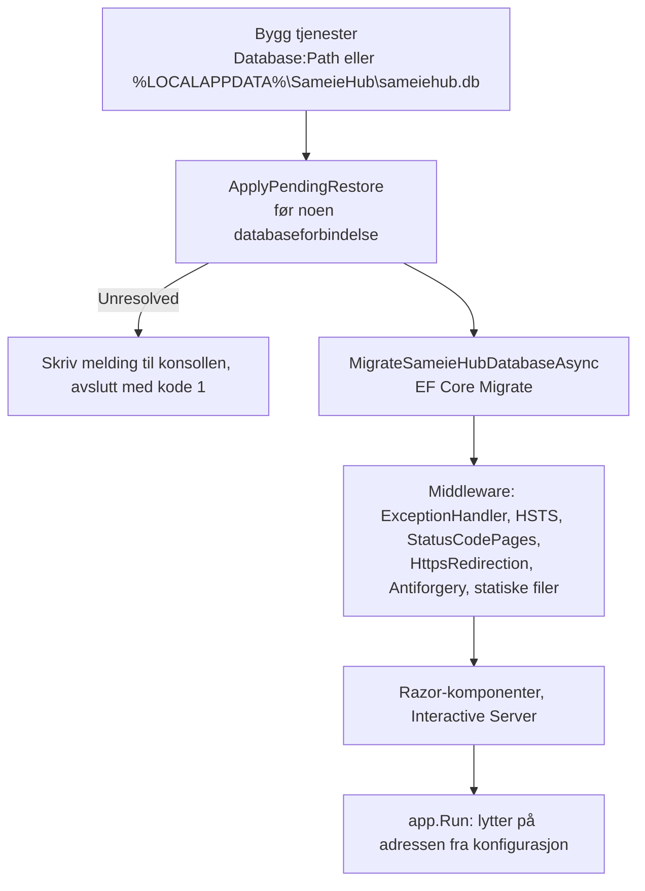
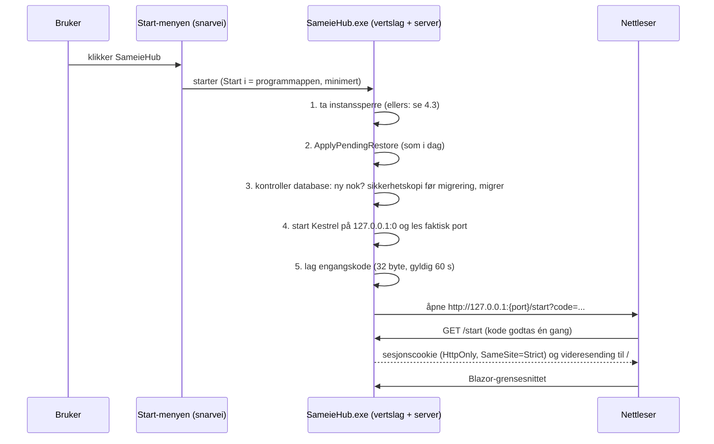
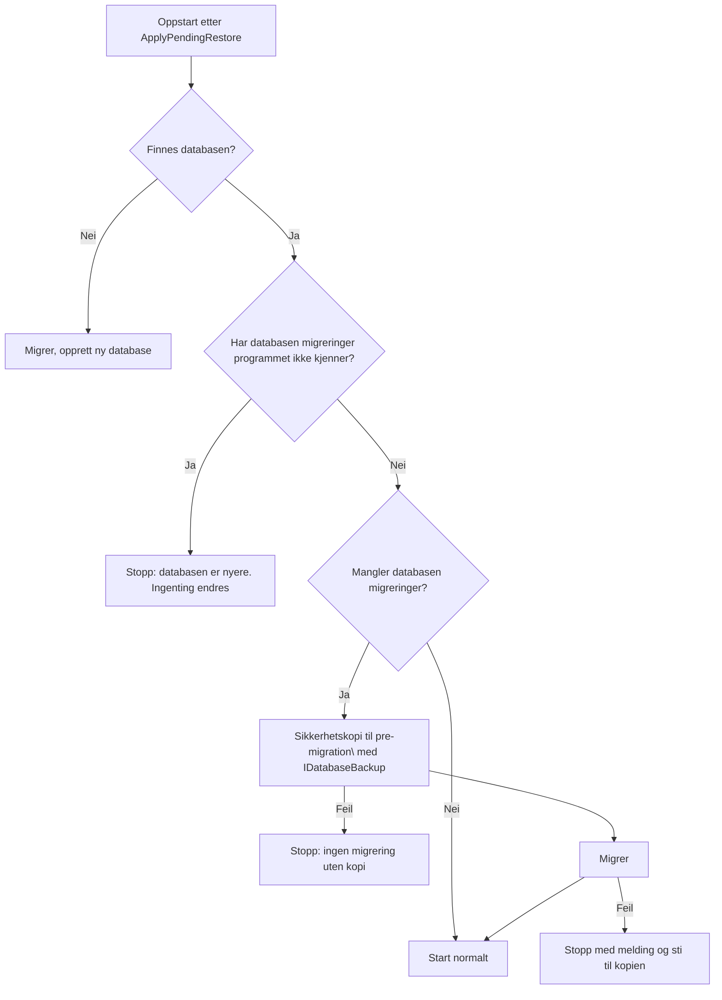

# Windows-distribusjon: analyse og plan (M8)

**Status:** planen er godkjent (D1–D12, med presiseringer). **M8-1 er gjennomført** (vedlegg A) og **M8-2 er gjennomført** (vedlegg B). M8-3 til M8-6 er ikke startet. Ingen installasjonsprogram og ingen endringer i domene, migreringer eller grensesnitt er laget. Dokumentet bygger på det koden gjør i dag (kontrollert 2026-11-26, commit `f373965`) og på en testpublisering som ble gjort i en midlertidig mappe utenfor repoet.

**Målet:** en vanlig Windows-bruker installerer SameieHub, starter det fra Start-menyen, får grensesnittet åpnet automatisk, beholder dataene sine ved oppdatering og kan avslutte programmet på en tydelig måte. Ingen Visual Studio, ingen PowerShell, ingen `dotnet`-kommandoer.

## Innhold

1. Kartlegging av dagens løsning
2. Sammenligning av arkitekturalternativer
3. Anbefalt løsning og begrunnelse
4. Oppstart og avslutning
5. Sikkerhetsvurdering
6. Database og lagring
7. Backup og restore
8. Installasjon og oppdatering
9. Foreslåtte milepæler
10. Åpne beslutninger som krever godkjenning

---

## 1. Kartlegging av dagens løsning

### 1.1 Hvordan SameieHub starter i dag

Det finnes ingen oppstartsfil for den vanlige databasen. Den startes bare med `dotnet run --project src/SameieHub.Web` (README og `docs/DEVELOPMENT.md`). De to skriptene som finnes, `scripts/demo.ps1` og `scripts/Start-demo.cmd`, gjelder bare demoen og krever .NET SDK, siden de kaller `dotnet run`. De viser likevel hvilke problemer en Windows-start må løse, og mye av logikken kan gjenbrukes som idé: portsjekk, ventetid til serveren svarer, åpne nettleseren, og `taskkill /T` ved avslutning.

`Program.cs` gjør dette i denne rekkefølgen:



### 1.2 Fakta fra koden og fra en testpublisering

| Funn | Konsekvens for Windows-versjonen |
|---|---|
| Databasebanen er `%LOCALAPPDATA%\SameieHub\sameiehub.db` (`DatabaseLocation`), og `Database:Path` kan overstyre den. Demoen bruker `%LOCALAPPDATA%\SameieHubDemo\sameiehub-demo.db`. | Den installerte versjonen bruker samme bane. Eksisterende data oppdages uten flytting eller konvertering. |
| Uten `ASPNETCORE_URLS` lytter en publisert `SameieHub.Web.exe` på `http://localhost:5000`, i miljøet *Production*. Målt: den binder både `127.0.0.1:5000` og `[::1]:5000`. `launchSettings.json` (port 5254, *Development*) brukes ikke av en publisert fil. | Standarden er allerede loopback, men porten er fast og kan være opptatt. Adressen må settes eksplisitt i produksjon. |
| Når den publiserte filen startes fra en annen arbeidsmappe enn sin egen, finner den ikke `appsettings.json` (innholdsroten er arbeidsmappen). Målt: loggnivået falt tilbake til *Information*, og EF Core logget SQL-setninger. | En snarvei uten riktig «Start i»-mappe gir andre innstillinger enn forventet. Innholdsroten må settes til programmappen i koden. |
| `AllowedHosts` er `"*"`. Målt: en forespørsel til `127.0.0.1` med `Host: evil.example` ga `200`. | Serveren avviser ikke fremmede vertsnavn. Det er en forutsetning for DNS-rebinding-angrep (se kapittel 5). |
| `UseHttpsRedirection()` er aktiv, men det finnes ingen HTTPS-adresse. | Gir en advarsel om manglende HTTPS-port ved start. Skal fjernes for loopback-HTTP. |
| Ingen sjekk av at bare én forekomst kjører. SQLite låser bare under skriving, så to forekomster kan starte, og en gjenoppretting (som flytter databasefilene) kan kollidere med den andre. | En instanssperre må lages. |
| `MigrateSameieHubDatabaseAsync` kalles uten `try/catch`. Feiler den, krasjer programmet med et unntak. Det finnes heller ingen kontroll av at databasen er *nyere* enn programmet (restoremotoren har en slik kontroll for sikkerhetskopier, men den gjelder ikke den aktive databasen). | Migreringsfeil og for ny database må håndteres med en forståelig melding og en sikkerhetskopi på forhånd. |
| Fatale oppstartsfeil skrives bare til `Console.Error`. Ved dobbeltklikk lukkes konsollvinduet straks. | Brukeren får ingen forklaring. Feilen må vises og logges. |
| Logging går bare til konsollen. Det finnes ingen loggfil. Det logges ikke full databasesti (bare mappe- og filnavn). | En loggfil og fast loggnivå trengs. Regelen om å ikke logge innhold beholdes. |
| Data Protection-nøkler (for antiforgery) lagres i `%LOCALAPPDATA%\ASP.NET\DataProtection-Keys`, kryptert med DPAPI. | Fungerer, men ligger utenfor SameieHub-mappen. Lav prioritet. |
| Det finnes ingen minimal-API-ruter og ingen offentlig adresse til databasefiler. Nedlasting skjer som en strøm over Blazor-forbindelsen (M5C). | Angrepsflaten er liten: Blazor-endepunktene, `_blazor`-forbindelsen og statiske filer. |
| Restore krever omstart, og siden sier «Lukk SameieHub … programmet (vinduet det kjører i) må stoppes». Programmet kan ikke starte seg selv på nytt. | I Windows-versjonen må brukeren ha en tydelig måte å avslutte og starte på igjen (se kapittel 7). |
| Testpublisering `win-x64`, self-contained, ikke trimmet, ikke én enkelt fil: **127 MB på disk, 354 filer, 55,7 MB som zip**. Native SQLite (`e_sqlite3.dll`, 1,9 MB) følger med. Programmet startet fra den publiserte mappen og svarte (200). Målingen er gjort på en maskin som har .NET installert, så at det virker helt uten .NET er ikke bekreftet ennå (M8-2 og D12). | Størrelsen er akseptabel for en installasjon. Tallene er måling fra én maskin og kontrolleres på nytt i M8-2. |
| CI kjører allerede på `windows-latest` med restore, build og test av hele løsningen. | CI kan utvides med publisering og røyktest uten nytt miljø. |

Hele publiseringen fungerte uten endring av prosjektfilene (`dotnet publish -r win-x64 --self-contained`). Avhengighetene er bare Microsoft sine pakker (EF Core 10.0.15 og SQLite). Det er ikke lagt til eller endret noe i repoet.

---

## 2. Sammenligning av arkitekturalternativer

| | **A. Self-contained Blazor-app som åpner nettleseren** | **B. Egen liten launcher som starter serveren** | **C. Eget Windows-vindu med WebView2** |
|---|---|---|---|
| **Hva det er** | Dagens Web-prosjekt publisert self-contained. Samme prosess starter serveren, åpner nettleseren og holder et synlig vindu. | Nytt prosjekt (WinForms eller lignende) med ikon i systemstatusfeltet. Starter `SameieHub.Web.exe` som barneprosess og holder styr på den. | Nytt WinForms/WPF-prosjekt som viser grensesnittet i et innebygd WebView2-vindu. Serveren kjører i samme eller i en barneprosess. |
| **Brukervennlighet** | God. Åpner brukerens vanlige nettleser. Brukeren må forstå at programvinduet er «serveren» og at nettleseren ikke er programmet. | Best i hverdagen (ikon i systemstatusfeltet, «Åpne» og «Avslutt»), men er et ekstra konsept å forklare. | Best: ett eget vindu. Lukker du vinduet, avsluttes alt. Ingen forvirring om nettleserfane og server. |
| **Installasjon** | Én mappe. Ingen forutsetninger. | Én mappe, to programmer. | Krever *WebView2 Runtime*. Den er forhåndsinstallert på Windows 11 og på oppdaterte Windows 10, men ikke garantert. Installasjonsprogrammet må kontrollere og eventuelt installere den (krever nedlasting eller en stor frakoblet pakke). |
| **Oppstart og avslutning** | Oppstart og avslutning håndteres av ett program, så det finnes ingen barneprosess som kan bli liggende igjen. Å lukke nettleseren avslutter ikke programmet. | Launcheren eier prosessen og kan tvinge den ned (Job Object). Mer kode for å lese «klar»-signal, feil og port. | Naturligst: vindu lukket = ferdig. Opplasting og nedlasting av filer (backup) må ellers verifiseres i WebView2, siden nedlasting via `blob:`-adresse og filvelger oppfører seg annerledes enn i Chrome og Edge. |
| **Størrelse** | ca. 127 MB på disk (målt). | Litt mer (launcher og eventuelt Windows Forms-biblioteker i self-contained, sannsynligvis 10–30 MB ekstra, ikke målt). | Som B pluss WebView2-pakken (ca. 1 MB for oppstartsprogrammet, men selve Runtime er ca. 150 MB hvis den må installeres). |
| **Vedlikehold** | Minst. Ett prosjekt, én publisering. | To prosjekter, to oppstartsveier, prosesskommunikasjon. | To prosjekter, et grafisk lag som ikke kan testes i vanlig CI, ny avhengighet (WebView2-versjoner). |
| **Avhengigheter** | Ingen nye. | Windows Forms (del av .NET), ikke NuGet. | WebView2-pakken (NuGet) og Runtime. Strider mot «ingen nye pakker» uten egen godkjenning. |
| **Oppdateringer** | Én mappe skiftes. | Samme. | Samme, pluss at Runtime oppdateres av Microsoft uavhengig av oss. |
| **Sikkerhet** | Lytter bare på loopback. Beskyttelsen mot andre prosesser lages i selve serveren. | Samme, og launcheren kan bære engangskoden til nettleseren. | Samme, og eget vindu betyr ingen nettleserutvidelser, historikk eller URL-er. Det er fortsatt en lokal webserver. |
| **Kompleksitet for en C#-student** | Lav. Mest kode i `Program.cs` og en liten hjelpeklasse. Kan testes i CI. | Middels. Prosessstyring, tråder og meldingsløkke er nytt. | Middels til høy. UI-tråd, WebView2-livssyklus og nedlasting. |
| **Omskriving av grensesnittet** | Ingen. | Ingen. | Ingen, men filhåndtering må testes. |

**Hvorfor ikke C nå:** den gir best opplevelse, men tre ting taler imot som første utgave: en ny pakkeavhengighet, en Runtime som ikke er garantert, og at nedlasting/opplasting av sikkerhetskopier (som er kritisk) må testes på nytt i et annet nettlesermiljø. Alternativet er ikke utelukket: vertslaget i anbefalingen under (kapittel 3) kan gjenbrukes hvis C velges senere.

**Hvorfor ikke B nå:** gevinsten er et ikon i systemstatusfeltet. Det kan legges til senere uten å endre serveren, hvis erfaring fra testing viser at det trengs.

---

## 3. Anbefalt løsning og begrunnelse

**Anbefaling for første utgave: alternativ A.** Dagens Web-prosjekt publiseres self-contained for `win-x64` som en vanlig programmappe. Et lite «vertslag» i Web-prosjektet (ingen nytt prosjekt) tar seg av det en Windows-bruker forventer:

- Starter serveren på `127.0.0.1` med en port operativsystemet velger.
- Sørger for at bare én forekomst kjører mot samme database.
- Åpner brukerens nettleser med en engangskode, så bare den nettleseren får tilgang.
- Holder et synlig programvindu (konsollvindu med norsk tekst) som viser at SameieHub kjører, og som lukkes for å avslutte.
- Viser startfeil på norsk i stedet for å lukke seg uten forklaring.

**Hvorfor:**

1. **Minst mulig nytt.** Ingen nye prosjekter, ingen nye pakker, ingen omskriving av grensesnittet, og nesten alt kan testes i den CI-en som finnes.
2. **Ingen skjulte prosesser.** Ett program, ett synlig vindu. Det finnes ingen barneprosess som kan bli liggende igjen.
3. **Forståelig for en C#-student.** Alt er ASP.NET Core-konsepter eleven allerede bruker (konfigurasjon, middleware, livssyklus), pluss `FileStream`-lås og `Process.Start`.
4. **Tåler endring.** Hvis erfaring viser at et konsollvindu er for teknisk, kan et ikon i systemstatusfeltet (B) eller WebView2 (C) legges oppå uten å røre serveren.

**Kjent kompromiss:** et konsollvindu er tekniskere enn et ikon i systemstatusfeltet. Det avbøtes ved at snarveien starter vinduet minimert (det er da synlig i oppgavelinjen), og vinduet har en tydelig norsk tekst. Dette må vurderes av eieren etter første test (beslutning D2).

**Ikke anbefalt:** trimming (Blazor og EF Core bruker refleksjon og trimming kan gi feil som først vises når en bestemt side åpnes), én enkelt fil (native SQLite og statiske webressurser pakkes ut ved oppstart og gjør feilsøking vanskeligere), og framework-dependent publisering (krever at .NET Runtime er installert, noe målet utelukker). *ReadyToRun* kan vurderes i M8-2 hvis oppstarten er treg. Dette er ikke målt ennå.

---

## 4. Oppstart og avslutning

### 4.1 Oppstart



Hvert trinn har en definert feilhåndtering (4.6). Rekkefølgen mellom trinn 2 og 3 er som i dag og endres ikke.

### 4.2 Avslutning

Programmet avsluttes på tre måter, og alle gjør det samme (ASP.NET Core sin ordnede nedstenging):

1. **Lukke programvinduet** eller trykke `Ctrl+C`. Må verifiseres på ekte Windows (M8-1): at lukkeknappen på konsollvinduet gir en ordnet nedstenging og ikke en brå avslutning.
2. **Knapp «Avslutt SameieHub»** i grensesnittet (eget milepæl-trinn, M8-5), som kaller `IHostApplicationLifetime.StopApplication()` og forklarer brukeren at programmet er stoppet. Den er også veien for «Avslutt og start på nytt» etter en gjenoppretting.
3. **Windows avslutter eller brukeren logger ut.** Behandles som punkt 1.

Ved ordnet nedstenging gjør programmet følgende, i denne rekkefølgen: slutter å ta imot nye forbindelser, avslutter Blazor-forbindelsene, kaller `SqliteConnection.ClearAllPools()` (slik at ingen databaseforbindelse blir stående åpen og `-wal`-filen slås sammen med hovedfilen), fjerner instansfilen og slipper sperren.

**Hvordan alle prosesser stoppes:** programmet består av én prosess. Det startes ingen barneprosesser, ingen bakgrunnstjeneste og ingen planlagt oppgave. Kontrolltest i CI og manuelt: etter avslutning finnes ingen prosess som heter `SameieHub*`, sperrefilen kan åpnes, og porten er lukket.

### 4.3 Hvis programmet allerede kjører

Instanssperren er en fil `%LOCALAPPDATA%\SameieHub\sameiehub.lock` som åpnes med `FileShare.None` så lenge programmet kjører. Windows frigjør den automatisk hvis programmet krasjer, så en gammel sperre kan aldri blokkere en ny start.

| Utgave | Hva en andre start gjør |
|---|---|
| Første utgave (M8-1) | Viser meldingen «SameieHub kjører allerede. Se etter vinduet «SameieHub» i oppgavelinjen.» og avslutter. |
| Senere (M8-3) | Sender en melding til den første forekomsten gjennom en navngitt pipe (bare for samme bruker). Den åpner da et nytt nettleservindu med en ny engangskode. |

Instanssperren dekker også databasen: ingen andre SameieHub-prosesser kan kjøre en gjenoppretting eller migrering mens den første er i gang.

### 4.4 Hvis brukeren lukker nettleseren

Programmet fortsetter å kjøre, og vinduet i oppgavelinjen viser det. Det er et bevisst valg: en nettleserfane kan lukkes ved et uhell, og en automatisk avslutning ville stoppet en pågående sikkerhetskopi eller et skjema. For å åpne grensesnittet igjen: start SameieHub fra Start-menyen på nytt (da åpnes en ny fane, se 4.3). Programvinduet sier også dette.

Automatisk avslutning etter en periode uten åpne faner er mulig (Blazor kan telle åpne forbindelser), men er ikke en del av første utgave (beslutning D3).

### 4.5 Hvis porten er opptatt

Programmet ber operativsystemet om en ledig port (port 0) og leser den faktiske adressen etter oppstart. Da kan «opptatt port» i praksis ikke oppstå, og det trengs ingen brannmurregel (en lytter på `127.0.0.1` utløser ikke Windows-brannmurens spørsmål, og utgående trafikk finnes ikke). Hvis bindingen likevel feiler (for eksempel et sikkerhetsprogram), vises feilmeldingen i 4.6. Ulempen er at adressen endres for hver start, så bokmerker virker ikke. Programmet åpner alltid riktig adresse selv, så dette er akseptabelt.

### 4.6 Oppstartsfeil

| Situasjon | Hva brukeren ser | Hva som skjer |
|---|---|---|
| Programmet kjører allerede | Melding (4.3) | Avslutter, ingenting endres |
| Gjenoppretting uavklart (`Unresolved`) | «SameieHub kunne ikke starte, fordi en gjenoppretting ble avbrutt og ikke kunne fullføres sikkert. Ingenting er slettet. Se veiledningen.» med sti til mappen `restore` | Avslutter med kode 1, ingen database opprettes (som i dag) |
| Databasen er nyere enn programmet | «Databasen er laget av en nyere versjon av SameieHub. Installer den nyeste versjonen.» | Avslutter, databasen røres ikke |
| Migrering feiler | «Databasen kunne ikke oppgraderes. Dine data er uendret. En kopi fra før oppgraderingen ligger i … .» | Avslutter, databasen står på forrige versjon (kontrolleres i test) |
| Port eller nettverk kan ikke åpnes | «Programmet kunne ikke starte den lokale serveren.» | Avslutter |
| Nettleseren kunne ikke åpnes | Adressen vises i programvinduet, så brukeren kan lime den inn | Programmet fortsetter |
| Uventet feil | Kort norsk melding og sti til loggfilen. Ingen stack trace med innhold i vinduet | Logges, avslutter |

Alle meldinger vises som tekst i programvinduet **og** i en meldingsboks (`MessageBoxW` fra `user32.dll`, uten ny pakke, bare når programmet kjører på Windows). Vinduet venter på en tast før det lukkes, slik at meldingen ikke forsvinner ved dobbeltklikk. Hver feil skrives også til loggfilen (kapittel 6.4).

---

## 5. Sikkerhetsvurdering

SameieHub inneholder personopplysninger (navn, telefon, e-post). Utgangspunktet er at **localhost alene ikke er nok**: enhver prosess og enhver nettside i brukerens nettleser kan nå en lokal port. Derfor tre lag.

### 5.1 Trusler og tiltak

| # | Trussel | Tiltak i planen | Gjenstår etter tiltaket |
|---|---|---|---|
| 1 | **Tilgang fra lokalnett eller internett** | Kestrel binder eksplisitt `127.0.0.1` (ikke `localhost`, ikke `0.0.0.0`). Ingen brannmurunntak. Lytteren utløser ikke brannmurspørsmål. Test i CI: adressen er loopback, ikke wildcard. | Ingen kjent |
| 2 | **Andre brukere og prosesser på samme maskin** kobler til porten | Tilfeldig port **og** en sesjonscookie som bare nettleseren som fikk engangskoden har. Alle forespørsler uten gyldig cookie får en forklarende `403`-side. Engangskoden gjelder én gang og i 60 sekunder. | En prosess som kjører som *samme* bruker (for eksempel skadevare) kan lese databasefilen direkte, med eller uten dette tiltaket. Koden kan i teorien leses fra kommandolinjen til nettleserprosessen i løpet av sekundene den gjelder. |
| 3 | **Skadelig nettside i brukerens nettleser** (CSRF, kryssopprinnelses-`WebSocket` til `127.0.0.1`, DNS rebinding) | (a) Cookien er `SameSite=Strict` og `HttpOnly`, og sendes derfor ikke fra andre nettsteder. (b) Verts-filter: bare `127.0.0.1:{port}` og `localhost:{port}` godtas (`AllowedHosts` i dag er `*` og slipper gjennom `Host: evil.example`, målt). (c) Dagens `UseAntiforgery()` beholdes for skjemaer. | Små. Må testes både automatisk og manuelt (M8-3). |
| 4 | **Lokale endepunkter** | Ingen minimal-API, ingen filadresse til databasen. Nedlasting skjer som strøm over Blazor-forbindelsen (M5C). Dette beholdes. Det nye `/start`-endepunktet tar imot én kode og lager én cookie. | Ingen kjent |
| 5 | **Data i hvile** | Databasen og sikkerhetskopiene er ukrypterte (som i dag) i brukerens egen profilmappe, ikke i en delt mappe. Anbefaling til brukeren: BitLocker/enhetskryptering. | Kryptering av SQLite er utenfor v1 |
| 6 | **Logger** | Fast loggnivå *Warning* for Microsoft, *Information* for SameieHub. Ingen SQL, ingen skjemainnhold, ingen full sti. Dagens regel (bare mappe- og filnavn) beholdes og testes. `DetailedErrors` er av. | Unntaksmeldinger fra tredjepart kan i teorien inneholde data, så loggen behandles som personlig fil. |
| 7 | **Installasjonsfilen** | Hash (SHA-256) publiseres med hver utgivelse. Uten kodesignering viser Windows SmartScreen «ukjent utgiver». | Signering krever sertifikat og koster penger (beslutning D6). |
| 8 | **Utdatert .NET-kjøretid** | Self-contained betyr at .NET-sikkerhetsoppdateringer krever en ny SameieHub-utgivelse. Planen: sjekk .NET-oppdateringer ved hver utgivelse, og hver gang Microsoft publiserer en sikkerhetsoppdatering for .NET 10. | En eldre installasjon forblir på eldre kjøretid til brukeren oppdaterer. |
| 9 | **Feilsøkingsfunksjoner i produksjon** | Miljøet er *Production* (ikke *Development*), ingen utviklerunntaksside, ingen detaljerte feil. | Ingen kjent |

### 5.2 Hvorfor ikke et innloggingssystem

Planen innfører *ikke* brukernavn, passord eller roller (utenfor v1, og krever særskilt godkjenning). Engangskoden og cookien er ikke noen brukeridentitet: den beskytter bare mot at andre kommer inn gjennom porten. Den kan fjernes uten å endre noe annet. Alternativet er å bare bruke tilfeldig port og verts-filter (forsvar mot punkt 3 uten punkt 2). Det er enklere, men svakere på flerbrukermaskiner (beslutning D4).

### 5.3 Risikoer som gjenstår i versjon 1

- Skadevare som kjører som samme Windows-bruker kan lese databasen og sikkerhetskopiene.
- Databasen og sikkerhetskopiene er ukrypterte. Sikkerhetskopier som brukeren legger i en delt mappe, en skytjeneste eller på en minnepinne er brukerens ansvar (siden advarer allerede om det).
- Installasjonsprogrammet er usignert i første utgave (SmartScreen-advarsel).
- Automatiske oppdateringer finnes ikke: brukeren må selv installere nye utgaver, også sikkerhetsoppdateringer.
- Brukere på samme maskin som deler Windows-konto deler data. Dette er bare for én lokal bruker (utenfor omfang).
- Ingen test med antivirusprogrammer. Et program som starter en lokal server og leser/skriver en database kan trigge falske positiver (første utgave bør testes mot Windows Defender).

---

## 6. Database og lagring

### 6.1 Hvor hva ligger

| Hva | Sted | Merknad |
|---|---|---|
| **Programfiler** | `%LOCALAPPDATA%\Programs\SameieHub\` | Installasjon for én bruker, uten administratorrettigheter (beslutning D5). Skrivebeskyttet i bruk, byttes ved oppdatering. |
| **Database (ordinær)** | `%LOCALAPPDATA%\SameieHub\sameiehub.db` (+ `-wal`, `-shm`) | Uendret. Samme bane som i dag, så eksisterende data finnes straks etter installasjon. |
| **Gjenoppretting** | `%LOCALAPPDATA%\SameieHub\restore\` | Uendret (M5B). Inneholder `pending.db`, journal og `before-restore-<tid>\`. |
| **Midlertidige filer** | `%LOCALAPPDATA%\SameieHub\transfer\<tilfeldig>\` | Uendret (M5C). Ligger ved siden av databasen, ikke i `%TEMP%`, og slettes etter bruk eller etter en time. |
| **Sikkerhetskopi før migrering** | `%LOCALAPPDATA%\SameieHub\pre-migration\` | Ny. Beholder de tre siste. |
| **Loggfiler** | `%LOCALAPPDATA%\SameieHub\logs\sameiehub-<dato>.log` | Ny. Én fil per dag, siste 14 dager. |
| **Instanssperre** | `%LOCALAPPDATA%\SameieHub\sameiehub.lock` | Ny. |
| **Demodatabase** | `%LOCALAPPDATA%\SameieHubDemo\sameiehub-demo.db` | Uendret og atskilt. Se 6.5. |
| **Sikkerhetskopier brukeren lager** | Brukerens nedlastingsmappe (valgt av nettleseren) | Programmet kan ikke velge sted. |

**Bevisst ikke brukt:** `Program Files` (krever administratorrettigheter), `%PROGRAMDATA%` og offentlige mapper (delt mellom brukere), og `%TEMP%` (ryddes av andre programmer). Ingen personopplysninger, sikkerhetskopier eller logger ligger i programmappen.

### 6.2 Oppdateringer og eksisterende data

En oppdatering bytter bare filene i programmappen. Installasjonsprogrammet kjenner ikke til `%LOCALAPPDATA%\SameieHub\` og kan ikke slette eller flytte noe der. Databasen oppgraderes av programmet selv ved første start av den nye versjonen (6.3).

### 6.3 Databaseoppgraderinger

Dagens metode beholdes: EF Core `Migrate()` ved oppstart. Det som legges til rundt:



- Gjenbruker `IDatabaseBackup` og `BackupFileInspector`-reglene som allerede er testet. Det lages ingen ny motor.
- SQLite kjører hver migrering i en transaksjon, så en mislykket migrering skal la databasen stå på forrige versjon. **Dette er en antakelse som kontrolleres med en test** i M8-1 (feilende migrering mot en testdatabase) i stedet for å stoles på.
- Hvis migreringen feiler, åpner ikke programmet noe grensesnitt. Meldingen forklarer at dataene er uendret, og hvor kopien ligger.
- Nedgradering (eldre program, nyere database) avvises. Det er den samme regelen som restore bruker for «nyere» sikkerhetskopier.

### 6.4 Loggfiler

.NET har ingen innebygd filloggføring, og nye pakker er utelukket. Planen er en liten egen `ILoggerProvider` (omtrent 60 linjer, i Web-prosjektet) som skriver tekstlinjer til `logs\`. Alternativet er å bare bruke konsollvinduet (da forsvinner feilene når vinduet lukkes). Beslutning D7. Reglene er de samme som i dag: bare filnavn, størrelse, årsakskoder og typer, aldri skjemainnhold, e-post, telefon eller full sti, og dette dekkes av en test som kjører en vanlig arbeidsflyt og søker gjennom loggen etter fiktive personopplysninger.

### 6.5 Produksjon og demo

Skillet beholdes og styrkes:

- Den installerte versjonen starter **aldri** i demomodus. `--seed-demo`/`--check-demo` kan bare brukes mot demobanen (kontrollen i `Program.cs` finnes allerede). Demoskriptene følger *ikke* med installasjonen i første utgave (beslutning D8).
- Restoremotoren avviser allerede demodatabasen som kilde og mål.
- Vertslaget får ingen demofunksjon.

### 6.6 Avinstallasjon

Avinstallasjon fjerner programmappen, snarveier og registreringen i «Apper og funksjoner». **Brukerdata beholdes som standard.** Avinstallasjonen viser: «Dine data (database og sikkerhetskopier i mappen …) beholdes. Slett mappen selv hvis du vil fjerne dem.» Et valg om å også slette data kan legges til senere, men bør da være av som standard og bruke bekreftelse som nevner at slettingen ikke kan angres (beslutning D9).

---

## 7. Backup og restore

Motorene (`SqliteDatabaseBackup`, `BackupTransfer`, `SqliteDatabaseRestore`, `BackupFileInspector`) og lagringsformatet endres **ikke**. Det finnes heller ingen dokumentert nødvendighet for det. Det er først og fremst brukeropplevelsen rundt motorene som må tilpasses.

| Punkt | I Windows-versjonen |
|---|---|
| **Nedlasting** | Uendret: strøm over Blazor-forbindelsen, filnavn med dato, privat midlertidig mappe slettes etterpå. Fungerer fordi nettleseren er vanlig Edge/Chrome. Kontrolleres manuelt i installert versjon (M8-2). |
| **Opplasting og validering** | Uendret: `InputFile`, 200 MB grense, `upload.db` i egen mappe, inspeksjon og sammenligning før noe forberedes. |
| **Bekreftelse før restore** | Uendret (bekreftelsesboks, `role="alertdialog"`). |
| **Kontrollert avslutning og omstart** | **Nytt:** knappen «Avslutt SameieHub» (og «Avslutt og start på nytt») i siden for venter-på-omstart. Teksten «Lukk SameieHub … programmet må stoppes» byttes til det som faktisk gjelder i installert versjon. Se under. |
| **Ventende restore ved neste oppstart** | Uendret: `ApplyPendingRestore` kjører først, før noen databaseforbindelse (og før migreringen). |
| **Feil** | Uendret: `Unresolved` stopper programmet med kode 1. Nytt er at meldingen også vises i en meldingsboks (4.6). Veiledningen i `ARCHITECTURE.md` («Hvis gjenopprettingen står uavklart») gjelder fortsatt. |
| **Beskyttelse mot tap** | Uendret: den gamle databasen *flyttes* til `restore\before-restore-<tid>\`, sjekksummer, journal. I tillegg beskytter instanssperren mot at to forekomster rører filene samtidig. |

### «Avslutt og start på nytt»

Programmet kan ikke erstatte seg selv mens det kjører. Planen: knappen stopper serveren ordnet, men starter først en ny prosess (`SameieHub.exe --wait-for-previous <pid>`) som venter til forrige prosess er borte og sperren er fri, og så starter som vanlig (der `ApplyPendingRestore` gjør jobben). Hvis den nye prosessen ikke starter, står gjenopprettingen fortsatt ventende, og brukeren kan starte fra Start-menyen. Ingenting går tapt. Dette er det eneste stedet barneprosess-lignende logikk trengs, og den er kort.

Siden (`BackupPage`) og knappene er endringer i grensesnittet, og tas derfor først etter egen godkjenning (M8-5).

---

## 8. Installasjon og oppdatering

### 8.1 Installasjonsalternativer

| | **Inno Setup** | **MSIX** | **Enkel programmappe (zip)** |
|---|---|---|---|
| **Hva** | Klassisk `Setup.exe` laget fra et skript. | Moderne pakke med Windows-pakkehåndtering. | Brukeren pakker ut en mappe og dobbeltklikker. |
| **Start-meny og avinstallasjon** | Ja, ferdig. | Ja. | Nei (manuelt). |
| **Krever administrator** | Nei (installasjon for én bruker). | Nei, men **sertifikat må stoles på**. | Nei. |
| **Kodesignering** | Anbefalt, ikke påkrevd. | **Påkrevd** for å kunne installeres (selvsignert krever at brukeren importerer sertifikatet). | Ikke relevant. |
| **Data og filbaner** | Ingen virtualisering. `%LOCALAPPDATA%\SameieHub` er den samme mappen som i dag. | **Skrivinger til AppData kan omdirigeres til pakkens private område**, og dataene slettes ved avinstallasjon. Det strider mot kravet om at eksisterende database og backup-baner skal bevares. | Ingen virtualisering. |
| **Oppdatering** | Ny `Setup.exe` over den gamle (samme AppId). | Oppdateringsmekanismer finnes, men krever signering og utgivelseskanal. | Pakk ut over gammel mappe (risikabelt). |
| **Kompleksitet** | Lav. Ett skript på omtrent 50 linjer. | Høy (manifest, identitet, signering, pakketesting). | Lavest. |
| **Passer for** | Første reelle utgave. | Senere, hvis distribusjon via Microsoft Store blir aktuelt. | Første **testversjon** (M8-2). |

**Anbefaling:** zip-mappe for første intern testversjon (M8-2), deretter **Inno Setup med installasjon for én bruker** (M8-4). MSIX frarådes fordi filvirtualiseringen og kravet om signering kan true kontinuiteten i databasen, og fordi det gir mye kompleksitet uten noen gevinst for ett sameie.

Inno Setup er et verktøy som kjøres under bygging, ikke en NuGet-pakke eller et prosjektbibliotek. Det må likevel installeres (på utviklermaskinen og i CI, for eksempel med `choco install innosetup`). Det krever godkjenning (beslutning D1).

### 8.2 Self-contained publish for win-x64

Publiseringen er kontrollert (kapittel 1.2). Innstillinger som planlegges i M8-2 (prosjektfil og skript, ingen kodeendring): `RuntimeIdentifier=win-x64`, `SelfContained=true`, ikke trimming, ikke enkeltfil. Eventuelt `PublishReadyToRun` hvis oppstarten er treg. Filnavnet bør bli `SameieHub.exe` (nå `SameieHub.Web.exe`, via `AssemblyName`). Dette må kontrolleres mot testene før det gjøres.

### 8.3 Versjonsnummer og utgivelsesfiler

- **Versjon:** `MAJOR.MINOR.PATCH` (semantisk). Første kandidat: `1.0.0-test.1`, deretter `1.0.0`. Kilden er en git-tag (`v1.0.0`). CI sender den inn som `-p:Version=…`, så den havner i `AssemblyInformationalVersion`, i installasjonsprogrammet og på en liten «Om»-visning (beslutning D10: ny visning i grensesnittet, senere).
- **Utgivelsesfiler:** `SameieHub-1.0.0-win-x64-Setup.exe`, `SameieHub-1.0.0-win-x64.zip` og `SHA256SUMS.txt`, publisert som en GitHub Release (først manuelt, senere automatisert fra tag).
- **Binærfiler:** bygget i CI og lagt ved en Release eller et *artifact*, **ikke committet**. Reglene i `CLAUDE.md` gjelder (ingen binærfiler, databaser, sikkerhetskopier eller hemmeligheter i repoet).

### 8.4 Oppdateringsprosess (uten automatisk oppdatering)

1. Brukeren laster ned og kjører ny `Setup.exe`.
2. Installasjonsprogrammet oppdager at SameieHub kjører (`AppMutex`, ikke et nytt prosjekt) og ber om å avslutte programmet. Det kan også kalle `SameieHub.exe --stop` (M8-3), som ber den kjørende forekomsten stoppe seg.
3. Programfilene byttes. Data røres ikke.
4. Brukeren starter. Programmet tar sikkerhetskopi før migrering og migrerer (6.3).

**Tilbakerulling:** installer forrige versjon. Hvis den nye versjonen har migrert databasen, nekter den gamle å starte (nyere database). Da brukes kopien i `pre-migration\` (instruksjon i dokumentasjonen og i feilmeldingen). Dette er med vilje: en gammel versjon skal aldri skrive til en database den ikke forstår.

Automatisk oppdatering, oppdateringstjeneste og nettverkskall for å sjekke nye versjoner er **ikke** med. Det ville krevd ekstern kommunikasjon som prosjektet har holdt utenfor (ingen eksterne integrasjoner).

---

## 9. Foreslåtte milepæler

Hver milepæl avsluttes med kontrollrapport og stopp for godkjenning, i tråd med `CLAUDE.md`. Ingen av dem endrer domenet, migreringene eller backupformatet. Antall tester kan ikke angis nøyaktig før detaljene er lagt, så tallene under er et anslag.

### Hva som kan testes hvor

| Kan kjøres i GitHub Actions (`windows-latest`) | Krever ekte Windows med grafisk grensesnitt (manuelt) |
|---|---|
| Alle eksisterende tester | Hvordan konsollvinduet oppfører seg ved lukking (ordnet nedstenging?) |
| Enhetstester for vertslaget (port, adresse, instanssperre, engangskode, verts-filter) | Start-menyen, snarvei, ikon, «Start i»-mappe, minimert start |
| Publisering `win-x64` og røyktest: start `SameieHub.exe` med `--no-browser`, kontroller loopback-binding, `200` med cookie og `403` uten, `Host: evil` avvist, ordnet stopp, ingen prosess igjen | Standard nettleser åpnes i forgrunnen med riktig adresse |
| Andre start mens første kjører (kode og melding) | SmartScreen, antivirus og eventuelle advarsler |
| Migreringsfeil, nyere database og sikkerhetskopi før migrering mot testdatabaser | Nedlasting og opplasting av sikkerhetskopier i ekte nettleser |
| Installer i stille modus til midlertidig mappe, kontroller at data i en testmappe er uendret, og avinstaller (etter M8-4) | Hele restore-flyten med ekte omstart |
| Loggtest: ingen fiktive personopplysninger i logg | Ytelse og oppstartstid på ren maskin, helst uten .NET og uten utviklerverktøy |
| Dokumentasjonskontroll (lenker, versjon) | En ren Windows-maskin eller virtuell maskin uten utviklerverktøy |

### M8-1: Vertslag i Web (loopback, instanssperre, startfeil)

- **Avgrenset:** Kestrel på `127.0.0.1:0`; innholdsrot = programmappen; instanssperre; avslutning med `ClearAllPools`; synlig vindu med norsk tekst; startfeil på norsk (vindu, meldingsboks, logg); nyere-database-sjekk; sikkerhetskopi før migrering; loggfil; fjerne `UseHttpsRedirection`; verts-filter. Ingen grensesnittendring.
- **Filer:** `Program.cs` (kort), nye små klasser i `SameieHub.Web/Hosting/` (vert, instanssperre, startfeil, filloggfører), `appsettings.json`, `SameieHub.Infrastructure/ServiceCollectionExtensions.cs` (migreringssjekk). Tester i `tests/SameieHub.Tests/`.
- **Tester:** instanssperre (to forsøk, frigjøring etter krasj-simulering), verts-filter, migreringsfeil lar databasen være uendret, nyere database avvises, sikkerhetskopi før migrering, loggen inneholder ingen personopplysninger, bare loopback.
- **Manuell kontroll:** start to ganger; lukk vinduet med X og med `Ctrl+C`; sjekk at ingen prosess og ingen `-wal` blir igjen; framprovoser en startfeil.
- **Akseptanse:** appen starter uten Visual Studio fra en publisert mappe; kjører aldri på noe annet enn loopback; én forekomst; forståelig melding ved feil; eksisterende testsuite og CI grønn.
- **Risiko:** vindu-lukking gir kanskje ikke ordnet nedstenging på alle Windows-versjoner (testes manuelt tidlig); litt kode i `Program.cs`.
- **Stopp:** godkjenning før M8-2.

### M8-2: Self-contained publisering og testversjon (zip)

- **Avgrenset:** `win-x64` self-contained mappe, `SameieHub.exe`, snarvei-skript for testing, publiseringsjobb i CI som lager en *artifact* (ikke commit) og røyktest.
- **Filer:** `SameieHub.Web.csproj` (publiseringsegenskaper, `AssemblyName`), `.github/workflows/ci.yml` (egen publiseringsjobb), nytt skript for publisering, `docs/DEVELOPMENT.md`.
- **Tester:** røyktest i CI (start, `200`, loopback, stopp, ingen prosess igjen); alle eksisterende tester.
- **Manuell kontroll:** pakk ut zip på en ren maskin eller virtuell maskin uten .NET; start; bruk alle fire områder og elbillading; sikkerhetskopi ned og opp (uten restore på ordinær database).
- **Akseptanse:** testversjonen fungerer uten utviklingsverktøy; størrelse og oppstartstid er målt og dokumentert.
- **Risiko:** gamle antakelser om `AssemblyName` og stier i tester; ReadyToRun kan påvirke feilsøking.
- **Stopp:** godkjenning før M8-3.

### M8-3: Tilgangsvern og andre-start

- **Avgrenset:** engangskode og sesjonscookie, `/start`-endepunkt, forklarende `403`-side, andre-start åpner nettleser via pipe, `--stop`.
- **Filer:** `SameieHub.Web/Hosting/` (middleware, engangskode, pipe), `Program.cs`, en enkel `403`-side.
- **Tester:** uten cookie `403`; engangskode virker bare én gang og utløper; cookie fra tidligere kjøring ugyldig; kryssopprinnelse og feil `Host` avvises; Blazor-forbindelsen virker bare med cookie.
- **Manuell kontroll:** en andre nettleser og en annen Windows-bruker (om mulig) får ikke tilgang; en skadelig test-HTML-side forsøker `fetch` og `WebSocket` mot porten.
- **Akseptanse:** punkt 2 og 3 i 5.1 er dekket med automatiske tester; ingen funksjon i grensesnittet er endret.
- **Risiko:** Blazor-forbindelsen (`_blazor`) og reconnect må ikke brytes av cookie-kravet; omfattende regresjonstester kreves.
- **Stopp:** godkjenning før M8-4. Tas ikke uten D4.

### M8-4: Installasjonsprogram (Inno Setup)

- **Avgrenset:** installasjon for én bruker, Start-meny, avinstallasjon med data beholdt, `AppMutex`-sjekk, versjonsnummer, SHA-256.
- **Filer:** `installer/SameieHub.iss`, publiseringsjobb i CI, `docs/`.
- **Tester:** stille installasjon i CI til midlertidig mappe; kontroller at en prøvemappe som ligner datamappen ikke endres; oppdatering over eksisterende installasjon; avinstallasjon.
- **Manuell kontroll:** på ren maskin: installer, start fra Start-menyen, bruk programmet, installer ny versjon over gammel (data beholdt), avinstaller (data beholdt).
- **Akseptanse:** hele flyten fra målet i kapittelets begynnelse fungerer for en vanlig bruker.
- **Risiko:** SmartScreen (usignert), antivirus, Inno-installasjon i CI.
- **Stopp:** godkjenning før M8-5.

### M8-5: Avslutt og start på nytt i grensesnittet

- **Avgrenset:** knappen «Avslutt SameieHub» og «Avslutt og start på nytt», teksten i restore-flyten, «Om»-visning med versjon. **Dette er den første milepælen som endrer grensesnittet.**
- **Filer:** `BackupPage.razor` og tilhørende tester, en liten tjeneste for nedstenging, layout/«Om».
- **Tester:** bUnit-tester for tekst og knapper; nedstenging kalles og krever gyldig sesjon.
- **Manuell kontroll:** hele restore-flyten på en *kopi* av en database (ikke demoen og ikke den ordinære): forbered, avslutt og start på nytt, kontroller resultatet. Dette gjøres på en testmaskin, ikke automatisk.
- **Akseptanse:** en gjenoppretting kan fullføres uten at brukeren trenger å forstå «vinduet programmet kjører i».
- **Risiko:** restore er den mest kritiske flyten; omstartsprosessen må ikke kunne etterlate to forekomster.
- **Stopp:** godkjenning før M8-6.

### M8-6: Utgivelse og rutiner

- **Avgrenset:** tag-drevet utgivelse (GitHub Release med installasjon, zip og hasher), utgivelsesliste, brukerveiledning («Installer og oppdater») og vedlikeholdsliste for .NET-oppdateringer. Valgfritt: kodesignering (D6), ikon i systemstatusfeltet (alternativ B) eller WebView2 (alternativ C) som egne forslag etter erfaring.
- **Filer:** `.github/workflows/`, `docs/`, `README.md`.
- **Tester:** kjøring av hele utgivelsen på en tag i et forkastet forsøk (uten å publisere).
- **Akseptanse:** en ny utgivelse kan lages uten manuelle trinn utover tag og godkjenning.
- **Risiko:** lav.
- **Stopp:** godkjenning før noe nytt.

Rekkefølgen er satt slik at hver milepæl kan brukes og testes alene. M8-3 kan flyttes foran M8-2 hvis eieren vil ha sikkerheten før første testversjon. Det er likevel anbefalt å teste en fungerende testversjon først.

---

## 10. Åpne beslutninger som krever godkjenning

| # | Beslutning | Anbefaling | Konsekvens hvis annerledes |
|---|---|---|---|
| **D1** | Bruke **Inno Setup** som byggeverktøy for installasjonsprogrammet (ikke en NuGet-pakke, men et verktøy som må installeres lokalt og i CI). | Ja | Uten dette finnes bare zip-mappe (M8-2). |
| **D2** | Er et **synlig konsollvindu** akseptabelt i første utgave, eller skal systemstatusfelt-ikon (B) eller WebView2 (C) lages med en gang? | Konsollvindu først, ev. B/C etter test | B/C krever nytt prosjekt (CLAUDE.md krever godkjenning) og mer testing. |
| **D3** | **Automatisk avslutning** når nettleseren har vært lukket en stund? | Nei i første utgave | Uten dette må brukeren lukke vinduet selv. |
| **D4** | **Engangskode og sesjonscookie** (5.1 punkt 2 og 3), eller bare tilfeldig port og verts-filter? | Engangskode og cookie | Bare verts-filter er enklere, men andre brukere på maskinen kan koble til porten. |
| **D5** | **Installasjon for én bruker** (`%LOCALAPPDATA%\Programs\SameieHub`, uten administrator), ikke `Program Files`. | Ja | `Program Files` krever administrator og gir UAC-spørsmål. |
| **D6** | **Kodesignering** (sertifikat og kostnad) eller usignert første utgave med SmartScreen-advarsel? | Usignert for intern testing, ta stilling før offentlig utgivelse | Signering fjerner advarselen, men koster penger og krever administrasjon av sertifikatet. |
| **D7** | **Egen enkel loggfører** (omtrent 60 linjer) til `logs\`, eller bare konsollvindu? | Egen loggfører | Uten den forsvinner feilsporet når vinduet lukkes. |
| **D8** | Skal **demomodus** følge med installasjonen? | Nei, bare i repoet | Å ta det med krever en egen demo-snarvei og tydelig skille i grensesnittet. |
| **D9** | **Slette brukerdata ved avinstallasjon**? | Aldri som standard. Eventuelt senere valg med bekreftelse | Automatisk sletting kan gi tap av alle data. |
| **D10** | **Endringer i grensesnittet** i M8-5: knappen «Avslutt», «Avslutt og start på nytt» og en «Om»-visning med versjon. | Ja, i egen milepæl | Uten dem må brukeren lukke vinduet og starte selv etter en gjenoppretting. |
| **D11** | Bytte filnavnet fra `SameieHub.Web.exe` til `SameieHub.exe` via `AssemblyName` (M8-2). | Ja | Beholdes «Web»-navnet, ser snarveien teknisk ut. |
| **D12** | **Antivirus og ren maskin:** kan eieren stille en ren Windows-maskin eller virtuell maskin (uten .NET og uten utviklerverktøy) til testing? | Ja, nødvendig for å bekrefte målet | Uten den kan «uten utviklingsverktøy» bare delvis bekreftes. |

### Ikke avklart i denne analysen

- Om lukking av konsollvinduet gir ordnet nedstenging (kontrolleres i M8-1).
- Om en mislykket migrering alltid lar databasen stå uendret (kontrolleres med test i M8-1).
- Størrelse og oppstartstid på en ren maskin (målt bare på utviklermaskinen).
- Om ReadyToRun gir merkbar forbedring.
- Hvordan ekte antivirusprogrammer reagerer.
- Om en nedlastet sikkerhetskopi lagres uten problemer i alle nettlesere brukeren kan ha valgt som standard.

### Begrensninger i denne milepælen (M8, bare plan)

Ikke gjort, i tråd med oppdraget: ingen Windows-launcher, ingen installasjonsprogram, ingen endring av domene, database, migreringer, grensesnitt eller `MY_CONTRIBUTIONS.md`, ingen nye pakker, og ingen møteadministrasjon. Testpubliseringen og testkjøringen ble gjort i en midlertidig mappe og påvirket ikke repoet eller noen reell database.

---

## Vedlegg A. M8-1: Windows-vertslag og sikker oppstart (gjennomført)

M8-1 lager det en Windows-start trenger i selve programmet, uten å endre den vanlige utviklingsstarten. Dette vedlegget beskriver hva som faktisk ble gjort og funnet, og hva som ikke er prøvd. Kapitlene over er planen slik den ble godkjent og er ikke omskrevet.

### A.1 To moduser

| | **Vanlig start** (uendret) | **Windows-modus** (`--windows-host`, eller miljøvariabelen `SAMEIEHUB_WINDOWS_HOST=1`) |
|---|---|---|
| Brukes av | `dotnet run`, `Start-demo.cmd`, `demo.ps1`, testene | Den framtidige distribuerte programmappen (M8-2 gjør modusen til standard for den publiserte filen) |
| Adresse | Som i dag (`launchSettings.json`, `ASPNETCORE_URLS`, demoen på port 5100) | `127.0.0.1`, port valgt av operativsystemet |
| Innholdsrot | Som i dag | Programmappen (`AppContext.BaseDirectory`) |
| Vertsnavn | `AllowedHosts: *` (som før) | Bare `127.0.0.1` og `localhost` |
| HTTPS | Uendret | Ingen HTTPS-omdirigering og ingen HSTS (det finnes bare en vanlig http-adresse på denne maskinen) |
| Instanssperre | Ingen | Ja |
| Migrering | Direkte `Migrate()` som før | `DatabaseUpgrader`: nyere-sjekk, sikkerhetskopi, migrering |
| Logg | Konsollen som før | Konsoll og loggfil, med strenge regler |
| Demo | Som før | Avvises (demodatabasen og `--seed-demo`/`--check-demo` kan ikke brukes) |

Valget gjøres med ett flagg fordi ingenting i utviklingsflyten skal endre seg. Standardverdien for den publiserte filen avgjøres i M8-2.

`--unattended` hindrer at nettleseren åpnes og at meldingsboks eller tastetrykk-vent vises. Det brukes ved testing og av CI.

### A.2 Nye filer

| Fil | Ansvar |
|---|---|
| `Web/Hosting/WindowsHost.cs` | Bygger programmet i Windows-modus (innholdsrot, loopback, vertsnavn, logg), nedstenging, behandling av lukket konsollvindu, banner og feilvisning |
| `Web/Hosting/WindowsStartup.cs` | Rekkefølgen før serveren starter, og de norske feilmeldingene (`StartupMessages`) |
| `Web/Hosting/InstanceLock.cs` | Instanssperren |
| `Web/Hosting/SafeLogging.cs` | `SafeLoggerProvider` og `FileLogSink` |
| `Infrastructure/Persistence/DatabaseUpgrader.cs` | Versjonskontroll, sikkerhetskopi før migrering og migrering |

`Program.cs` har fått en gren for Windows-modus. Ellers er den uendret. Det er ikke laget nye prosjekter eller pakker.

### A.3 Rekkefølge i Windows-modus

1. Ta **instanssperren** (ellers: «SameieHub kjører allerede»).
2. `ApplyPendingRestore` (som før, før noen databaseforbindelse). Er utfallet `Unresolved`, slippes sperren og programmet stopper.
3. **`DatabaseUpgrader`:** finnes ikke databasefilen, opprettes den. Finnes den, men er tom (0 byte), stopper programmet (endret i M8-2, se vedlegg B.4). Ellers kontrolleres den med `BackupFileInspector` (samme regler som restore bruker for sikkerhetskopier): skadet, ikke SameieHub og nyere enn programmet avvises uten at noe endres. En eldre database kopieres, og så migreres den.
4. Serveren starter på `127.0.0.1:0`, og adressen vises i vinduet og i loggen. Nettleseren åpnes (ikke med `--unattended`).

Sperren tas **før** gjenopprettingen, så en annen forekomst aldri kan flytte databasefilene mens den første kjører. Dette er dekket av en test som viser at `ApplyPendingRestore` ikke kalles når sperren er opptatt.

### A.4 Instanssperren

En fil `sameiehub.lock` (navnet følger databasen: `sameiehub-demo.lock` for demoen) ved siden av databasen åpnes med `FileShare.None` så lenge programmet kjører. Windows frigjør den når prosessen slutter, også etter krasj, så en gammel fil blokkerer aldri. **Filen slettes aldri**: å slette en fil en annen forekomst holder åpen, kunne latt to forekomster hver få sin sperre. Bare delingsfeil (Windows-feil 32 og 33) betyr «opptatt». Andre feil (ingen tilgang, full disk) gir en egen melding.

Testet automatisk: to samtidige starter, frigjøring etter vanlig avslutning, fil som er igjen etter en krasj, mappe som mangler, og dobbel `Dispose`. Testet manuelt: andre start mot et kjørende program ga meldingen og avslutningskode 1, og en ny start etter at det første programmet ble avsluttet med tvang (`Stop-Process -Force`) startet uten problemer.

### A.5 Databaseoppgradering

- **Nyere database:** avvises før noe skrives. Test: sjekksummen av filen er lik før og etter. Manuelt kontrollert med en kopi der en ukjent migrering var lagt inn.
- **Sikkerhetskopi før migrering** (bare for en eldre database): `pre-migration\sameiehub-before-upgrade-<tid>.db`. De tre siste beholdes, og eldre slettes først etter en vellykket migrering.
- **Funn: den vanlige backupmotoren kan ikke brukes til dette.** `SqliteDatabaseBackup` validerer kopien som en *komplett* SameieHub-database (alle tabeller og alle migreringer) og avviser derfor en eldre database. Motoren og backupformatet er uendret. `DatabaseUpgrader` bruker i stedet SQLites egen backup-API fra en skrivebeskyttet forbindelse (så kopien er konsistent selv med en aktiv `-wal`-fil), skriver til en midlertidig fil, kontrollerer at kopien er en lesbar, gyldig *eldre* SameieHub-database og gir den så sitt endelige navn uten overskriving. Test: en rad som bare finnes i `-wal`-filen er med i kopien.
- **Migreringsfeil:** programmet stopper, kopien beholdes, og meldingen sier hvor den ligger. Etter feilen kontrolleres databasen: den må bestå SQLites kontroller og ha nøyaktig samme migreringshistorikk som før. Først da sier meldingen at den er kontrollert, og meldingen sier også at innholdet ikke er sammenlignet rad for rad. Er kontrollen negativ, står det at databasen ikke kunne bekreftes uendret. Det gjøres **ingen automatisk gjenoppretting**.
- **Test av feilende migrering:** databasen settes på første migrering, og en kolonne som migrering nummer to ville legge til som sjette endring, opprettes på forhånd. Migreringen feiler da etter fem vellykkede endringer. Resultat: alle fem er rullet tilbake, og historikken er uendret. Dette er verifisert for **dette** tilfellet (SQLite og EF Core kjører en migrering i én transaksjon). Det er ikke bevist for alle tenkelige feil (for eksempel en full disk midt i en skriving).
- **Sikkerhetskopi som ikke kan lages** (for eksempel at mappen `pre-migration` er en fil): migreringen starter ikke.

### A.6 Nettverk og vertsnavn

Kontrollert automatisk (en liten applikasjon med samme vertsinnstillinger) og manuelt mot den publiserte filen:

- Bare `127.0.0.1` lytter på porten (`GetActiveTcpListeners` og `netstat`). Port valgt av operativsystemet.
- Maskinens LAN-adresse og `::1` gir ingen forbindelse.
- Riktig vertsnavn (`127.0.0.1` eller `localhost`) gir 200. `evil.example`, `127.0.0.1.evil.example`, en annen IP-adresse og `[::1]` gir 400.
- Den vanlige utviklingsstarten har fortsatt `AllowedHosts: *` og slipper gjennom fremmede vertsnavn (målt). Det er med vilje uendret.

**Begrensning:** vertsnavnkontrollen beskytter mot enkel DNS-rebinding, men ikke mot andre prosesser på samme maskin, og den erstatter ikke tilgangsbeskyttelsen i M8-3 (engangskode og sesjonscookie). Frem til M8-3 skal programmet bare brukes i kontrollert testmiljø med fiktive data.

### A.7 Loggføring

- **Sted:** `logs\sameiehub-<dato>.log` i datamappen (brukerens private mappe, ved siden av databasen).
- **Grenser:** 1 MB per fil og 14 filer. Er en fil full, skrives én linje om det, og resten av dagen logges ikke. Eldre filer slettes.
- **Innhold:** tid, nivå, kategori og melding på én linje (linjeskift fjernes). **Unntak skrives bare som typenavn** (og indre typenavn), aldri meldingen, fordi meldingen fra et bibliotek kan inneholde skjemainnhold eller data. Dette gjelder både loggfilen og konsollvinduet.
- **Filtre:** `Microsoft` og `System` er begrenset til advarsler og feil, `SameieHub` til informasjon. Dermed logges ingen SQL (EF Core logger kommandoer på informasjonsnivå) og ikke rammeverkets oppstartslinjer, som inneholder full mappesti med Windows-brukernavn. `Microsoft.Hosting.Lifetime` er også begrenset, så SameieHub logger selv at den kjører, på hvilken adresse, og at den avslutter.
- **Funn:** en publisert fil som ble startet fra en annen arbeidsmappe enn sin egen, leste ikke `appsettings.json` og logget da SQL. Innholdsroten settes derfor til programmappen, og filtrene settes i koden, så loggingen ikke avhenger av en fil.
- **Ikke verifisert:** at *ingen* tredjepartskomponent noen gang skriver data i en melding (ikke i et unntak). Kontrollen gjelder de meldingene vi har sett og er en regel, ikke et bevis. Meldinger fra `Microsoft`-kategorier er likevel bare advarsler og feil.

### A.8 Avslutning: testet på Windows

Programmet ble startet fra en annen arbeidsmappe enn programmappen (self-contained publisering i en midlertidig mappe, med en isolert database). Begge konsollhendelsene ble sendt til et ekte konsollvindu (klassisk `conhost`).

| Hendelse | Resultat |
|---|---|
| **Ctrl+C** (`GenerateConsoleCtrlEvent`) | Ordnet. Loggen har «shutting down» og «has stopped», avslutningskode 0, `-wal` og `-shm` er borte, sperren og databasen kan åpnes igjen med en gang. |
| **Lukking med X, før rettingen** (`SC_CLOSE` sendt til konsollvinduet) | **Ikke ordnet.** Programmet ble avsluttet av Windows med en gang. Ingen nedstengningskode kjørte (ingen logglinjer), og `-wal` og `-shm` ble liggende. Sperren ble likevel frigjort av operativsystemet, og SQLite gjenoppretter fra `-wal`-filen ved neste åpning. |
| **Lukking med X, etter rettingen** | Ordnet. Loggen har «The console window was closed…» og «shutting down», `-wal` og `-shm` er borte, og sperren og databasen er frie innen ca. et halvt sekund. Linjen «has stopped» ble ikke alltid skrevet, fordi Windows avslutter prosessen når kontrollhåndtereren returnerer. |
| **Ny start etter at programmet ble avsluttet med tvang** | Starter normalt. Databasen åpnes, og sperren er fri. |

**Retting:** `SetConsoleCtrlHandler` fanger lukking av vinduet, avlogging og avslutning av Windows. Håndtereren ber verten stoppe, og venter inntil fire sekunder (Windows gir ca. fem).

**Hva som *ikke* er prøvd:**
- Et ekte museklikk på X i et vindu en person ser. `SC_CLOSE` er det X-knappen sender, men det ble sendt programmatisk til konsollvinduet.
- Windows Terminal som standard terminal (konsollvinduet i testen var klassisk `conhost`). Der kan lukking av fanen oppføre seg annerledes.
- Avlogging og avslutning av Windows (håndtereren er registrert, men ikke prøvd).
- Meldingsboksen ved oppstartsfeil og at nettleseren åpnes. Begge ble hoppet over med `--unattended`. Kode og meldingstekst finnes, men visningen er ikke sett.
- Norske tegn i konsollen: tekstene ble sett bare gjennom en omdirigert utdata. I et ekte konsollvindu avhenger tegnene av kodesiden.

### A.9 Gjenstår (ikke M8-1)

Engangskode og sesjonscookie (M8-3), publisering som `SameieHub.exe` med Windows-modus som standard (M8-2), installasjon (M8-4), knapper for avslutning og omstart (M8-5), og test på en ren maskin eller virtuell maskin (D12, før distribusjon).

---

## Vedlegg B. M8-2: Self-contained Windows-program og intern testpakke (gjennomført)

M8-2 lager en selvstendig programmappe og en zip som kan startes uten Visual Studio, .NET SDK eller terminalkommandoer. **Dette er fortsatt en intern testversjon uten tilgangsbeskyttelse (M8-3). Den skal ikke distribueres og ikke brukes med personopplysninger.**

### B.1 Slik bygges pakken

```powershell
.\scripts\Publish-Windows.ps1 -Version 0.8.2-test
```

Skriptet kjører `dotnet publish` for `win-x64`, self-contained, uten trimming, ikke som én fil og uten feilsøkingssymboler (`-p:DebugType=none`, så mappen er mindre og har ingen kildestier). Det fjerner `appsettings.Development.json`, kopierer `packaging/windows/` (les-meg og `Start-SameieHub.cmd`) inn i mappen, kontrollerer at `SameieHub.exe` finnes og lager `SameieHub-<versjon>-win-x64-test.zip`. Resultatet ligger i `artifacts/windows/`, som git ignorerer. **Ingen binærfiler eller zip-filer legges i repoet.**

| Mål (på utviklermaskinen, 2026-11-26) | Verdi |
|---|---|
| Mappe | 125,3 MB, 505 filer |
| Zip | 55,4 MB |

Tallene gjelder denne publiseringen og endres med .NET-versjonen og pakkene.

### B.2 `SameieHub.exe` (AssemblyName)

Web-prosjektet har fått `AssemblyName = SameieHub` og, for å beholde alt annet, `RootNamespace = SameieHub.Web`. Konsekvenser som ble undersøkt:

| Sted | Utfall |
|---|---|
| Kodens navnerom og Razor-komponenter | Uendret fordi `RootNamespace` er satt eksplisitt (uten det ville det fulgt `AssemblyName`). |
| `App.razor` | **Ett nødvendig utslag:** stilarket for komponentene (CSS-isolasjon) heter etter assemblyen, fra `SameieHub.Web.styles.css` til `SameieHub.styles.css`. Lenken er endret. Alle stilark og skript er verifisert (200) i den publiserte pakken, og i demoen. |
| Tester | Uendret. `InternalsVisibleTo`, `WebApplicationFactory<Program>` og `typeof(Program).Assembly` virker. Alle tester består. |
| Skript (`demo.ps1`, `Start-demo.cmd`) | Bruker `dotnet run --project`, ikke filnavnet. Uendret. |
| Dokumentasjon | Navnet `SameieHub.Web.exe` fantes bare i planen (denne filen) og er rettet. Prosjektfilen og mappen heter fortsatt `SameieHub.Web`. |
| Logg | Kategorien for programmets egen loggmelding heter nå `SameieHub` i stedet for `SameieHub.Web`. Loggfilteret (`SameieHub`) dekker begge. |

### B.3 Windows-modus uten flagg

Den publiserte `SameieHub.exe` bruker Windows-modus av seg selv. Prosjektfilen legger bare ved et `AssemblyMetadata`-merke (`SameieHub.DefaultHostMode = Windows`) når byggingen er **self-contained**. Det er derfor aldri satt for `dotnet run`, `dotnet test` eller vanlig `dotnet build`. Rekkefølgen er:

1. `--windows-host` slår alltid modusen på (beholdt, nyttig ved testing av vanlig bygg).
2. Ellers: `SAMEIEHUB_WINDOWS_HOST` = `1` slår på, `0` slår av (for å kjøre de publiserte filene som i utvikling).
3. Ellers: på hvis merket finnes.

Testet: enhetstester av valget, og den publiserte pakken startet uten flagg og lyttet på `127.0.0.1` med en tilfeldig port. Ordinær database og demodatabase har uendret sti.

### B.4 Feilveier i oppstarten (gjennomgang fra M8-1)

- **Uventet feil fra `ApplyPendingRestore()`:** gjennomgangen fant at et unntak derfra ikke var fanget. Sperren ble da ikke frigjort eksplisitt, og programmet krasjet med en stack trace. Nå fanges det (også en `IOException`): sperren frigjøres, oppgraderingen kjøres ikke (så det kan ikke opprettes en tom database), meldingen er den samme som for uavklart gjenoppretting, og loggen får bare typenavnet. Restoremotoren er ikke endret.
- **Uventet feil ved klargjøring av databasen** (for eksempel en låst fil): gir en lesbar melding («uventet feil», se loggen), frigjør sperren, og påstår ikke at databasen er uendret. Før ble bare `DatabaseUpgradeException` fanget.
- **Sperren frigjøres på alle feilveier.** `PrepareAsync` har nå ett sted som frigjør den hvis et trinn mislykkes.
- **Database på 0 byte:** `Inspect()` regnet før en tom fil som «ingen database» og lot migreringen fylle den. Det er endret. **Finnes ingen fil**, er det en normal første oppstart. **Finnes en tom fil**, stopper programmet med en egen melding («Databasefilen er tom (0 byte) …»), uten å fylle eller erstatte filen, og uten å lage en sikkerhetskopi. Skadet og ikke-SameieHub-filer stoppet allerede. Følge: en tom fil etter en avbrutt første oppstart må flyttes til side for hånd.

### B.5 Startfiler

- **`SameieHub.exe`:** dobbeltklikk. Åpner konsollvinduet «SameieHub» og nettleseren.
- **`Start-SameieHub.cmd`:** gjør det samme, setter «Start i»-mappen og venter på en tast hvis programmet stopper med en feil. Den er et valg, ikke et krav. Programmet finner filene sine uansett hvor det startes fra (innholdsrot i M8-1).
- **`LES-MEG.txt`:** merker pakken som intern testversjon, forklarer SmartScreen-advarselen (usignert), hvor data ligger (`%LOCALAPPDATA%\SameieHub`) og at dette er **samme database som utviklingsversjonen bruker**.
- Pakken inneholder ingen database, ingen personopplysninger og ingen hemmeligheter. Det kontrolleres av røykprøven.
- Brukeren trenger ikke kopiere noe til AppData: mappen og databasen opprettes av programmet.

### B.6 Røykprøve og CI

`scripts/Test-WindowsPackage.ps1 -Zip <zip>` pakker ut zip-filen i en midlertidig mappe, starter `SameieHub.exe` **uten flagg** mot en midlertidig database (via `Database__Path`, så den ordinære databasen aldri brukes) og kontrollerer:

- at nødvendige filer er med (runtime, `hostfxr.dll`, `e_sqlite3.dll`, statiske ressurser, startfiler) og at det ikke følger med database, logg, symboler, nøkler eller hemmeligheter;
- at programmet lytter bare på `127.0.0.1` (ikke `::1`, ikke nettverket), at forsiden svarer 200, at et fremmed vertsnavn gir 400, og at alle stilark og skript siden lenker til svarer 200;
- at en andre start gir avslutningskode 1;
- at programmet avsluttes med Ctrl+C (`-StopWith ctrlc`, standard) eller X (`-StopWith close`, klassisk konsollvindu), at ingen prosess blir igjen, at sperren er fri, at databasen kan åpnes, at `-wal` og `-shm` er borte, og at loggen viser ordnet avslutning uten mappesti.

CI har en egen jobb `windows-package` (etter `build-and-test`) som publiserer pakken, kjører røykprøven (Ctrl+C) og lagrer zip-filen som CI-artifact `SameieHub-windows-test-package` (7 dager). Den er bare til intern kontroll og er ikke en GitHub Release. Lokal kjøring: 39 kontroller bestått med Ctrl+C og 38 med X.

### B.7 Avslutning i den publiserte versjonen (nytt funn)

Med nettleseren **åpen** ventet avslutningen 30 sekunder (rammeverkets standard for å la åpne forbindelser avslutte seg). Windows gir et lukket konsollvindu bare ca. fem sekunder, så X ville latt Windows avslutte programmet midt i nedstengingen. Nå er ventetiden satt til tre sekunder i Windows-modus (testet). Målt på den publiserte pakken med en åpen nettleserfane:

| Hendelse | Tid til programmet er borte | Resultat |
|---|---|---|
| Ctrl+C | 3,4 s | Prosessen borte, `-wal`/`-shm` borte |
| X (SC_CLOSE sendt til klassisk konsollvindu) | 3,5 s | Prosessen borte, `-wal`/`-shm` borte, sperren fri, databasen kan åpnes |

Ved lukking av nettleseren er en pågående forespørsel (for eksempel en nedlasting) det som kan avbrytes av den korte ventetiden. SQLite-transaksjoner er atomiske, så en avbrutt skriving rulles tilbake ved neste åpning.

**Begrensninger:**
- X-knappen er testet ved å sende det X-knappen sender (`SC_CLOSE`) til et klassisk konsollvindu (`conhost`), ikke ved et museklikk.
- **Windows Terminal** (standard terminalapplikasjon i Windows 11): lukking av en fane eller et vindu der er ikke testet. Programmet starter i det vinduet som Windows gir det. Hvis Windows Terminal håndterer lukkingen annerledes, er konsekvensen at programmet avsluttes brått (SQLite gjenoppretter fra `-wal`-filen ved neste start), ikke at data forsvinner. Lukking med Ctrl+C er den sikre måten.
- Avlogging og avslutning av Windows er ikke testet.
- Meldingsboksen ved oppstartsfeil er ikke vist i en test (`--unattended` hopper over den).

### B.8 Testet på faktisk maskin, og hva som ikke er testet

Alt under er kjørt på **utviklingsmaskinen** (Windows 11, med .NET SDK og runtime installert). **Dette er ikke en test på en ren maskin.**

| Kontroll | Resultat |
|---|---|
| Utpakking av zip | Ok |
| Oppstart uten flagg (som dobbeltklikk, med `Database__Path` mot en midlertidig database) | Ok. Nettleseren åpnes (standardnettleseren på maskinen) |
| Oppstart med `dotnet` fjernet fra `PATH` og `DOTNET_ROOT` tom | Ok. Dette viser at programmet ikke trenger `dotnet` på `PATH`, men **beviser ikke** at det virker uten .NET installert: runtime ligger fortsatt i registeret og filsystemet |
| Forsiden, oppgaver, styresaker, boenheter, elbillading, sikkerhetskopi | Alle åpnes og viser innhold (nettleser) |
| Registrere en fiktiv boenhet (Blazor-forbindelsen) | Ok |
| Laste ned sikkerhetskopi (fiktive data) | Ok: fil på 90 112 byte med datert filnavn, `transfer`-mappen er tom etterpå |
| Avslutte, og starte på nytt | Ok. Dataene fra forrige kjøring finnes |
| Utviklingsmodus (`dotnet run`) og demomodus (`demo.ps1 launch`) | Ok: demoen svarer på port 5100, stilark og sider gir 200 |
| Gjenoppretting (restore) | **Ikke gjennomført** (ikke på ordinær database, ikke på demoen) |
| Ren Windows-maskin eller virtuell maskin uten .NET | **Ikke tilgjengelig. Ikke testet.** GitHub-runneren har også .NET installert. Må gjøres før distribusjon (D12). |
| Zip fra CI-artifact på en annen maskin | Ikke testet |

Til å begynne med ble kontrollene kjørt mot en isolert database i en midlertidig mappe. Den ordinære databasen i AppData ble ikke brukt.

### B.9 Svakheter og kjente begrensninger

- Programmet har ingen tilgangsbeskyttelse før M8-3, og pakken bruker samme database som utviklingsversjonen (`%LOCALAPPDATA%\SameieHub`) hvis ikke noe annet er satt. Den er bare for en testmaskin med fiktive data.
- Pakken er usignert. SmartScreen vil advare, og en zip lastet ned fra nettet får «Mark of the Web», som kan gi advarsel for hver fil som kjøres.
- Konsollvinduet er teknisk. Vinduet har en kort norsk forklaring («SameieHub kjører …»), men viser fortsatt loggmeldinger.
- Mappen er stor (125 MB) fordi runtime følger med og ingenting er trimmet.
- Versjonsnummeret er et argument til skriptet. Det vises ikke i grensesnittet (M8-5).
- En tom databasefil gir nå en stopp som brukeren må løse for hånd.
